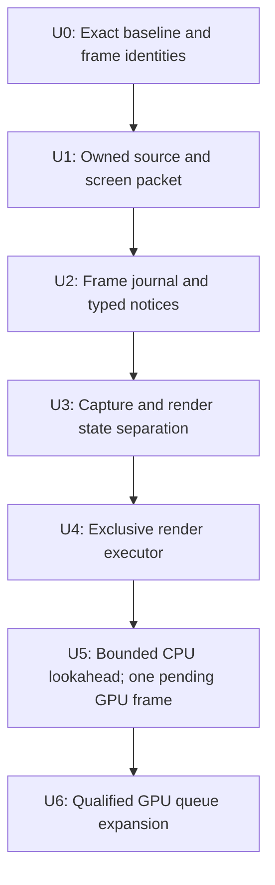

# Native Metal 4: 상위 계약 분석 및 코드 에디터 인계서

**BAR RAE · 2026-11-12 · 단일 Markdown 전달본**

이 파일에는 앞서 작성한 전체 분석, 구현 인계 지침, 고정 commit의 소스 링크, 상세 증거 부록을 함께 수록했습니다. 코드 에디터는 **I부의 첫 패치 범위와 반례부터** 읽고, 필요한 근거를 II부와 부록에서 확인하면 됩니다. 다른 HTML/TXT 파일을 함께 전달할 필요는 없습니다.

내용은 기존 분석을 형식 변환·통합한 것입니다. 새 코드 수정이나 성능 실험 결과를 추가한 문서가 아닙니다. 수정 순서는 제안이며, 성능 효과와 그래픽 동등성은 구현 후 해당 환경에서 검증해야 합니다.

**소스 기준 주의:** I·II부의 코드 줄 번호는 특별한 표시가 없으면 intervention `16e7f184…` 기준입니다. **부록 A는 자체 명시한 main/review 및 native233 overlay 기준을 사용하며, 부록 B·C는 intervention을 기본으로 합니다.** 각 부록의 기준을 우선합니다. 경로는 해당 checkout의 repository-relative 경로로 해석합니다.

## 목차

- [I. 코드 에디터 실행 지침](#editor-instructions)
- [II. 전체 분석](#analysis-report)
- [III. 상세 증거 부록](#evidence-appendices)
  - [부록 A — CUS capture·roster·read-set](#appendix-capture)
  - [부록 B — resource graph·alias·dependency](#appendix-resource)
  - [부록 C — frame 수명·worker·two-ticket](#appendix-lifecycle)

---

<a id="editor-instructions"></a>

## I. 코드 에디터 실행 지침

### 목표

동일 workload·그래픽 의미·synced simulation을 유지하면서 Native가 MVK3와 동급 또는 우세가 되도록 개선한다.
이 문서는 구현할 변경의 순서와 검증 기준이다. 이 분석에서 repository 소스는 수정하지 않았고 새 Mac 성능 측정도 하지 않았다.
반복 작업의 존재는 소스로 확인했지만, 각각의 ms/FPS 기여도는 아직 측정되지 않았다.

상세 분석: [이 문서 II부](#analysis-report)

소스 고정점:

| 대상 | Commit |
| --- | --- |
| main | `5bc9cb313574e3f86758b429975d5becfadd7dbf` |
| review | `db4725a7490ff6dcc8d130646f76e28ebb9b7eae` |
| intervention | `16e7f1844203bdd7e26bb19a39e9e0276f1fcb74` |

[검토 기준 소스](https://github.com/yeojuny/BAR-Metal4/blob/16e7f1844203bdd7e26bb19a39e9e0276f1fcb74/)

아래 engine 경로 및 줄 번호는 특별한 표시가 없으면 intervention commit 기준이다.
review의 native233은 docs/research/native233/OVERLAY-MANIFEST.json의 31개 replacement를 적용한 effective source다.
review root engine만으로 native233을 검토하지 않는다. historical 연구 packet을 새 구현으로 덮어쓰지 않는다.

### 먼저 확인할 6개의 기계적인 사실

1. Rendering/EngineBridge/NativeTerrainProgramSource.cpp
   Write223–240: 매 유효 uniform write마다 value vector와 전체 map snapshot을 새로 만든다.
   Publish217–221: uniform만 바뀌어도 program identity를 publication에 값으로 복사한다.
   BindTerrainSource247–255: 연결된 publication마다 program을 다시 검증한다.
   같은 값 write를 생략하는 분기가 없다.
   반면 Rendering/Shaders/Shader.cpp760–780의 GLSLProgramObject는 UniformState::Set 결과로 unchanged 갱신을 생략한다.
   native SourceProgram은 Shader.h261–281의 base forwarding을 사용하므로 이 생략을 받지 못한다.

2. Lua/LuaNativeCUSSource.cpp134 → Backend/NativeCUSModelInputs.cpp57:
   VAO submissions를 draw.submissions에 복사하고 modelInputs.submissions에 다시 복사한다.
   objects도 draw.objects와 texture snapshot.originalSubmissionOrder에 반복 복사한다.
   NativeCUSSourceData.cpp39–45는 이 배열들의 완전한 순서/일치를 검사한다. 다른 subset이 아니다.

3. Backend/NativePostprocessData.cpp265–322:
   OrderNativePostprocessCommands가 전체 validation+stable_sort를 수행한다.
   ValidateNativePostprocessConsumer가 current-frame version 하나를 찾을 때 이 전체 작업을 다시 한다.
   Metal4PostprocessNative.mm547–607: PrepareFrameImages 내부에서 두 번, 초기 준비와 Prepare에서 다시 호출한다.
   두 preparation 경로가 모두 실행되면 네 번의 전체 order build + 해당 consumer 추가 rebuild다.

4. EngineBridge/NativeWaterGroundSourceCapture.cpp114–120:
   deferred slice가 Draw를 값으로 복사한다.
   Metal4WorldRenderer.mm3232–3234:
   forwardCUS는 전체 frame을 복사하고 deferred Draw를 지운다.
   Draw에 map/vector가 있으므로 단순 shared_ptr 복사가 아니다.

5. Metal4WorldRenderer.mm2110–2133 + Backend/NativeSerialRenderWorker.h23–37:
   worker는 reference-captured stack 입력을 처리하고 future.get/WaitIdle 후 main에 반환한다.
   현재는 synchronous thread migration이며 main N+1과 render N의 CPU overlap이 아니다.

6. Metal4RuntimeNative.mm854–860은 조건부 두 ticket을 허용하지만,
   NativeUIRecorder.cpp793–807 / NativePostprocessRecorder.cpp48–58 /
   NativeVolumetricCloudContext.cpp42–52는 각각 단 하나의 submittedFrame만 허용한다.
   A가 held/pending이고 B가 earlier drain 없이 두 번째 ticket 분기에 도달하면
   SceneBridge.cpp1612–1615에서 B의 Hold가 기존 A와 충돌한다.
   이는 조건부 call-chain 증명이다. 실제 게임에서 그 분기가 실행됐다고 주장하지 않는다.

### P0 — 재현 가능한 비교 기준을 먼저 고정

- run-candidate.sh는 여러 intervention을 한꺼번에 켜는 combined profile이다. control arm이 아니다.

- Native233 RESULTS.json의 아래 11개 measured flags를 기록하고 비교 양쪽에 동일하게 적용한다.

```dotenv
BAR_NATIVE_CPU_READ_PACKET220=2
BAR_NATIVE_RESIDENCY_RELEASE220=1
BAR_NATIVE_TERRAIN_UNIFORM_RELEASE220=1
BAR_NATIVE_SCREEN_TABLE_H5=1
BAR_NATIVE_WORLD_PARTICLE_UPLOAD220=1
BAR_NATIVE_COMBINED_OVERLAP220=1
BAR_NATIVE_FORWARD_BOUNDARY220=1
BAR_NATIVE_RESIDENCY_DIFF220=1
BAR_NATIVE_TERRAIN_PROGRAM_VALIDATION220=1
BAR_NATIVE_TERRAIN_DEFINITION232=1
BAR_NATIVE_RANGE_DIVISION233=1
```

- wrapper가 설정하지 않는 measured flag가 6개 있다. parent environment 상속에 맡기지 않는다.

- 새 runtime flag를 끈다고 compiler/link flags 및 unconditional key 변경이 원상복구되지는 않는다.

- native233의 두 UI 입력이 공개 source closure에 없으므로 public v1.11.2 pair를 사용하면 양쪽 같은 pair로 고정하고
  native233-derived baseline이라고 기록한다. 원래 measured233 binary 그대로라고 부르지 않는다.

- README의 현재 candidate는 compile/link 후 SDL_QUIT 때문에 frame0 전 종료된 기록이다.
  이 결과를 gameplay, parity 또는 performance pass로 취급하지 않는다.

- actual drawable/attachment 크기, viewport, AA, VSync, scene seed/camera, map/game/widget bytes,
  compiler/SDK, warmup/window, power/foreground를 같은 조건으로 기록한다.

- diagnostic build와 clean A/B는 분리한다. 기존 220 stock과 238 diagnostic을 서로 붙여 개선률을 만들지 않는다.

### P1-A — 첫 PR: Terrain writer의 exact-change fast path

작업 위치:
  engine/rts/Rendering/EngineBridge/NativeTerrainProgramSource.cpp
  우선 SourceProgram::Write, OwnsCurrent, MatchesCurrentPublication, Publish를 함께 읽는다.

최소 구현:

1. 현행 context/bound/location/count/ownership/overflow/nonfinite 검사의 의미와 순서를 유지한다.
2. 새 value vector를 만들기 전에 현재 slot의 type, rows, columns, count, transpose와 실제 전체 값의 비트를 비교한다.
3. 값이 같다는 조건만으로 return하지 않는다. 현재 bound publication의 identity/state/consumer/uniform owner도
   writer의 현재 상태와 같아야 한다. 현재 MatchesCurrentPublication 또는 동등한 증명을 활용한다.

4. 값이 같고 current도 일치할 때만 allocation/publication/revision 변화 없이 반환한다.
   current가 stale이면 첫 PR에서는 기존 clone/write/publish 경로로 fallback한다.

5. 값이 바뀐 경로는 우선 그대로 둔다. global Shader/GLSL 경로를 바꾸어 MVK에 영향을 주지 않는다.

꼭 검증할 반례:

```text
saved = Current(A)
Write(B)
Restore(saved)             // binding A, writer B가 될 수 있다
Write(B와 같은 값)
```

OwnsCurrent는 program/generation/sourceRevision만 확인한다. 값만 비교하고 return하면
CaptureCurrent의 MatchesCurrentPublication이 실패할 수 있다. 이 반례는 실제 workload 관측이 아니라 API 계약 검증이다.

다음도 확인:

- signed zero를 합치는 float ==, epsilon 비교, 배열 일부만 비교하는 helper를 사용하지 않는다.

- type/shape/count/transpose가 다르면 같은 byte prefix로 생략하지 않는다.

- -1 location과 count0의 기존 동작, invalid binding, unsupported source, overflow, NaN/Inf 거절을 유지한다.

- A draw를 capture한 뒤 B 값을 써도 A가 변하지 않는다.

- nested ActiveShader/Current/Restore, shader reload, context recreation, program deletion 및 address reuse.

계측과 통과 기준:

- setter calls, exact changes, aligned no-ops, stale-publication fallback, map copies, publications를 frame 단위로 센다.

- aligned no-op 분기의 map/vector/publication allocation과 revision 증가가 0이어야 한다.

- changed path의 snapshot 불변성과 failure behavior가 같아야 한다.

- 비교값 접근을 위한 임시 vector/map을 만들면 allocation 제거 목적을 달성하지 못한다.

- FPS 예상 수치를 먼저 쓰지 말고 counter와 같은 조건의 clean A/B를 보고한다.

### T2–T4 — 같은 Terrain 축의 후속 commit

T2. immutable linked program definition/certificate를 uniform revision과 분리한다.
    context/program generation/sourceRevision/actual source hashes/defines/supported ABI를 link에서 확인한다.
    draw는 retained owner 및 scalar generations로 provenance를 확인한다.
    actual target format/MSAA/texture-type/PSO validation은 prepare 경계에 유지한다.
    OriginalProgram의 mutable pipelines/imageLibraries를 main source validation이 읽지 않게 한다.

T3. mutable writer와 sealed uniform content를 분리해 관측 경계에서만 snapshot을 만든다.
    단순히 draw 한 곳에만 Freeze를 넣지 않는다.
    Current의 모든 호출을 'kind/identity 확인'과 '상태 저장/복원 및 소비'로 분류한다.
    OwnsCurrent 같은 내부 확인이 매 setter에서 다시 seal하게 만들면 개선이 사라진다.
    LuaShaders::ActiveShader와 LuaNativeUnitGlass 등의 Save/Restore 사용처도 확인한다.
    CompileRequest의 try_emplace linkDefaults는 이전 이름 값을 보존한다.
    현재 비활성인 이름의 writer state를 무조건 삭제하지 않는다.

T4. link-time typed slot/packing plan을 만들고 source 값의 typed base를 재사용한다.
    이름은 source API 경계에서만 해석하고 target/image transport는 prepare에서 완성한다.
    DrawUniform은 camera/matrix/clip/fog/target에도 의존한다. uniform owner 하나로 전체 GPU block을 cache하지 않는다.
    역행렬 공유도 exact view/matrix와 실제 branch를 확인한다. simulation frame 하나는 key가 아니다.
    먼저 Terrain 한 family에서 정리한다. 모든 family를 거대한 공통 struct로 합치지 않는다.

### P1-B — 기존 Postprocess graph를 snapshot당 한 번 index

작업 위치:
  Backend/NativePostprocessData.{h,cpp}
  Backend/NativePostprocessRecorder.{h,cpp}
  Metal4/Metal4PostprocessNative.{h,mm}
  Metal4WorldRenderer의 PrepareFrameImages 호출 두 곳과 SaveImage suffix

계약:

- exact immutable source snapshot owner + serial/source frame + prefix/suffix selection을 식별한다.

- ordered command refs, version→producer, immutable descriptors, static overwrite proof를 한 번 만든다.

- current-frame consumer는 해당 producer를 index로 찾고 실제 stage/sequence/offset를 확인한다.

- full structural validation은 기존 실행/오류 경계에서 첫 사용 때 seal하는 방식부터 가능하다.

- duplicate version, producer/consumer 역전, same-offset commandSequence tie를 그대로 거절한다.

- SnapshotPrefix와 suffix는 같은 serial이면서 다른 내용일 수 있다. serial-only cache 금지.

- isRetired/PreparationInput/readability와 이번 lease의 retain/registration은 runtime 상태다.
  static plan과 섞지 않는다. exact lease 안의 중복 준비만 줄인다.

- 기존 owning texture snapshots를 유지한 채 root와 내부 참조로 index한다.
  새 backing shared_ptr를 대량으로 추가해 MRTWriteReuse209의 owner count를 바꾸지 않는다.

통과 기준:

- exact snapshot당 full order build1, lookup당 full sort0.

- 실제 command order/target/format/clear/preserve/copy/GPU barrier는 첫 PR에서 동일.

- prefix/suffix, cancellation, failed/retired external input, actual no-resubmission 동작이 동일.

### P1-C — CUS의 immutable ordered roster

작업 위치:
  Lua/LuaNativeCUSSource.cpp의 VertexArray, AddOne, Remove/Clear/Delete, Submit
  Backend/NativeCUSModelInputs, NativeCUSSourceData, NativeCUSTextureHistory
  EngineBridge/NativeCUSSourceCapture, NativeCUSModelCapture
  NativeCUSRenderInputs, NativeCUSDrawRuns147, Metal4CUSSource consumers

계약:

- VAO builder의 objects/submissions/bin metadata를 하나의 immutable roster로 seal한다.

- 성공한 roster mutation 후 첫 Submit에서 seal. unchanged roster는 owner를 재사용한다.

- cached roster는 성공한 각 AddOne 직후 무효화한다. Add(table) 전체 성공 뒤 한 번만 무효화하면
  뒤 원소에서 실패했을 때 앞서 성공한 AddOne의 committed prefix를 놓쳐 stale roster가 될 수 있다.

- geometry/index-range proof는 새 roster의 Submit 경계에서 한 번 한다.

- SourceDraw/ModelInputs/texture provenance가 같은 roster를 참조한다.

- public Lua API, AddToSubmission 시점의 model/bin 소유, swap-remove 순서,
  original index first/count, baseInstance, 별개 texture/world event sequence를 유지한다.

- roster에 frame-specific VBO snapshot, pose, uniforms, textures, GPU handles를 넣지 않는다.

- 첫 PR에서는 per-event ModelInputs wrapper를 유지해도 된다. pose/content identity는 P2로 분리한다.

- accessors/const span은 owner와 함께 살아야 한다. 새 owner+옛 vector를 영구 이중 보관하지 않는다.

통과 기준:

- 같은 roster의 여러 Submit에서 로스터 복사 및 geometry-range 재검증이 반복되지 않는다.

- 프로그램/texture/uniform/instance 변경은 각각 독립적으로 draw에 반영된다.

- Add/Remove/Delete 후 이전 draw가 변하지 않고 destroyed-object shadow 경로를 보존한다.

- 기존 validation 경로를 비교용으로 유지해 accept/reject 및 original order가 같음을 확인한다.

### P2 — payload/receipt 공유를 확장하고 phase copy 제거

- SourceEvent(frame, world sequence, texture event ordinal, stage/offset)와 immutable content를 분리한다.

- CUS structural proof는 factory-created immutable owner에 붙인다. public bool validated는 증명이 아니다.

- ordinary successful raster draw의 SourceValidate는 정상 read-set reuse/단일fallback에서3회,
  model MRT에서5회다. byte-budget fallback, verification mode, 오류 재시도는 더 많다.
  이 수치를 전체 benchmark의 평균 호출 수나 시간으로 취급하지 않는다.

- read-set key를 modelInputs wrapper 주소 대신 실제 roster/instance/publication/read-profile로 옮기되
  처음에는 conservative exact owner tuple을 사용한다. skinning scale/interpolation, observed row mask,
  team255, bone branch를 빠뜨리지 않는다. 기존 geometry cache를 다시 만들지 않는다.

- uniform typed base는 source ABI 값과 late image/clip/target transport를 분리한다.

- deferred/forward는 shared per-draw payload와 selected event envelopes로 선택한다.
  전체 부모 frame을 각 phase가 보유해 반대 phase의 instance/texture/pose까지 오래 pin하지 않게 한다.

- source manifest도 load/reset 시점 immutable owner로 공유할 수 있다.

- existing SSBO page-content reuse와 unchanged VBO snapshot을 보존한다.
  publicationSerial 증가를 전체 GPU upload로 가정하지 않는다.

특별 소유권 경고 — MRTWriteReuse209와 연결:

- 기존 owning sampler record를 유지한 채 index만 root를 retain하면 leaf witness는 유지된다.

- 별도의 owning material snapshot을 공유해도 actual reader의 추가 owner가 남는지 확인한다.

- reader를 writer의 U.current/F.previous raw reference로 바꾸면 count==2여도 reader가 있을 수 있다.
  이 경우 old alias permission은 더 이상 안전성 증명이 아니다.

- 영향받는 경로는 기존 witness를 유지하거나 complete semantic reader proof가 생길 때까지
  alias를 conservative COW로 막는다. 객체 lifetime과 과거 content overwrite 안전성은 다른 조건이다.

### P3–P4 — worker 이전에 frame 소유권과 completion 장부

이미 WorldFrame, CPURead Packet, GPU lifetime graph가 있다. 이를 확장해 다음을 닫는다.

1. ScreenFrameView의 raw drawList와 span을 owning screen packet으로 대체한다.
   EndFrame에서 move/exchange하고 다음 recorder는 새 writable storage를 사용한다.
   WorldFrame+screen+surface policy+CPU read receipt+source certificates가 하나의 owned task 입력이다.
   아직 synchronous executor로 소비한다.

2. main-owned journal을 scene epoch/sourceDrawFrame/postprocess serial/capture ordinal로 식별한다.
   UI/postprocess/cloud의 single submittedFrame을 bounded per-frame ledger로 바꾼다.
   OwnsPendingVersion은 전체 outstanding journal을 조회한다.
   rollback/targetChanges/RecordTargetSubmission의 수정은 지정 FrameId의 journal에만 적용한다.
   journal을 예약한 뒤 queue에 공개한다. current frame abort가 이미 worker가 받은 frame을 지우지 못하게 한다.

3. completion 종류를 분리한다.
   Enqueue accepted: CPU ownership 이전.
   SubmissionNotice: 실제 submission ID.
   GPUCompletionNotice: event+feedback+producer checks 이후 성공, 또는 별도의 오류/timeout notice.
   PresentationNotice: exact drawable의 actual presented time.
   오류/timeout은 성공 retirement나 allocator 재사용을 허가하지 않는다. 미확정 owner는 quarantine.
   worker는 임의 Lua/main callback 대신 ID가 있는 data notice를 전달한다.
   main은 정확한 journal만 retire하며 late old-scene notice가 새 scene을 건드리지 못한다.

4. ordinary render 입력 밖의 mutable crossings를 제거한다.
   CaptureEnvironmentInputs → impl environment/reflection plans
   shieldPending/shieldRegistry 및 AbortShieldPublications
   PBR pending vector의 capture enqueue vs render iterate/prune
   ScreenGPU ReserveAttachmentAllocationForCapture vs PrepareImage의 textures map
   terrain consumer Supports/LibraryGeneration vs mutable pipelines/imageLibraries
   OriginalNativeShadowTextures / shadowHandler / live NativeTextureRegistry / globalRendering
   worker의 ui::GetRecorder().RecordTargetSubmission
   MRTWriteReuse209의 '더 이상 source writer 없음'과 exact count 전제

5. render Impl/cache/fulfillment/runtime GPU completion은 한 render executor가 소유한다.
   main은 live engine/Lua capture와 publication journal을 소유한다.
   실제 shader link/즉시 FBO 결과가 필요한 API만 synchronous ordered control로 둔다.
   capture→render와 render→main의 서로 기다리는 callback cycle을 만들지 않는다.
   source/program owner의 최종 파괴 thread affinity는 별도 확인한다.
   CPURead Packet을 worker로 옮겼다고 기존 main release 계약까지 자동 해결되는 것은 아니다.

검증:

- worker N을 의도적으로 pause한 동안 main에서 N+1 capture/abort해도 N의 값/owner가 그대로다.

- 두 held source records와 하나의 current recorder를 유지하고 exact ID별로 retire한다.

- 두 번째 ticket conditional path를 강제로 만드는 통합 테스트를 한다. queued_tickets 로그만 보지 않는다.

- 잘못된 epoch/중복/순서가 바뀐 receipt와 Begin 전/후 실패, feedback/event timeout을 검사한다.

- 아직 wait는 제거하지 않는다. 새 owned API를 synchronous reference executor로 먼저 통과시킨다.

### P5 — GPU pending limit1로 실제 CPU lookahead

- P3/P4 이후 normal path의 Invoke/get를 Enqueue와 completion mailbox로 바꾼다.

- capture, queued/preparing, GPU-owned를 모두 포함하는 bounded source-frame credit를 둔다.
  첫 구현에서 small bound로 시작하되 실제 retained bytes와 tail/input latency를 측정한다.

- GPU pending 한 개와 기존 independent recording slot 정책은 유지한다.

- 기존 CPURead Packet을 소비 thread의 scope/context에 명시적으로 전달한다. TLS pointer 공유 금지.

- CPU timing도 FrameId/sample identity로 main과 worker의 work를 따로 기록한다.

- SaveImage/prefix/suffix, shader reload, world reset, resize/close 등은 explicit drained control로 시작한다.

- source callbacks/writers를 다시 실행하지 않는다. synced simulation을 worker로 옮기지 않는다.

- capture [begin,end]와 worker의 실제 Prepare/Encode active interval 양끝을 기록하고,
  대기를 제외한 작업 구간의 교집합이 양수인지 확인한다.
  CaptureBegin(N+1) < EncodeEnd(N) 하나만으로는 충분하지 않다.
  completed/presented throughput, accepted→presented latency와 tails를 함께 본다.
  enqueue FPS만 오른 것은 성공이 아니다.

### P6 — resource-use proof 뒤 GPU 최적화

- stable producer invocation identity, immutable content/storage version, sampler/view, consumer order,
  actual stage/subresource/read/write/preserve effect를 기존 typed families에 점진적으로 추가한다.

- logical previous/history/rollback과 실제 old-pixel read를 구분한다.

- CUS provider는 material cache 전에 실행된다. TerrainInfo 같은 한 family부터
  per-submission resolved-read receipt로 wrapper/validation/callback 중복을 줄인다.
  같은 texture pointer만으로 dedup하거나 다른 submission의 completion state를 재사용하지 않는다.

- NoCommands는 GPU command 없음 + 생략해도 CPU lifecycle transition 손실 없음이다.
  draw-time readability는 별도로 유지한다. Unknown이면 기존 안전 경로다.

- 현재 MRT preserve-copy가 benchmark에서 큰 낭비라는 증거는 없다. sampled MRT0 copy0 반례를 유지한다.

- exact clear/full-overwrite/consumer proof 뒤 copy/alias를 한 경로씩 바꾼다.

- barrier/pass scope, pools, ICB, GPU queue 깊이는 각각 분리 실험한다.

- priorReadChecks.empty는 등록된 callback이 없다는 뜻이다. Postprocess의 pending encoded input은
  기존 retire-before-next-submit 규칙에 의존하면서 이 map에 등록되지 않는다.
  모든 pending borrow가 producer submission/ordering/lifetime 요구를 명시한 뒤 두 GPU ticket을 검토한다.

- Metal4 command buffer가 resource를 강하게 retain하지 않고 MTL4 queue가 hazardTrackingMode에 의존하지
  않는다는 공식 API 계약을 지킨다. semaphore 대기나 reference 하나만 지워서 해결하지 않는다.

### 반드시 피할 shortcut

- full validation 삭제만으로 성능 올리기

- 모든 snapshot을 live engine/Lua state reference로 바꾸기

- uniform/camera가 같다는 이유로 side-effecting 원래 writer/RNG를 생략하거나 두 번 실행하기

- raw GL name, simulation frame, pointer address 또는 hash 하나만으로 내용 동일성 판단

- same serial의 prefix/final/suffix를 같은 graph로 판단

- 기존 page/geometry/VBO reuse가 없다고 가정하고 새 cache 추가

- borrowing으로 leaf owner를 제거한 뒤 old use_count alias gate를 그대로 사용

- future.get 제거와 two-in-flight/fast-math/pool 변경을 하나의 성능 PR로 묶기

- clean233, stock220, instrumented238 수치를 한 연속 개선률로 엮기

- source 반복 호출 수를 측정 FPS 절감량으로 바꾸어 보고하기

### 최종 수락 기준

1. 소스 계약: event order/현재 binding/old snapshot/actual publication semantics가 유지됨.
2. 구조적 개선: 중복 생성·sort·validation·wrapper/callback 수가 의도대로 줄고 retention 부작용이 없음.
3. 소유권: packet/journal/slot/producer/retirement ID가 맞고 race, premature reuse, rollback 충돌이 없음.
4. 그래픽: 같은 source/target/workload의 실제 출력과 Metal API validation. 대상 family의 반례도 포함.
5. 게임: synced simulation/네트워크 결정론과 원래 source callback 횟수·순서 유지.
6. 성능: 같은 control의 clean paired A/B, mean interval/FPS와 tails·presentation·input latency를 함께 보고.
7. 단계별 보고: 변경 전 병목 근거, 실제 줄인 작업, 측정한 ms, 남은 GPU/CPU 제한을 구분.

### 숫자 약속

원래 stock220→MVK3 동급은 6.202ms→4.424ms, 약1.778ms 감소에 해당한다.
이는 old workload 예산이지 이 리팩터링의 예측 절감량이 아니다.
별도238의 4.831ms GPU envelope를 그대로 직렬 유지하고 gap만 제거하는 가정은 약207FPS다.
230FPS interval4.348ms, 300FPS3.333ms에는 GPU work/ordering의 추가 변화도 필요하다.
이것을 Metal4 상한이라고 하지 않는다. CPU/GPU deficit는 더하지 않는다.
동급/우세는 최종 동일 조건에서 검증할 목표이며, 코드 감사만으로 보장하지 않는다.

### 빠른 위치 검색 (repo root에서)


```bash
rg -n 'void Publish|void Write|OwnsCurrent|MatchesCurrentPublication|CaptureCurrentNativeTerrainProgram' engine/rts/Rendering/EngineBridge/NativeTerrainProgramSource.cpp
rg -n 'OriginalNativeSourceProgramBinding\(\)\.(Current|Restore)' engine/rts
rg -n 'draw\.objects|draw\.submissions|draw\.floatUniforms|AddOne|RemoveFromSubmission|void Submit' engine/rts/Lua/LuaNativeCUSSource.cpp
rg -n 'submissions\.assign|originalSubmissionOrder|ValidateNativeCUSSourceDraw' engine/rts/Rendering/Backend
rg -n 'OrderNativePostprocessCommands|ValidateNativePostprocessConsumer|PrepareFrameImages' engine/rts/Rendering
rg -n 'forwardCUS|slice->draws|use_count\(\)|ExclusiveFreshPair' engine/rts/Rendering/EngineBridge/NativeWaterGroundSourceCapture.cpp engine/rts/Rendering/Metal4/Metal4WorldRenderer.mm engine/rts/Rendering/Metal4/Metal4MRTWriteReuse209.h
rg -n 'future|WaitIdle|DrawDispatch|HoldSubmittedFrame|priorReadChecks|PreparationInput' engine/rts/Rendering
```


### 제출할 첫 결과물

첫 패치는 P1-A T1로 한정해 code diff + 반례 검증 + counter 결과를 제출한다.
T2 정의/관측 경계의 구체 API 제안은 별도로 적어 다음 패치가 T1을 버리지 않고 확장하도록 한다.
P1-B와 P1-C는 동일 identity 원칙에 합의한 뒤 독립 PR로 진행할 수 있다.
P3–P6는 선행 소유권/의존성 증명을 통과한 범위만 점진적으로 진행한다.

---

<a id="analysis-report"></a>

## II. 전체 분석

MVK3 동급·우세를 목표로, 데이터 생성·검증·소유권의 상위 경계부터 고치는 설계 및 코드 에디터 인계서

이 문서는 실제 소스와 공개 진단 자료를 대조한 읽기 전용 분석이다. 새 엔진 빌드, Mac 실행, GPU capture 또는 성능 개선 측정을 수행한 결과가 아니다. 아래에서 **반복 작업의 존재**, **특정 분기에서 성립하는 통합 결함**, **구현 제안**, **아직 측정하지 않은 성능 효과**를 구분한다.

<a id="verdict"></a>

### 1. 결론: 처음 열 파일과 먼저 고정할 계약

**첫 구체적인 수정 지점은 `NativeTerrainProgramSource.cpp`의 `SourceProgram::Write → Publish → BindTerrainSource`다.** 지금은 uniform 한 항목을 쓰면 전체 named-uniform map을 복사하고, 변하지 않은 program identity를 다시 복사·검증한다. 기존 GL 프로그램이 가진 동일 값 갱신 생략도 이 native 대체 객체에서는 적용되지 않는다. 아래쪽 upload pool이나 destructor worker를 더 다듬기 전에 이 불필요한 생산부터 줄이는 것이 순서에 맞다. [\[S01\]](#s01) [\[S02\]](#s02) [\[S03\]](#s03)

이 작업과 병렬로 시작할 수 있는 두 번째 작은 축은 **후처리의 이미 존재하는 producer graph를 정확한 snapshot당 한 번만 검증·인덱싱하는 것**이다. 모델 쪽에서는 **`VertexArray::Submit`에서 immutable ordered roster를 공유**하는 변경이 같은 역할을 한다. 이 셋은 실제 호출 수와 복사 구조가 확인된 개선 지점이다. 어느 것이 현재 장면의 가장 큰 시간 비중인지는 별도 계측이 필요하다. 아래 우선순위는 측정하지 않은 ms 순위가 아니라 **변경 의존성과 재사용성의 순위**다.

> **공통 상위 계약** / 원본 이벤트의 순서와 내용의 동일성을 분리한다. 동일성을 증명할 수 있는 CPU uniform·roster·material 내용은 실제 변경에 맞춰 owner/revision을 만들고, 불변 내용의 구조적 검증은 발행 경계에서 완료한다. 각 draw의 순서·target·GPU producer readiness·완료 수명은 별도로 유지한다. 별도 GPU writer의 논리 버전·publication을 최종 픽셀이 비슷하다는 이유로 합치는 원칙이 아니다.

이미 `WorldFrame`, immutable snapshot, logical image version, CPU read-set packet, GPU completion graph와 부분적인 command index가 있다. 이를 바탕으로 계약을 보강하면 된다. 모든 렌더링 계층을 새 framegraph로 갈아엎는 일이 선행 조건은 아니다. [\[S10\]](#s10) [\[S15\]](#s15) [\[S21\]](#s21)

<a id="scope"></a>

### 2. 비교한 코드의 정확한 범위

| 대상 | 고정 revision | 용도 |
| --- | --- | --- |
| BAR-Metal4 main | `5bc9cb313574e3f86758b429975d5becfadd7dbf` | 원래 MVK3/Native220 비교 자료와 기본 코드 |
| review/native-progress-20261110 | `db4725a7490ff6dcc8d130646f76e28ebb9b7eae` | native233 자료 및 31개 overlay 대체 소스 |
| intervention/native-perf-20261112 | `16e7f1844203bdd7e26bb19a39e9e0276f1fcb74` | overlay를 반영한 전체 소스와 worker/two-in-flight 후보의 통합 상태 |

native233을 검토할 때는 review의 루트 `engine/`만 보면 안 된다. `docs/research/native233/OVERLAY-MANIFEST.json`에 지정된 31개 postimage를 사용해야 한다. 이 보고서의 S 코드 링크는 줄 번호의 일관성을 위해 intervention의 고정 commit을 가리킨다. 소스의 공통 반복 구조와 intervention에서 새로 생긴 worker/queue 문제를 각 절에서 구분한다. overlay 자료가 공개되었다는 사실만으로 측정 바이너리를 완전히 재현했다는 뜻은 아니다. [\[R02\]](#r02)

이번 추가 분석은 Terrain program/uniform capture, CUS roster·pose·read-set, texture registry/history, postprocess producer lookup, MRT alias permission, Game/SceneBridge/WorldRenderer/Runtime의 수명 및 완료 경로를 깊게 추적했다. 부록에는 각 담당 분석의 읽은 파일 범위와 반례를 수록했다. 앞선 720개 backend/Metal4 파일의 기계적 검색과 모든 파일을 한 줄씩 의미 검토했다는 주장은 구분한다.

<a id="terrain"></a>

### 3. 첫 수정: Terrain의 uniform 쓰기와 program 발행 분리

#### 3.1 코드에서 실제로 발생하는 일

`SourceProgram::Write`는 위치·count/extent·현재 binding·유한값을 검사하고 writer shape를 기록한 후 새 값 vector를 만들고, `make_shared<NativeTerrainUniformSnapshot>(*uniforms)`로 snapshot 전체를 복사한다. 여기서 shader ABI가 기대하는 shape까지 대조하는 것은 아니다. snapshot의 `values`는 `map<string, NativeTerrainUniformValue>`이고 각 value는 vector를 가진다. 따라서 포인터 한 개의 복사가 아니다. 이어 revision을 올리고 한 항목을 바꾼 뒤 `Publish()`를 호출한다. 같은 값을 다시 썼는지 검사하는 분기는 없다. [\[S01:223–240\]](#s01) [\[S04\]](#s04)

`Publish`는 새 publication을 만들면서 `identity`를 값으로 복사한다. identity에는 이름과 compile defines vector가 들어 있다. `BindTerrainSource`는 연결된 프로그램을 다시 `ValidateNativeTerrainProgram`으로 검증한다. 이후 `CaptureCurrentNativeTerrainProgram`, square 제출, GPU 준비에도 관련 검사와 identity 비교가 이어진다. uniform 값 변경과 shader 정의 변경의 수명이 서로 다른데, 발행 경로가 이 둘을 다시 묶어 처리한다. [\[S01:217–289\]](#s01) [\[S05\]](#s05)

이 차이는 MVK의 번역 계층을 추측한 이야기가 아니다. 원래 `GLSLProgramObject::SetUniform`는 `uState->Set(...)` 결과가 참일 때만 GL 호출을 한다. native `SourceProgram`은 base class의 raw setter 전달을 받아 자체 `Write`를 수행하므로 그 unchanged-value suppression을 거치지 않는다. native adapter에 원래 front-end의 중요한 상태 캐시 효과가 빠져 있다는 소스 차이다. 다만 실제 동일 값 호출의 비율은 계측해야 한다. [\[S02:760–780\]](#s02) [\[S03:261–281\]](#s03)

모든 쓰기가 가짜 변경은 아니다. `SMFRenderState::Enable`는 camera, map heights, shadow matrix 등을 쓰고, `SetSquareTexGen`은 square마다 `texSquare`를 쓴다. square별 값은 실제로 달라질 수 있다. 따라서 첫 fast path 뒤에도 “한 항목 변경 때문에 전체 이름 map을 복사하는” 구조는 남는다. [\[S06\]](#s06)

#### 3.2 기존 232 최적화가 이 원인을 끝내지 못하는 이유

`TerrainDefinition232`는 성공한 identity proof를 16-entry thread-local cache로 기억해 defines 문법 검사를 재사용한다. 하지만 cache lookup도 전체 identity를 비교하고, 그 뒤 consumer의 context/library generation, `Matches`, `Supports` 검사는 계속한다. 전체 uniform map 복사와 publication 생성도 그대로다. 이 캐시는 유용한 국소 최적화지만 위쪽에서 같은 정의를 반복 발행하는 구조는 바꾸지 않는다. [\[S05:30–91\]](#s05)

#### 3.3 재작업을 줄이는 변경 단위

| 순서 | 변경 | 계속 유효한 결과 |
| --- | --- | --- |
| T1 | 현재 `Write`의 필수 오류 검사를 보존한 뒤 type·rows·columns·count·transpose와 값의 비트를 비교한다. 값이 같고 current publication의 identity·state·consumer·uniform owner도 writer와 일치할 때만 새 vector/map/publication 없이 반환한다. | 실제 내용 변경과 binding 복원을 구분하는 규칙. 후속 typed storage에서도 그대로 쓴다. |
| T2 | 성공한 link의 identity·defines·지원 ABI를 immutable program definition/certificate로 발행한다. uniform revision과 분리한다. | uniform 갱신마다 shader 정의를 복사·재검증할 이유를 없앤다. worker에도 안전하게 넘길 정적 증명이 된다. |
| T3 | source writer는 실제 변경을 누적한다. draw 및 상태 보존에 필요한 관측 경계에서 immutable uniform content를 seal한다. | setter 호출 수가 아니라 실제 관측되는 상태 수에 맞춰 snapshot을 만든다. 이미 capture한 draw는 이전 내용을 유지한다. |
| T4 | link 때 이름→typed slot/packing plan을 만든다. source 값은 typed base로 재사용하고 target/image 관련 필드만 prepare에서 채운다. | GPU 소비자가 문자열 map을 다시 해석하는 작업을 줄인다. GPU buffer/argument 최적화가 안정된 표현 위에 놓인다. |

T1은 변경된 값에 대해서는 현행 경로를 그대로 쓰는 좁은 첫 PR로 만들 수 있다. T2–T4를 한 번에 모든 shader family에 적용할 필요는 없다. 먼저 Terrain 한 family에서 세대·수명·오류 규칙을 고정한 뒤 CUS의 별도 ABI에도 같은 원칙을 적용한다. 거대한 범용 uniform 객체 하나로 합칠 필요는 없다.

#### 3.4 에디터가 놓치기 쉬운 경계

**T1에도 구체적인 반례가 있다.** `Current(A)` 저장 → `Write(B)` → `Restore(A)` → B와 같은 값의 Write를 생각하면 된다. `OwnsCurrent`는 program/generation/sourceRevision만 비교하므로 이를 통과할 수 있다. 현행 Write는 다시 Publish해 binding을 writer와 맞춘다. 값만 보고 return하면 binding은 A, writer는 B로 남아 capture의 `MatchesCurrentPublication`이 실패할 수 있다. 첫 PR은 현재 publication까지 일치할 때만 skip하고, stale publication이면 기존 경로로 fallback한다. 실제 workload에서 관측된 실패가 아니라 새 shortcut의 계약을 검증하는 반례다. [\[S01:122–125,211–240,274–289\]](#s01) [\[S07\]](#s07)

- **float 근사 비교를 쓰지 않는다.** 원래 상태 캐시가 구별하는 비트, signed zero, integer 표현, array extent와 matrix transpose를 보존한다. 기존 GL helper를 그대로 재사용하기 전에 배열 전체 비교 범위를 확인한다.

- **draw에서만 seal하면 충분하지 않다.** `NativeSourceProgramBinding::Current/Restore`와 `LuaShaders::ActiveShader`가 현재 selection을 저장·복원한다. 내부 `OwnsCurrent` 확인과 실제 상태 저장 관측을 분리해야 lazy publication이 매 setter마다 다시 강제되지 않으면서도 nested callback의 복원이 정확하다. [\[S07\]](#s07) [\[S08:869–908\]](#s08)

- **relink에서 이름 상태를 함부로 지우지 않는다.** 현재 `CompileRequest`는 이전 writer 값을 유지하고 새 active 이름에만 link default를 넣는다. typed ABI에 현재 비활성 이름의 source 상태를 유지할 별도 경로가 필요할 수 있다. [\[S01:196–209\]](#s01)

- **정적 link proof와 target PSO 성공을 혼동하지 않는다.** context·프로그램 세대는 draw마다 싸게 확인하고, 실제 target format/MSAA/texture type의 지원 및 GPU 준비 검사는 원래의 늦은 경계에 남긴다.

- **view별 값은 simulation frame만으로 공유하지 않는다.** `DrawUniform`은 model-view/projection, clipping, fog, target clip convention 등을 쓴다. forward advanced에서는 model-view 역행렬도 draw마다 계산한다. 이를 공유하려면 실제 view/matrix/clip identity가 같다는 증명이 필요하다. reflection/refraction과 메인 뷰를 구별한다. [\[S09:430–479\]](#s09)

현재 `Metal4TerrainUniformRelease220.inc`가 모든 square의 uniform snapshot owner를 모아 중복 제거하고 완료 뒤 별도 worker에서 파괴하는 것은, 현재 표현의 수명·파괴 비용을 뒤에서 다루는 코드다. source snapshot 개수와 표현을 바꾼 뒤 이 경로의 필요성과 비용을 다시 평가하는 순서가 맞다. 존재 자체가 큰 병목이라는 증거는 아니다. [\[S11\]](#s11)

<a id="cus"></a>

### 4. 모델/CUS: 같은 로스터를 세 번 만들고 서로 같은지 검사한다

`LuaNativeCUSSource::VertexArray`는 원래 `objects/submissions/uniformBins`를 보유한다. 매 Submit에서 objects와 submissions를 `draw`로 복사하고, TextureHistory가 objects를 `originalSubmissionOrder`에 다시 복사하며, `MakeNativeCUSModelInputs`가 submissions를 새 wrapper에 또 복사한다. `ValidateNativeCUSSourceDraw`는 이 배열들의 원소 및 전체 순서가 같음을 다시 확인한다. 서로 다른 subset이나 instance rebasing이 아니다. [\[S12:95–141\]](#s12) [\[S13:43–60\]](#s13) [\[S14:28–63\]](#s14)

geometry 전체를 매 draw 복사한다는 뜻은 아니다. 모델 geometry는 이미 공유·캐시한다. 여기서 반복되는 것은 객체·submission owner 목록, uniform map, 구조 검증이다. `MakeNativeCUSModelInputs`는 immutable geometry의 piece index 개수도 매 제출마다 다시 더한다. 바뀐 roster를 처음 Submit하는 경계에서 한 번 증명할 수 있는 내용이다.

#### 4.1 먼저 공유할 것은 ordered roster다

제안하는 `NativeCUSSubmissionRoster`는 captured objects, retained submissions, 필요한 bin metadata와 그 원래 순서를 소유한다. frame sequence, texture binding, instance snapshot, pose publication, GPU resource를 넣지 않는다. VAO builder가 성공적으로 Add/Remove/Clear/Delete될 때만 cached roster를 무효화하고, 첫 Submit에서 seal한다. 이후 SourceDraw·ModelInputs·texture provenance는 같은 roster owner를 참조한다.

무효화는 성공한 각 `AddOne` 직후에 해야 한다. `Add(table)`은 원소를 차례로 처리하므로 뒤 원소가 실패해도 앞의 성공한 추가는 남는다. bulk Add 전체 성공 뒤에만 cache를 무효화하면 이 부분 성공 상태를 놓친다. [\[S12:105–119\]](#s12)

`AddToSubmission` 시점의 모델/bin 조회는 유지해야 한다. 현재 명령은 살아 있는 unit lookup보다 오래 남을 수 있고, 삭제 객체 정리 전에 shadow draw가 실행될 수 있다. `RemoveFromSubmission`의 swap-with-last 순서도 그대로여야 instance row가 맞는다. 새 typed owner를 만든다는 이유로 draw를 정렬하거나 살아 있는 unit을 나중에 다시 조회하면 안 된다. [\[S12:105–124\]](#s12)

첫 roster PR에서는 `ModelInputs`의 per-event wrapper를 유지해도 된다. 중복 vector와 geometry proof를 공유하는 것부터 끝내고, wrapper 제거·pose content identity·read-set key 변경은 P2로 분리한다.

#### 4.2 구조적 validation을 seal에서 한 번 끝내기

CPU Prime 결과를 보관·재사용하거나 한 번의 fallback으로 계산하는 성공한 일반 non-culled/non-noattachment draw는 Submit, CPU read-set 생성, GPU Prepare에서 source validator를 세 번 통과한다. 선택된 model MRT 경로에는 FinishDeferredPhase와 PrepareCUSDeferred가 더해져 다섯 번이다. 이는 정해진 분기의 호출 수이며, 모든 draw·모든 frame에 대한 계측 평균이 아니다. front-and-back cull 또는 proven noattachment는 CPU read-set을 생략해 각각 두 번·네 번이다. Prime이 계산 후 cache byte budget 때문에 결과를 보관하지 못한 경우, verification mode 또는 오류 재시도에서는 더 많을 수 있다. [\[S14\]](#s14) [\[S16:66–117\]](#s16) [\[S17\]](#s17) [\[S18\]](#s18)

이를 단순히 `validated=true`로 건너뛰면 안 된다. 외부에서 변경할 수 없는 factory-created owner가 실제 검증한 내용과 같은 owner임을 보증해야 한다. 불변 roster·uniform type/layout·geometry range proof는 재사용하고, 원본 draw 순서·실제 phase·target·관측된 row·현재 producer readiness 검사는 각각 필요한 경계에서 유지한다.

#### 4.3 read-set cache와 frame 분할은 그 다음이다

현행 CPU read-set key에는 `modelInputs.get()`가 들어간다. Submit마다 새 wrapper를 만들면 roster·instances·pose 내용이 같아도 별도 draw 사이의 reuse를 얻기 어렵다. 같은 captured draw의 중복 Prime은 이미 제거된다. stable roster 뒤에 event envelope와 pose payload를 분리해야 cache가 의미 있는 내용 identity를 사용하게 된다. skinning read set은 interpolation 및 scale 분기에 의존하므로 geometry만을 key로 삼을 수 없다. [\[S10:19–60\]](#s10) [\[S16:95–115\]](#s16)

ground deferred slice는 선택된 Draw를 값으로 복사하고, forward 경로는 전체 SourceFrame을 복사한 뒤 deferred draw를 지운다. Draw 안에는 map과 vector가 있어 deep copy다. immutable per-draw payload가 생긴 뒤 selected event envelope/view로 바꾸면 된다. 다만 각 view가 전체 부모 frame을 완료까지 잡으면 반대 phase의 instance·pose·texture까지 오래 pin할 수 있다. **선택한 draw의 payload만 보유하는 표현**을 우선 검토하고 기존 pool pin 및 VBO snapshot 수명을 대조한다. [\[S19:114–120\]](#s19) [\[S20:3232–3234\]](#s20)

이때 기존 owning sampler snapshot의 witness를 유지한다. writer의 current/previous를 raw reference로 빌리는 것으로 바꾸면 §6.3의 old alias permission까지 함께 재검토해야 한다.

기존 model SSBO는 unchanged 4 KiB page와 physical buffer를 재사용하고, VBO snapshot은 unchanged revision을 재사용한다. 따라서 “publication serial이 늘어서 매번 SSBO 전체를 GPU에 올린다”거나 “모든 snapshot을 없애면 된다”는 진단은 틀리다. Draw callback이 mutable model uniform storage를 쓰더라도 현재 draw가 앞선 publication을 읽어야 하는 의미도 유지해야 한다. [\[S22\]](#s22) [\[S23\]](#s23) [\[S24\]](#s24)

<a id="postprocess"></a>

### 5. 후처리: 이미지 한 개를 찾기 위해 전체 그래프를 재검증·정렬한다

`OrderNativePostprocessCommands`는 order vector를 만들고 모든 operation/external producer를 검증한 후 stable sort한다. `ValidateNativePostprocessConsumer`가 아직 완료되지 않은 current-frame image 한 개의 producer를 확인할 때도 이 함수를 호출한다. `PrepareFrameImages`는 frame validation 안에서 한 번, output 준비 순회를 위해 또 한 번 호출한다. WorldRenderer의 초기 준비와 `PostprocessGPU::Prepare`가 모두 실행되는 정상 경로에서는 이 준비가 반복되어 **네 번의 전체 order construction에 해당 consumer 조회의 추가 재구성이 붙는다.** CPU-owned·이미 retired인 image의 fast path는 제외한다. [\[S25:265–322\]](#s25) [\[S26:547–607\]](#s26)

producer 수를 P, 이런 조회를 R이라고 하면 재검증을 포함한 `O(P log P)` 구축이 여러 번 반복된다. 기존 graph의 순서와 version-to-producer index를 정확한 sealed snapshot에 붙이면 정적 작업은 한 번, 각 조회는 인덱스 확인과 해당 소비자의 순서 검사가 된다. 실제 P/R과 비용은 계측으로 확인한다.

#### 보관할 것과 계속 실행할 것을 분리한다

| 정적 plan에 보관 | 실행할 때 계속 확인 |
| --- | --- |
| ordered command refs, version→producer, immutable descriptor, stage/offset/sequence 규칙, 기존 full-overwrite proof | 이번 lease의 allocation retain, encoded 여부, 실제 predecessor completion, GPU error, 취소 및 no-resubmission 조건 |

key를 `frame.serial` 하나로 만들면 안 된다. `SnapshotPrefix`와 SaveImage 이후 suffix는 같은 serial을 유지하면서 operation 목록이 다르다. exact owner/control-block identity와 selection/cutoff가 필요하다. producer order는 정적 사실이지만 `isRetired`·`PreparationInput`·readability는 runtime 상태다. 이를 structural plan에 고정하면 completion·취소·lease/submission 변화를 반영하지 못하므로 원래 실행 경계에서 계속 확인한다. 첫 도입은 기존 검증의 동일한 실행 경계에서 static 결과만 seal하고, 오류 발생 시점이 달라지지 않는지 비교하는 편이 안전하다. [\[S27:34–45\]](#s27) [\[S28\]](#s28)

`PrepareFrameImages` 자체는 “한 번 만들어졌으니 모든 호출을 생략”할 대상이 아니다. static index 재사용과 이번 lease의 자원 등록·소유권 보존은 별도다. exact lease 안에서 중복 output 준비를 없애되 필요한 retain과 runtime 검사는 유지한다.

<a id="resource"></a>

### 6. GPU 최적화 전에 정리할 resource identity와 reader 계약

#### 6.1 이벤트 번호는 material cache key가 아니다

TextureHistory의 sequence는 Bind·Enable·state update뿐 아니라 Submit에서도 증가한다. 반대로 취소에 따른 content 복원은 원본 GL writer event가 아니므로 이 sequence를 증가시키지 않는다. sequence를 material identity로 쓰면 unchanged Submit에서 miss가 나고, 특정 취소 변경은 놓칠 수 있다. source chronology는 그대로 두고 context/object lifetime·allocation/content version·sampler/default/enable state·선택된 shader ABI를 별도의 의미 있는 내용 key로 다뤄야 한다. [\[S29\]](#s29) [\[S30:207–228\]](#s30)

정상 `Binding()` 조회는 existing immutable current object를 돌려주며 매번 새로운 texture object를 생성하지 않는다. Terrain은 전체 32 units×target binding 상태를 snapshot하고 검증한 뒤 Prepare에서 다시 검증하고, 실제 sampler를 고를 때 해당 object를 또 검사한다. 이것은 texture pixel 전체 복사와는 다른 owner/state lookup·보관·검증 비용이다. 먼저 semantic snapshot sharing과 static receipt를 도입하고, 사용하지 않는 binding을 덜 보관하는 변경은 아래 alias witness와 함께 검토한다. [\[S05:101–141\]](#s05) [\[S09:736–787\]](#s09)

#### 6.2 material cache가 hit해도 앞의 resource resolution은 이미 실행된다

`CUSSourceGPU::Prepare`는 draw의 active texture slot별 provider 호출과 검증을 마친 뒤 material buffer cache를 조회한다. TerrainInfo provider는 같은 backing/resource에도 새 `ImageOwner`와 callback을 만들 수 있고, 나중의 dependency/completion dedup은 그 wrapper 주소를 사용한다. inner guard가 실제 GPU 작업을 다시 하지 않게 막더라도 wrapper 생성·외곽 callback·검증은 남는다. [\[S17:400–456\]](#s17) [\[S31:113–180\]](#s31)

정리할 상위 인터페이스는 **stable producer invocation identity와 per-submission resolved-read receipt**다. sampler/view와 consumer의 순서 의미를 보존하면서 같은 자원 해결을 재사용한다. 같은 MTL texture 주소만 보고 합치거나 이전 submission의 completion callback·readable 상태를 재사용하면 안 된다.

#### 6.3 참조 개수와 실제 GPU reader를 분리해야 한다

`MRTWriteReuse209::ExclusiveFreshPair`는 U object와 backing의 owner가 각각 정확히 두 개라는 좁은 구조적 증명으로 U/F 물리 저장소 reuse를 허용한다. GPU에서 읽지 않는 binding의 추가 보유도 이를 거절시킬 수 있다. 반대로 representation을 바꾸어 실제 reader가 writer의 U.current/F.previous를 nonowning하게 빌리면, reader가 있는데 count가 두 개로 남아 기존 증명을 깨뜨릴 수 있다. [\[S32:100–137\]](#s32)

| 새 표현 | 기존 증명에 미치는 영향 |
| --- | --- |
| 기존 owning sampler record를 유지하고, index는 기존 frame root와 내부 참조만 보유 | leaf witness 유지. root 수명 연장에 따른 보수적 reuse 거절은 점검 |
| 여러 reader가 구조적 두 owner와 구별되는 별도의 owning material snapshot 하나를 공유 | 실제 reader를 나타내는 추가 leaf witness가 남는지 확인 |
| 기존 sampler owner를 없애고 writer structural member를 raw reference로 읽음 | **zero-reader count proof가 무효가 될 수 있음**. 해당 gate를 보수적으로 막거나 완전한 consumer proof가 먼저 필요 |

객체가 메모리에 살아 있다는 것과 그 객체가 나타내는 과거 픽셀을 덮어써도 된다는 것은 별개의 조건이다. CUS snapshot/view 변경도 이 지점에서는 단순 CPU 자료구조 정리로 취급하면 안 된다.

#### 6.4 copy·clear·barrier를 고칠 실제 상위 경로

현행 경로는 `NativeOpaqueModelCapture`의 원래 clear mask/scissor 수집 → 논리 MRT 버전 발행 → 원래 engine/Lua/PostDeferred reader 수집 → fresh reuse permission → attachment별 preserve 판정 → alias/COW 선택 → 실제 copy·render pass·barrier다. 원본 full clear/full copy를 증명해 이미 일부 predecessor read를 생략하는 코드도 있다. 따라서 pool 크기나 barrier flag부터 바꾸기보다 이 경로에 **실제 read/write·stage·subresource·preserve effect**를 전달해야 한다. [\[S33\]](#s33) [\[S18\]](#s18) [\[S34\]](#s34)

현재 `Unknown / NoCommands / CommandsRequired` callback summary는 유용하지만 일반적인 resource access graph 전체를 나타내지 않는다. 한 closed family부터 typed effect를 추가하고, 누락 family는 Unknown으로 남겨 기존 안전 경로를 사용한다. metadata상의 previous version, rollback 보관, 실제 이전 픽셀 읽기, shader read, attachment load, readback도 구별한다.

`NoCommands`는 GPU 명령이 없을 뿐 아니라 callback을 생략해도 producer의 필요한 CPU 상태 전이가 사라지지 않는다는 증명이다. draw-time readability 검사는 별도로 유지한다. GPU command가 없다는 관측 하나만으로 callback을 지우면 안 된다. [\[S34\]](#s34)

이 조사에서 현행 MRT clear/copy가 대량으로 잘못 실행된다는 증거는 발견하지 않았다. 기존 비교 자료의 16개 sampled MRT0 owner는 preservation copy 0을 기록했다. 따라서 이 계약 정리로 큰 GPU copy 비용이 사라진다고 먼저 예측할 수 없다. 목적은 실제 작업 결정을 한곳에서 설명·증명할 수 있게 하는 것이고, 그 뒤 구체적인 GPU 변경을 측정한다. [\[R01\]](#r01)

<a id="ownership"></a>

### 7. 실제 CPU 병렬화의 선행 조건: 소유한 frame과 명시적인 실행 문맥

**이 절의 worker 문제는 intervention 후보에 대한 것이다.** native233에는 이미 이전 GPU가 실행되는 동안 다음 CPU frame을 capture·prepare·record하는 겹침이 있다. 추가로 얻으려는 것은 main이 N+1을 생성하는 동안 별도 CPU renderer가 N을 준비·기록하는 겹침이다. GPU 대기 제거와 같은 일이 아니다.

현재 `DrawDispatch`는 stack frame/options를 reference로 잡아 `worker.Invoke`에 넘기며, Invoke는 `future.get()`와 `WaitIdle()` 후 반환한다. 소스 로그도 `main_wait=1`, `simulation_overlap=0`라고 적는다. worker thread로 이동했다는 사실만으로 CPU pipeline이 된 것은 아니다. [\[S35\]](#s35) [\[S36:2110–2133\]](#s36)

#### 대기만 지우면 깨지는 실제 입력들

| 확인된 지점 | 현재 수명/공유 상태 | 선행 수정 |
| --- | --- | --- |
| `ScreenFrameView` | root drawList는 raw pointer, targetPasses는 recorder 저장소의 span. 다음 BeginFrame이 root를 비움 | root geometry와 passes를 move/exchange하는 owning sealed screen packet |
| `CaptureEnvironmentInputs` | main이 renderer Impl의 environment pointer/plan을 갱신하고 worker DrawPrepared가 같은 필드를 읽음 | 이미 있는 frame.environmentFrame을 request 입력으로 사용. plan은 render request/worker 소유 |
| shield/PBR staging | renderer 안의 단일 pending transaction/vector를 capture와 준비·완료가 함께 사용 | capture-owned declarations/journal과 render-owned execution 상태 분리 |
| coverage target cache | capture 예약과 worker PrepareImage가 같은 ScreenGPU textures map에 접근 | main의 source handle 선언과 render의 physical allocation 분리 |
| terrain program consumer | main의 Supports/LibraryGeneration이 mutable pipelines map을 읽고 Prepare가 emplace | immutable link certificate와 worker-only PSO cache 분리 |
| live registry·globalRendering·UI recorder | DrawPrepared에 현재 전역 상태 조회와 RecordTargetSubmission 호출이 남아 있음 | snapshot policy/certificate와 frame별 journal/notice로 교체 |

주요 근거는 [ScreenFrameView/recorder \[S37\]](#s37), [environment \[S38\]](#s38), [ScreenGPU capture allocation \[S39\]](#s39), [shield/PBR 및 live state \[S40\]](#s40), [terrain program \[S09\]](#s09)다. `shared_ptr<const Consumer>`라도 내부 mutable cache를 포함할 수 있다. const만으로 thread safety를 인정하면 안 된다.

현재 CPU read-set receipt도 thread-local active scope에 매달려 있다. SceneBridge가 main에서 adopt한 뒤 worker에서 Find하면 scope가 없어 fallback 검증이 다시 실행될 수 있다. 결과의 정확성을 깨는 경로는 아니지만, 앞서 해 놓은 CPU 작업을 다시 하게 된다. 기존 move-only Packet을 소유한 frame과 함께 넘기고 소비 executor에서 활성화하거나 explicit context로 전달해야 한다. TLS pointer 자체를 복사하면 안 된다. CPU phase timing도 TLS이므로 worker로 옮길 때 FrameId와 sampling identity를 함께 옮겨야 측정 누락을 막는다. [\[S10:91–114\]](#s10) [\[S41\]](#s41)

Packet 이동과 owner 최종 파괴의 thread affinity는 별도로 확인한다. 현재 CPU read packet 주석은 source/GPU owner를 receiving main에서 해제하는 계약을 둔다. worker가 receipt를 소비하도록 바꿀 때 source/program/destructor의 그 제약까지 자동으로 해결되는 것은 아니다. [\[S10:63–64\]](#s10)

ordinary capture는 live engine/Lua 상태를 main이 소유하고, GPU prepare/encode/cache/completion은 한 render executor가 소유하게 한다. 실제 shader link나 FBO 확인처럼 즉시 결과가 필요한 API는 ordered synchronous control로 남길 수 있다. 이를 모든 frame의 hot path에 필요한 lock으로 만들지 않는다. worker가 main callback을 기다리고 main이 render control을 기다리는 역방향 의존도 금지한다.

<a id="ledger"></a>

### 8. 두 GPU frame보다 먼저: 모든 source recorder의 frame별 장부

**intervention의 two-in-flight 분기에는 조건부로 성립하는 통합 불일치가 있다.** Runtime은 `priorReadChecks.empty()`일 때 두 번째 ticket을 허용하지만 UI·postprocess·cloud recorder는 모두 단 하나의 `submittedFrame`만 보유하고, 두 번째 Hold를 거절한다. 실제 benchmark에서 이 분기가 실행되어 실패했다는 주장은 하지 않는다. 앞선 resource drain 때문에 도달하지 못할 수도 있다. 그러나 도달했을 때의 call chain은 확인된다. [\[S42:845–860\]](#s42) [\[S43:1610–1615\]](#s43) [\[S44\]](#s44)

1. A를 submit하고 source recorder들이 A를 hold한 상태에서, B가 prior-read check 없이 두 번째 ticket 분기에 진입한다.

2. pending이 하나이므로 `while(size >= 2)`는 drain을 하지 않는다. B를 pending queue에 넣고 submit한다.

3. renderer는 `presented=true, sourceFrameCompleted=false`로 돌아온다. 이 경로의 lease destructor와 receipt 전달은 아직 pending인 A를 자동으로 retire하지 않는다.

4. SceneBridge는 B의 UI Hold를 호출한다. `!submittedFrame` 조건은 이미 A 때문에 거짓이다. UI만 고쳐도 후처리·구름에 같은 조건이 남는다.

GPU가 물리적으로 끝난 것만으로 이 장부가 자동으로 비워지지 않는다. feedback handler는 데이터와 semaphore를 갱신하며, 실제 source retirement는 명시적인 runtime drain과 receipt 적용에서 일어난다. 따라서 `queued_tickets=2` 로그만으로 통합 성공을 판정할 수 없다.

#### 필요한 최소 장부

scene epoch + sourceDrawFrame + postprocess serial + capture ordinal의 frame identity로 현재 capture, queued/preparing, submitted, GPU-retired/failed 상태를 구분한다. 장부를 먼저 예약한 뒤 worker에 packet을 공개한다. 완료는 정확한 해당 ID에만 적용하고 N+1의 binding/journal을 지우지 않는다. abort는 아직 worker가 시작하지 않았다는 확인과 실제 GPU 작업이 시작된 뒤의 quarantine을 구별한다.

| 사건 | 뜻 | 허용하지 않는 추론 |
| --- | --- | --- |
| Enqueue accepted | CPU packet 소유권 인수 | GPU 제출·완료·화면 표시 성공 |
| Submission notice | 실제 command submission 및 ID | source publication 완료 |
| GPU completion notice | 성공은 event+feedback 및 필요한 producer checks를 모두 충족. 오류/timeout notice는 별도 실패 상태 | 다른 frame journal의 retirement, 미확정 GPU owner의 성공 retirement·재사용 |
| Presentation observation | 해당 drawable의 실제 reported presentation time | allocator/resource 재사용 허가 |

CPU lookahead를 처음 켤 때는 기존 **GPU pending 한 개 정책**을 유지한다. main·render executor를 겹치는 이점부터 분리해서 확인하고, source packet credit를 작게 제한한다. queue 길이만 제한하면 capture/prepare/GPU가 각각 보유한 frame이 빠질 수 있으므로 전체 live frame 수명을 센다. SaveImage/prefix, shader reload, resize/reset/종료 등은 처음에는 명시적인 drain 경계를 유지한다.

오류나 timeout을 통보했다고 아직 GPU가 사용할 수 있는 owner를 재사용해서는 안 된다. 완료가 확인되지 않은 owner와 allocator/residency는 기존 quarantine 규칙을 유지한다. Apple 문서도 Metal4 command buffer가 자원을 강하게 보유하지 않는 점과, MTL4 queue 작업의 access conflict는 명시적인 동기화가 필요하며 resource hazardTrackingMode가 이를 대신하지 않는 점을 명시한다. 이 수명·ordering 계약은 앱이 책임져야 한다. [\[R04\]](#r04) [\[R05\]](#r05)

`priorReadChecks.empty()`도 완전한 independence certificate가 아니다. Postprocess의 `PreparationInput`은 이전 encoded version을 pin하면서 “N의 실제 retirement 뒤 N+1 submit”이라는 기존 규칙에 의존하지만 이 check map에 등록하지 않는다. 같은 queue의 ordering/barrier가 개별 경우를 안전하게 만들 수는 있어도, 빈 map만으로 모든 resource·수명·CPU publication 의존성이 없다고 증명되지는 않는다. queue 확장은 resource version별 producer submission과 실제 access를 기술한 뒤 별도 검증해야 한다. [\[S26:478–486\]](#s26) [\[S45\]](#s45)

<a id="plan"></a>

### 9. 에디터에게 맡길 PR 순서와 의존관계

첫 세 작업은 공통된 identity 원칙을 합의하면 서로 병렬로 진행할 수 있다. 소유권·완료 장부는 synchronous 실행을 유지한 채 정리한다. 실제 worker 비동기화와 GPU queue 확대를 하나의 PR에 넣지 않는다. 특정 shader의 독립적인 수학 개선을 모두 기다리게 할 필요는 없지만, 아직 바뀔 데이터 표현이나 lifetime에 의존하는 pool/cache/ICB 작업은 이 선행 계약을 소비해야 한다.

| 단계 | 구체적인 변경 경계 | 선행 조건과 통과 기준 |
| --- | --- | --- |
| P0 / 기준 고정 | effective233 source/overlay, UI 자산, 모든 flag, toolchain, 실제 drawable/attachment, workload를 기록. 현재 호출 수 계측 | 후속 PR의 효과를 별도 확인할 수 있는 동일한 control arm. profiler 빌드와 clean A/B를 분리 |
| P1-A / Terrain 발행 | T1 동일 값 fast path → T2 immutable link definition → T3 관측 경계 seal → T4 typed packing | 각각 작은 commit. 현재 binding·relink·오류 의미 유지. 값이 같고 current publication도 writer와 일치하는 분기는 map/publication allocation 및 revision 증가 0 |
| P1-B / 후처리 인덱스 | 기존 frame에 static validated order/producer index 추가. exact lease 준비 재사용 | P1-A와 독립 가능. exact snapshot당 order build 1, consumer lookup당 전체 sort 0. dynamic readiness 유지 |
| P1-C / CUS roster | VAO builder의 immutable ordered roster를 Submit에서 공유 | P1-A와 독립 가능. unchanged roster Submit마다 목록 재복사 0. 원래 object/bin/index 순서 유지 |
| P2 / payload·receipt | event envelope와 pose/uniform/material content 분리. structural proof 재사용. CUS phase selection과 stable resolved-read identity | P1의 identity 사용. owning sampler witness·pool pins·read-set dependencies 재검토. GPU command order 유지 |
| P3 / 소유권과 장부 | owned screen+WorldFrame+CPU receipt, frame별 UI/postprocess/cloud journal, typed completion notices | 아직 synchronous 실행. N+1 capture/abort가 N packet을 바꾸지 않음. 둘 이상의 outstanding source record를 정확히 retire |
| P4 / 경계 닫기 | environment/shield/PBR/coverage/live registry/surface policy를 capture data와 worker-owned state로 분리 | render executor의 hidden live input 제거. immediate API control만 명시적 동기 통로로 남김. refcount 기반 permission 전제 재증명 |
| P5 / CPU lookahead | Enqueue + bounded source-frame credits. main capture N+1과 renderer N의 실제 겹침 | GPU pending limit 1 유지. TLS receipt/계측 전달, readback/reset drain, 실제 completed/presented throughput·latency 확인 |
| P6 / GPU 변경 | typed resource-use/effect를 기반으로 하나씩 copy/preserve/barrier/pass/queue-depth/ICB 검토 | 해당 변경의 producer-consumer proof, Metal validation, output parity, clean A/B. Unknown은 기존 경로 유지 |

> **금지할 순서 역전** / borrowed packet을 둔 채 `future.get()`부터 제거하지 않는다. 단일 submitted journal을 둔 채 GPU ticket부터 늘리지 않는다. texture owner를 없앤 뒤 old `use_count` permission을 그대로 신뢰하지 않는다. static validation receipt를 GPU completion으로 취급하지 않는다.

P3와 P4를 모든 family의 일반화 프로젝트로 무한히 확장할 필요는 없다. 우선 현재 worker가 허용하는 normal present 경로를 닫고, prefix/readback·reset 등은 drained control 경로로 유지한다. 필요한 범위를 넘어 범용 abstraction을 만드는 것은 이번 목표의 선행 조건이 아니다.

<a id="measurement"></a>

### 10. 각 PR이 실제 일을 줄였는지 판정하는 방법

hot path 모든 호출에 고해상도 타이머를 붙이는 것보다, 먼저 frame 단위의 bounded counter와 드문 trace로 구조를 확인한다. 그 뒤 관련 구간 CPU time과 제출 timeline을 측정하고, 최종 판정은 계측을 뺀 동일 조건 A/B로 한다. allocation 수 감소가 곧 frame time 감소라는 뜻은 아니다. 더 오래 pin한 owner 때문에 다른 pool에서 복사가 늘어났는지도 함께 본다.

| 작업 | 첫 계측 | 정확성 검증 |
| --- | --- | --- |
| Terrain | setter calls / bitwise changes / seals / map copy bytes / program publications / definition validations / typed packs | A draw 후 B setter가 A를 바꾸지 않음. nested Current/Restore, relink defaults·비활성 이름, 잘못된 binding/shape/nonfinite, reflection view |
| CUS | Submit / roster mutations·seals / copied elements / SourceValidate passes / read-set builds·hits / partition Draw materializations | Add 시점 owner 유지, swap-remove 순서, destroy-before-shadow, original baseInstance, skin scale·interpolation·team255·unobserved rows |
| Postprocess | exact snapshot owners / graph order builds / producer lookups / output-registration hits / dynamic predecessor checks | 같은 serial의 prefix/suffix 구별, duplicate writer, stage 역전, same-offset commandSequence, canceled output, actual retire |
| Resource reads | provider calls / unique semantic reads / wrapper creations / callbacks / 실제 producer commands / alias 거절 이유 | sampler-only update, bind 없이 content change, name 재사용, default vs unobserved, cancellation 뒤 sampler 보존 |
| Ownership/worker | capture·prepare·encode의 frame/thread ID, live credits, retained bytes, accepted/committed/completed/presented 수 | worker N 정지 중 main N+1 capture/abort, duplicate/wrong-epoch completion, close/resize/reload/readback, 오류 quarantine |

논리적 frame ID에는 source draw identity를 써야 한다. simulation frame은 pause 중에도 여러 draw가 발생하므로 충분하지 않다. GPU timestamp, callback delivery, 실제 presentation timestamp, main의 DrawScreen 호출 간격도 별개의 계측이다. 비동기로 바꾼 뒤 enqueue 횟수만으로 engine FPS가 상승하면 잘못된 성공 판정이 될 수 있다. 현재 `Game.cpp`의 draw counter와 Metal presentation의 관계도 함께 확인해야 한다. [\[S46\]](#s46)

CPU overlap은 capture와 worker Prepare/Encode의 시작·끝을 모두 기록해 실제 작업 구간의 교집합을 확인한다. `CaptureBegin(N+1) < EncodeEnd(N)`만으로는 capture가 worker 시작 전에 모두 끝난 경우도 통과하므로 충분하지 않다. 대기 구간, thread별 CPU work, frame별 실제 presentation도 함께 대조한다.

CPU 자료구조의 변경에는 host에서 검증할 수 있는 핵심 계약 테스트를 쓰고, Metal ordering·resource lifetime·픽셀 비교는 실제 Apple 환경에서 확인한다. 엔진의 synced simulation과 네트워크 결정론은 이번 렌더링 변경의 대상이 아니다. renderer 작업을 옮긴다는 이유로 원래 Lua/engine writer를 두 번 실행하거나, RNG를 소비하는 uniform writer를 생략하거나, 다음 simulation의 최신 값을 가져오면 안 된다. [\[S47\]](#s47)

<a id="target"></a>

### 11. MVK3 동급 또는 우세까지 얼마나 남았나

원래 stock 비교는 MVK3 약 **226.02 FPS / 4.424 ms**, Native220 약 **161.23 FPS / 6.202 ms**다. 동일 throughput 목표에 필요한 간격 감소는 약 **1.778 ms**, FPS 증가는 약 **40.2%**다. 이는 그 고정 workload에서의 old Native220 예산이며 native233 또는 지금 intervention 후보의 개선률 예측이 아니다. DrawScreen throughput을 monitor Hz나 exclusive GPU time으로 바꾸어 읽어서도 안 된다. [\[R01\]](#r01)

별도의 238 진단에서는 main CPU loop 약 5.726 ms, capture 2.431 ms, renderer prepare 1.587 ms, encode 0.624 ms가 보고되었다. 평균 GPU envelope는 4.831 ms였고 1,735 adjacent pairs 중 1,585개에서 ready가 이전 GPU end보다 늦었다. 이전 GPU end→다음 commit의 평균 0.806 ms 중 prepare 0.261 ms, encode 0.448 ms가 드러났다. 이 수치는 CPU의 생성·준비·기록 경계를 개선할 이유를 준다. 하지만 nested CPU scope와 exposed interval을 더하거나, 0.709 ms를 그대로 회수 가능한 절감량으로 쓰면 안 된다. [\[R03\]](#r03)

**현재 자료로 “위의 PR만 하면 230 FPS를 넘는다”고 말할 수는 없다.** static source audit가 증명한 것은 없앨 수 있는 반복과 안전한 변경 순서다. 각 반복이 몇 ms를 차지하는지, 새 owner 표현이 다른 곳의 비용을 얼마나 줄이거나 늘리는지, GPU에서 얼마가 더 필요한지는 실행해야 결정된다.

| 조건부 예산 | 수치 | 올바른 의미 |
| --- | --- | --- |
| 238의 직렬 GPU envelope를 그대로 유지하고 envelope 사이 gap만 제거 | `1000 / 4.830822 ≈ 207 FPS` | 같은 작업·직렬 실행을 가정한 scheduling 기준. Metal4의 상한이 아님 |
| 230 FPS | frame interval 4.348 ms | 238의 같은 GPU envelope보다 약 0.483 ms 짧다. GPU work 또는 검증된 overlap 변화도 필요 |
| 300 FPS | frame interval 3.333 ms | 같은 GPU envelope보다 약 1.497 ms 짧다. CPU worker 이동만으로 설명할 수 없는 목표 |

238은 SDK/instrumentation이 다른 별도 진단 population이다. 이 계산으로 MVK3와 직접 성능 비율을 만들지는 않는다. 230/300은 목표의 수학적 interval일 뿐 예측이나 보장 범위가 아니다. CPU deficit와 GPU deficit도 겹쳐 실행되므로 합산하지 않는다.

#### 현실적인 도달 전략

먼저 P1–P2로 실제 CPU work를 줄이고 source contract를 안정화한다. 그 결과를 바탕으로 P3–P5에서 주어진 CPU work를 합법적으로 겹쳐 GPU에 늦게 전달하는 구간을 줄인다. GPU envelope가 목표 interval보다 계속 길면 P6에서 정확한 resource-use와 matched pass 자료로 남은 병목을 잡는다. 이 순서라면 앞에서 만든 definition, roster, plan, completion ledger가 뒤의 batching·pool·barrier 변경에 그대로 쓰인다.

현재 자료는 “Native가 API의 한계에 도달했다”는 결론을 지지하지 않는다. source 표현과 실행 경계에 손볼 근거가 여러 개 남아 있다. 동시에 “Native이므로 반드시 MVK3보다 빠르다”는 결론도 지지하지 않는다. 최종 동급·우세는 같은 작업량·같은 그래픽 의미·같은 build 조건에서 end-to-end로 확인할 합격 기준이다.

<a id="avoid"></a>

### 12. 지금 먼저 하지 않을 작업과 이유

| 변경 | 앞서 해결할 내용 |
| --- | --- |
| 모든 full validation을 release에서 삭제 | 무엇을 어느 immutable owner에 대해 증명했는지 고정. target·readability·실제 row 확인은 남김 |
| 모든 snapshot을 live data reference로 교체 | Draw callback·publication 경계와 과거 내용 유지. lifetime뿐 아니라 내용 불변성 보장 |
| 메모리 pool·destructor worker부터 대폭 추가 | 불필요한 snapshot/map/roster 자체를 줄인 뒤 실제 남은 allocation/retirement 비용 확인 |
| ICB·멀티스레드 encode부터 확대 | stable payload, resource read set, source order와 backend 소유권. 기존 adjacent run reuse도 보존 |
| two-in-flight flag만 켜기 | frame별 모든 source journal, exhaustive pending-read/ordering certificate, 실패 시 quarantine |
| 전체 framegraph·렌더러 교체 | 기존 graph/WorldFrame/receipt의 좁은 빈틈부터 채우고 실제 효과 확인 |
| fast math·compiler flag·queue 변경을 한 번에 적용 | 구조 개선과 수치 의미/빌드 효과를 분리. 승패 원인을 알 수 있는 개별 A/B |
| Lua display-list 또는 VBO byte-copy를 우선 대형 재작성 | 239/240에서 해당 범위는 작았음. 이번 terrain map/metadata 반복과 같은 비용으로 혼동하지 않음 |

위 표는 이 기능들을 영구히 배제한다는 뜻이 아니다. 후속 변경이 의존할 identity·수명·검증 계약을 먼저 고정하자는 순서다. 특히 actual shader arithmetic이나 특정 pass에 이미 독립적인 증거가 있다면 별도 분기에서 실험할 수 있다. 아직 정의되지 않은 입력 표현을 각 최적화가 제각각 다시 설계하게 만들지 않는 것이 핵심이다.

<a id="handoff"></a>

### 13. 코드 에디터에게 전달할 핵심 요청

[이 문서 I부의 에디터 인계 지침](#editor-instructions)은 repo root에서 바로 따라갈 파일·심벌·rg 명령·PR 통과 조건을 모은 실행 인계서다. 첫 패치 요청을 다음처럼 좁히는 것이 좋다.

> `NativeTerrainProgramSource.cpp`의 Write/Publish/BindTerrainSource를 열고 동일 값 write에도 전체 uniform map을 복사하고 definition을 재발행하는 경로를 확인해 주세요. 먼저 native writer 내부에서 필수 검사를 유지한 exact-change fast path를 구현하고, immutable link definition과 uniform revision을 분리하는 다음 commit의 계약을 제시해 주세요. Current/Restore, relink defaults, source draw snapshot 불변성, mutable PSO cache와의 분리를 함께 검토해 주세요. GPU command order·queue depth·shader math·synced simulation은 이 PR에서 바꾸지 마세요. 측정하지 않은 FPS 개선률 대신 실제 publication/copy/validation 횟수와 같은 조건 A/B 결과를 제출해 주세요.

이어서 postprocess index와 CUS roster를 독립 PR로 맡기면 된다. 실제 비동기 worker는 source packet·journal·hidden mutable state를 닫은 뒤 진행한다. 이 보고서의 부록은 각 단계에서 “왜 지금의 자료구조가 후속 최적화를 막는지”와 “어떤 shortcut이 의미를 바꾸는지”를 더 자세히 검증한 기록이다.

<a id="sources"></a>

### 14. 고정 commit 원문과 근거 위치

아래 링크는 live branch 대신 분석한 revision을 가리킨다. 본문의 S 참조는 소스 사실, R 참조는 측정·provenance·공식 API 설명이다. 링크된 원문의 모든 줄을 성능 병목으로 판정했다는 뜻은 아니다.

<a id="s01"></a>

#### S01 · Terrain source writer, publication, link and capture

[engine/rts/Rendering/EngineBridge/NativeTerrainProgramSource.cpp · 44–289](https://github.com/yeojuny/BAR-Metal4/blob/16e7f1844203bdd7e26bb19a39e9e0276f1fcb74/engine/rts/Rendering/EngineBridge/NativeTerrainProgramSource.cpp#L44-L289)

<a id="s02"></a>

#### S02 · Original GLSL unchanged-uniform suppression

[engine/rts/Rendering/Shaders/Shader.cpp · 760–780](https://github.com/yeojuny/BAR-Metal4/blob/16e7f1844203bdd7e26bb19a39e9e0276f1fcb74/engine/rts/Rendering/Shaders/Shader.cpp#L760-L780)

<a id="s03"></a>

#### S03 · Base program setter forwarding

[engine/rts/Rendering/Shaders/Shader.h · 261–281](https://github.com/yeojuny/BAR-Metal4/blob/16e7f1844203bdd7e26bb19a39e9e0276f1fcb74/engine/rts/Rendering/Shaders/Shader.h#L261-L281)

<a id="s04"></a>

#### S04 · Terrain uniform and square snapshot representation

[engine/rts/Rendering/Backend/NativeWaterGroundSourceData.h · 22–67](https://github.com/yeojuny/BAR-Metal4/blob/16e7f1844203bdd7e26bb19a39e9e0276f1fcb74/engine/rts/Rendering/Backend/NativeWaterGroundSourceData.h#L22-L67)

[engine/rts/Rendering/Backend/NativeTerrainSourceData.h · 25–65](https://github.com/yeojuny/BAR-Metal4/blob/16e7f1844203bdd7e26bb19a39e9e0276f1fcb74/engine/rts/Rendering/Backend/NativeTerrainSourceData.h#L25-L65)

<a id="s05"></a>

#### S05 · Terrain identity and image validation / capture

[engine/rts/Rendering/Backend/NativeTerrainSourceData.cpp · 30–141](https://github.com/yeojuny/BAR-Metal4/blob/16e7f1844203bdd7e26bb19a39e9e0276f1fcb74/engine/rts/Rendering/Backend/NativeTerrainSourceData.cpp#L30-L141)

<a id="s06"></a>

#### S06 · Actual SMF uniform writers

[engine/rts/Map/SMF/SMFRenderState.cpp · 389–402](https://github.com/yeojuny/BAR-Metal4/blob/16e7f1844203bdd7e26bb19a39e9e0276f1fcb74/engine/rts/Map/SMF/SMFRenderState.cpp#L389-L402)

[engine/rts/Map/SMF/SMFRenderState.cpp · 481–525](https://github.com/yeojuny/BAR-Metal4/blob/16e7f1844203bdd7e26bb19a39e9e0276f1fcb74/engine/rts/Map/SMF/SMFRenderState.cpp#L481-L525)

<a id="s07"></a>

#### S07 · Current/Restore source binding observation

[engine/rts/Rendering/Backend/NativeSourceProgramBinding.h · 14–72](https://github.com/yeojuny/BAR-Metal4/blob/16e7f1844203bdd7e26bb19a39e9e0276f1fcb74/engine/rts/Rendering/Backend/NativeSourceProgramBinding.h#L14-L72)

<a id="s08"></a>

#### S08 · Nested Lua ActiveShader save/restore

[engine/rts/Lua/LuaShaders.cpp · 869–908](https://github.com/yeojuny/BAR-Metal4/blob/16e7f1844203bdd7e26bb19a39e9e0276f1fcb74/engine/rts/Lua/LuaShaders.cpp#L869-L908)

<a id="s09"></a>

#### S09 · Terrain consumer mutable PSO state, DrawUniform and Prepare

[engine/rts/Rendering/Metal4/Metal4TerrainSourceGPU.mm · 269–310](https://github.com/yeojuny/BAR-Metal4/blob/16e7f1844203bdd7e26bb19a39e9e0276f1fcb74/engine/rts/Rendering/Metal4/Metal4TerrainSourceGPU.mm#L269-L310)

[engine/rts/Rendering/Metal4/Metal4TerrainSourceGPU.mm · 389–479](https://github.com/yeojuny/BAR-Metal4/blob/16e7f1844203bdd7e26bb19a39e9e0276f1fcb74/engine/rts/Rendering/Metal4/Metal4TerrainSourceGPU.mm#L389-L479)

[engine/rts/Rendering/Metal4/Metal4TerrainSourceGPU.mm · 704–825](https://github.com/yeojuny/BAR-Metal4/blob/16e7f1844203bdd7e26bb19a39e9e0276f1fcb74/engine/rts/Rendering/Metal4/Metal4TerrainSourceGPU.mm#L704-L825)

<a id="s10"></a>

#### S10 · Existing CPU read-set cache, sealed Packet and TLS active scope

[engine/rts/Rendering/Backend/NativeCUSCPUReadScope.h · 9–115](https://github.com/yeojuny/BAR-Metal4/blob/16e7f1844203bdd7e26bb19a39e9e0276f1fcb74/engine/rts/Rendering/Backend/NativeCUSCPUReadScope.h#L9-L115)

<a id="s11"></a>

#### S11 · Terrain uniform owner collection and deferred destruction

[engine/rts/Rendering/Metal4/Metal4TerrainUniformRelease220.inc · 70–117](https://github.com/yeojuny/BAR-Metal4/blob/16e7f1844203bdd7e26bb19a39e9e0276f1fcb74/engine/rts/Rendering/Metal4/Metal4TerrainUniformRelease220.inc#L70-L117)

<a id="s12"></a>

#### S12 · CUS mutable VAO roster and per-Submit capture

[engine/rts/Lua/LuaNativeCUSSource.cpp · 95–141](https://github.com/yeojuny/BAR-Metal4/blob/16e7f1844203bdd7e26bb19a39e9e0276f1fcb74/engine/rts/Lua/LuaNativeCUSSource.cpp#L95-L141)

<a id="s13"></a>

#### S13 · Repeated geometry-range proof and ModelInputs roster copy

[engine/rts/Rendering/Backend/NativeCUSModelInputs.cpp · 22–60](https://github.com/yeojuny/BAR-Metal4/blob/16e7f1844203bdd7e26bb19a39e9e0276f1fcb74/engine/rts/Rendering/Backend/NativeCUSModelInputs.cpp#L22-L60)

<a id="s14"></a>

#### S14 · CUS source draw structural validation

[engine/rts/Rendering/Backend/NativeCUSSourceData.cpp · 28–63](https://github.com/yeojuny/BAR-Metal4/blob/16e7f1844203bdd7e26bb19a39e9e0276f1fcb74/engine/rts/Rendering/Backend/NativeCUSSourceData.cpp#L28-L63)

<a id="s15"></a>

#### S15 · Existing WorldFrame source packet

[engine/rts/Rendering/Backend/WorldFrameData.h · 254–323](https://github.com/yeojuny/BAR-Metal4/blob/16e7f1844203bdd7e26bb19a39e9e0276f1fcb74/engine/rts/Rendering/Backend/WorldFrameData.h#L254-L323)

<a id="s16"></a>

#### S16 · CUS read-set inputs and skinning branches

[engine/rts/Rendering/Backend/NativeCUSRenderInputs.cpp · 66–117](https://github.com/yeojuny/BAR-Metal4/blob/16e7f1844203bdd7e26bb19a39e9e0276f1fcb74/engine/rts/Rendering/Backend/NativeCUSRenderInputs.cpp#L66-L117)

<a id="s17"></a>

#### S17 · CUS preparation, late material-cache lookup and dependency deduplication

[engine/rts/Rendering/Metal4/Metal4CUSSource.mm · 180–246](https://github.com/yeojuny/BAR-Metal4/blob/16e7f1844203bdd7e26bb19a39e9e0276f1fcb74/engine/rts/Rendering/Metal4/Metal4CUSSource.mm#L180-L246)

[engine/rts/Rendering/Metal4/Metal4CUSSource.mm · 388–474](https://github.com/yeojuny/BAR-Metal4/blob/16e7f1844203bdd7e26bb19a39e9e0276f1fcb74/engine/rts/Rendering/Metal4/Metal4CUSSource.mm#L388-L474)

<a id="s18"></a>

#### S18 · Deferred-phase validation, preserve/reuse decisions and encoding

[engine/rts/Rendering/Backend/NativeCUSDeferredData.cpp · 40–75](https://github.com/yeojuny/BAR-Metal4/blob/16e7f1844203bdd7e26bb19a39e9e0276f1fcb74/engine/rts/Rendering/Backend/NativeCUSDeferredData.cpp#L40-L75)

[engine/rts/Rendering/Metal4/Metal4CUSDeferred.mm · 176–365](https://github.com/yeojuny/BAR-Metal4/blob/16e7f1844203bdd7e26bb19a39e9e0276f1fcb74/engine/rts/Rendering/Metal4/Metal4CUSDeferred.mm#L176-L365)

<a id="s19"></a>

#### S19 · Deferred ground CUS draw-by-value selection

[engine/rts/Rendering/EngineBridge/NativeWaterGroundSourceCapture.cpp · 114–120](https://github.com/yeojuny/BAR-Metal4/blob/16e7f1844203bdd7e26bb19a39e9e0276f1fcb74/engine/rts/Rendering/EngineBridge/NativeWaterGroundSourceCapture.cpp#L114-L120)

<a id="s20"></a>

#### S20 · Forward ground full-frame copy then erase

[engine/rts/Rendering/Metal4/Metal4WorldRenderer.mm · 3232–3234](https://github.com/yeojuny/BAR-Metal4/blob/16e7f1844203bdd7e26bb19a39e9e0276f1fcb74/engine/rts/Rendering/Metal4/Metal4WorldRenderer.mm#L3232-L3234)

<a id="s21"></a>

#### S21 · Existing indexed world command selection

[engine/rts/Rendering/Backend/NativeWorldDrawPlan167.h · 19–88](https://github.com/yeojuny/BAR-Metal4/blob/16e7f1844203bdd7e26bb19a39e9e0276f1fcb74/engine/rts/Rendering/Backend/NativeWorldDrawPlan167.h#L19-L88)

<a id="s22"></a>

#### S22 · Existing published page and GPU storage reuse

[engine/rts/Rendering/Backend/NativeCUSPublishedReuse.h · 1](https://github.com/yeojuny/BAR-Metal4/blob/16e7f1844203bdd7e26bb19a39e9e0276f1fcb74/engine/rts/Rendering/Backend/NativeCUSPublishedReuse.h#L1)

[engine/rts/Rendering/Backend/NativeCUSPublishedData.cpp · 79–97](https://github.com/yeojuny/BAR-Metal4/blob/16e7f1844203bdd7e26bb19a39e9e0276f1fcb74/engine/rts/Rendering/Backend/NativeCUSPublishedData.cpp#L79-L97)

[engine/rts/Rendering/Backend/NativePublishedBufferPool.h · 44–69](https://github.com/yeojuny/BAR-Metal4/blob/16e7f1844203bdd7e26bb19a39e9e0276f1fcb74/engine/rts/Rendering/Backend/NativePublishedBufferPool.h#L44-L69)

<a id="s23"></a>

#### S23 · Unchanged VBO snapshot and unique-owner copy rule

[engine/rts/Rendering/Backend/NativeDirtyBufferSnapshot.h · 35–60](https://github.com/yeojuny/BAR-Metal4/blob/16e7f1844203bdd7e26bb19a39e9e0276f1fcb74/engine/rts/Rendering/Backend/NativeDirtyBufferSnapshot.h#L35-L60)

<a id="s24"></a>

#### S24 · Draw-time model uniform mutation and publication ordering

[engine/rts/Lua/LuaShaders.cpp · 1049–1069](https://github.com/yeojuny/BAR-Metal4/blob/16e7f1844203bdd7e26bb19a39e9e0276f1fcb74/engine/rts/Lua/LuaShaders.cpp#L1049-L1069)

[engine/rts/Rendering/Models/ModelsMemStorage.cpp · 97–102](https://github.com/yeojuny/BAR-Metal4/blob/16e7f1844203bdd7e26bb19a39e9e0276f1fcb74/engine/rts/Rendering/Models/ModelsMemStorage.cpp#L97-L102)

[engine/rts/Rendering/Backend/NativeCUSModelPublication.h · 22–25](https://github.com/yeojuny/BAR-Metal4/blob/16e7f1844203bdd7e26bb19a39e9e0276f1fcb74/engine/rts/Rendering/Backend/NativeCUSModelPublication.h#L22-L25)

<a id="s25"></a>

#### S25 · Postprocess full sort/validation per consumer

[engine/rts/Rendering/Backend/NativePostprocessData.cpp · 265–322](https://github.com/yeojuny/BAR-Metal4/blob/16e7f1844203bdd7e26bb19a39e9e0276f1fcb74/engine/rts/Rendering/Backend/NativePostprocessData.cpp#L265-L322)

<a id="s26"></a>

#### S26 · Postprocess readiness, duplicate preparation and image resolution

[engine/rts/Rendering/Metal4/Metal4PostprocessNative.mm · 478–607](https://github.com/yeojuny/BAR-Metal4/blob/16e7f1844203bdd7e26bb19a39e9e0276f1fcb74/engine/rts/Rendering/Metal4/Metal4PostprocessNative.mm#L478-L607)

<a id="s27"></a>

#### S27 · Postprocess EndFrame and same-serial prefix

[engine/rts/Rendering/Backend/NativePostprocessRecorder.cpp · 34–45](https://github.com/yeojuny/BAR-Metal4/blob/16e7f1844203bdd7e26bb19a39e9e0276f1fcb74/engine/rts/Rendering/Backend/NativePostprocessRecorder.cpp#L34-L45)

<a id="s28"></a>

#### S28 · Postprocess same-serial suffix selection and preparation

[engine/rts/Rendering/Metal4/Metal4WorldRenderer.mm · 1992–2023](https://github.com/yeojuny/BAR-Metal4/blob/16e7f1844203bdd7e26bb19a39e9e0276f1fcb74/engine/rts/Rendering/Metal4/Metal4WorldRenderer.mm#L1992-L2023)

[engine/rts/Rendering/Metal4/Metal4WorldRenderer.mm · 2193–2198](https://github.com/yeojuny/BAR-Metal4/blob/16e7f1844203bdd7e26bb19a39e9e0276f1fcb74/engine/rts/Rendering/Metal4/Metal4WorldRenderer.mm#L2193-L2198)

<a id="s29"></a>

#### S29 · Texture history event sequence and draw capture

[engine/rts/Rendering/Backend/NativeCUSTextureHistory.cpp · 1–134](https://github.com/yeojuny/BAR-Metal4/blob/16e7f1844203bdd7e26bb19a39e9e0276f1fcb74/engine/rts/Rendering/Backend/NativeCUSTextureHistory.cpp#L1-L134)

[engine/rts/Rendering/Backend/NativeCUSTextureHistory.h · 26–88](https://github.com/yeojuny/BAR-Metal4/blob/16e7f1844203bdd7e26bb19a39e9e0276f1fcb74/engine/rts/Rendering/Backend/NativeCUSTextureHistory.h#L26-L88)

<a id="s30"></a>

#### S30 · Texture version resolution, sampling updates and cancellation

[engine/rts/Rendering/Backend/NativeTextureRegistry.cpp · 65–131](https://github.com/yeojuny/BAR-Metal4/blob/16e7f1844203bdd7e26bb19a39e9e0276f1fcb74/engine/rts/Rendering/Backend/NativeTextureRegistry.cpp#L65-L131)

[engine/rts/Rendering/Backend/NativeTextureRegistry.cpp · 207–228](https://github.com/yeojuny/BAR-Metal4/blob/16e7f1844203bdd7e26bb19a39e9e0276f1fcb74/engine/rts/Rendering/Backend/NativeTextureRegistry.cpp#L207-L228)

<a id="s31"></a>

#### S31 · TerrainInfo repeated wrapper and callback construction

[engine/rts/Rendering/Metal4/Metal4TerrainInfoSource.mm · 113–180](https://github.com/yeojuny/BAR-Metal4/blob/16e7f1844203bdd7e26bb19a39e9e0276f1fcb74/engine/rts/Rendering/Metal4/Metal4TerrainInfoSource.mm#L113-L180)

<a id="s32"></a>

#### S32 · MRT structural ownership permission and sealed registry assumption

[engine/rts/Rendering/Metal4/Metal4MRTWriteReuse209.h · 18–22](https://github.com/yeojuny/BAR-Metal4/blob/16e7f1844203bdd7e26bb19a39e9e0276f1fcb74/engine/rts/Rendering/Metal4/Metal4MRTWriteReuse209.h#L18-L22)

[engine/rts/Rendering/Metal4/Metal4MRTWriteReuse209.h · 100–137](https://github.com/yeojuny/BAR-Metal4/blob/16e7f1844203bdd7e26bb19a39e9e0276f1fcb74/engine/rts/Rendering/Metal4/Metal4MRTWriteReuse209.h#L100-L137)

<a id="s33"></a>

#### S33 · Original clear and MRT/PostDeferred capture boundaries

[engine/rts/Rendering/EngineBridge/NativeOpaqueModelCapture.cpp · 62–149](https://github.com/yeojuny/BAR-Metal4/blob/16e7f1844203bdd7e26bb19a39e9e0276f1fcb74/engine/rts/Rendering/EngineBridge/NativeOpaqueModelCapture.cpp#L62-L149)

[engine/rts/Rendering/Metal4/Metal4OpaqueModelSource.mm · 303–309](https://github.com/yeojuny/BAR-Metal4/blob/16e7f1844203bdd7e26bb19a39e9e0276f1fcb74/engine/rts/Rendering/Metal4/Metal4OpaqueModelSource.mm#L303-L309)

<a id="s34"></a>

#### S34 · Existing exact overwrite/clear proofs and dependency summary

[engine/rts/Rendering/Backend/NativeMRTClearLoad145.h · 1](https://github.com/yeojuny/BAR-Metal4/blob/16e7f1844203bdd7e26bb19a39e9e0276f1fcb74/engine/rts/Rendering/Backend/NativeMRTClearLoad145.h#L1)

[engine/rts/Rendering/Backend/NativePostprocessOverwrite157.h · 1](https://github.com/yeojuny/BAR-Metal4/blob/16e7f1844203bdd7e26bb19a39e9e0276f1fcb74/engine/rts/Rendering/Backend/NativePostprocessOverwrite157.h#L1)

[engine/rts/Rendering/Metal4/Metal4Pass160Policy.h · 1–24](https://github.com/yeojuny/BAR-Metal4/blob/16e7f1844203bdd7e26bb19a39e9e0276f1fcb74/engine/rts/Rendering/Metal4/Metal4Pass160Policy.h#L1-L24)

[engine/rts/Rendering/Metal4/Metal4SourceImage.h · 1–35](https://github.com/yeojuny/BAR-Metal4/blob/16e7f1844203bdd7e26bb19a39e9e0276f1fcb74/engine/rts/Rendering/Metal4/Metal4SourceImage.h#L1-L35)

<a id="s35"></a>

#### S35 · Synchronous serial render worker

[engine/rts/Rendering/Backend/NativeSerialRenderWorker.h · 23–37](https://github.com/yeojuny/BAR-Metal4/blob/16e7f1844203bdd7e26bb19a39e9e0276f1fcb74/engine/rts/Rendering/Backend/NativeSerialRenderWorker.h#L23-L37)

<a id="s36"></a>

#### S36 · Reference-capturing worker dispatch and receipt delivery

[engine/rts/Rendering/Metal4/Metal4WorldRenderer.mm · 2110–2133](https://github.com/yeojuny/BAR-Metal4/blob/16e7f1844203bdd7e26bb19a39e9e0276f1fcb74/engine/rts/Rendering/Metal4/Metal4WorldRenderer.mm#L2110-L2133)

<a id="s37"></a>

#### S37 · Borrowed ScreenFrameView and mutable UI root storage

[engine/rts/Rendering/Backend/ScreenDrawList.h · 392–406](https://github.com/yeojuny/BAR-Metal4/blob/16e7f1844203bdd7e26bb19a39e9e0276f1fcb74/engine/rts/Rendering/Backend/ScreenDrawList.h#L392-L406)

[engine/rts/Rendering/Backend/NativeUIRecorder.cpp · 742–764](https://github.com/yeojuny/BAR-Metal4/blob/16e7f1844203bdd7e26bb19a39e9e0276f1fcb74/engine/rts/Rendering/Backend/NativeUIRecorder.cpp#L742-L764)

[engine/rts/Rendering/Backend/NativeUIRecorder.cpp · 793–807](https://github.com/yeojuny/BAR-Metal4/blob/16e7f1844203bdd7e26bb19a39e9e0276f1fcb74/engine/rts/Rendering/Backend/NativeUIRecorder.cpp#L793-L807)

<a id="s38"></a>

#### S38 · Environment capture writes and render preparation reads

[engine/rts/Rendering/Metal4/Metal4WorldRenderer.mm · 1196–1202](https://github.com/yeojuny/BAR-Metal4/blob/16e7f1844203bdd7e26bb19a39e9e0276f1fcb74/engine/rts/Rendering/Metal4/Metal4WorldRenderer.mm#L1196-L1202)

[engine/rts/Rendering/Metal4/Metal4WorldRenderer.mm · 2184–2191](https://github.com/yeojuny/BAR-Metal4/blob/16e7f1844203bdd7e26bb19a39e9e0276f1fcb74/engine/rts/Rendering/Metal4/Metal4WorldRenderer.mm#L2184-L2191)

<a id="s39"></a>

#### S39 · Capture-time ScreenGPU allocation sharing a renderer cache

[engine/rts/Rendering/Metal4/Metal4ScreenNative.mm · 1694–1720](https://github.com/yeojuny/BAR-Metal4/blob/16e7f1844203bdd7e26bb19a39e9e0276f1fcb74/engine/rts/Rendering/Metal4/Metal4ScreenNative.mm#L1694-L1720)

<a id="s40"></a>

#### S40 · Shared shield/PBR staging and remaining live state access

[engine/rts/Rendering/Metal4/Metal4WorldRenderer.mm · 1892–1956](https://github.com/yeojuny/BAR-Metal4/blob/16e7f1844203bdd7e26bb19a39e9e0276f1fcb74/engine/rts/Rendering/Metal4/Metal4WorldRenderer.mm#L1892-L1956)

[engine/rts/Rendering/Metal4/Metal4PBRSourceService.mm · 12–32](https://github.com/yeojuny/BAR-Metal4/blob/16e7f1844203bdd7e26bb19a39e9e0276f1fcb74/engine/rts/Rendering/Metal4/Metal4PBRSourceService.mm#L12-L32)

[engine/rts/Rendering/Metal4/Metal4WorldRenderer.mm · 2469–2472](https://github.com/yeojuny/BAR-Metal4/blob/16e7f1844203bdd7e26bb19a39e9e0276f1fcb74/engine/rts/Rendering/Metal4/Metal4WorldRenderer.mm#L2469-L2472)

[engine/rts/Rendering/Metal4/Metal4WorldRenderer.mm · 3036–3040](https://github.com/yeojuny/BAR-Metal4/blob/16e7f1844203bdd7e26bb19a39e9e0276f1fcb74/engine/rts/Rendering/Metal4/Metal4WorldRenderer.mm#L3036-L3040)

[engine/rts/Rendering/Metal4/Metal4WorldRenderer.mm · 3774–3779](https://github.com/yeojuny/BAR-Metal4/blob/16e7f1844203bdd7e26bb19a39e9e0276f1fcb74/engine/rts/Rendering/Metal4/Metal4WorldRenderer.mm#L3774-L3779)

[engine/rts/Rendering/Metal4/Metal4WorldRenderer.mm · 4036–4039](https://github.com/yeojuny/BAR-Metal4/blob/16e7f1844203bdd7e26bb19a39e9e0276f1fcb74/engine/rts/Rendering/Metal4/Metal4WorldRenderer.mm#L4036-L4039)

<a id="s41"></a>

#### S41 · Main-thread CPU read receipt and thread-local phase tracing

[engine/rts/Rendering/Metal4/Metal4SceneBridge.cpp · 1479–1505](https://github.com/yeojuny/BAR-Metal4/blob/16e7f1844203bdd7e26bb19a39e9e0276f1fcb74/engine/rts/Rendering/Metal4/Metal4SceneBridge.cpp#L1479-L1505)

[engine/rts/Rendering/Metal4/Metal4RuntimeNative.mm · 181–202](https://github.com/yeojuny/BAR-Metal4/blob/16e7f1844203bdd7e26bb19a39e9e0276f1fcb74/engine/rts/Rendering/Metal4/Metal4RuntimeNative.mm#L181-L202)

<a id="s42"></a>

#### S42 · Two-ticket admission, feedback and submission return

[engine/rts/Rendering/Metal4/Metal4RuntimeNative.mm · 845–945](https://github.com/yeojuny/BAR-Metal4/blob/16e7f1844203bdd7e26bb19a39e9e0276f1fcb74/engine/rts/Rendering/Metal4/Metal4RuntimeNative.mm#L845-L945)

[engine/rts/Rendering/Metal4/Metal4RuntimeNative.mm · 561–576](https://github.com/yeojuny/BAR-Metal4/blob/16e7f1844203bdd7e26bb19a39e9e0276f1fcb74/engine/rts/Rendering/Metal4/Metal4RuntimeNative.mm#L561-L576)

<a id="s43"></a>

#### S43 · Deferred receipt and source recorder Hold integration

[engine/rts/Rendering/Metal4/Metal4SceneBridge.cpp · 1597–1622](https://github.com/yeojuny/BAR-Metal4/blob/16e7f1844203bdd7e26bb19a39e9e0276f1fcb74/engine/rts/Rendering/Metal4/Metal4SceneBridge.cpp#L1597-L1622)

<a id="s44"></a>

#### S44 · Single-slot UI, postprocess and cloud submitted ownership

[engine/rts/Rendering/Backend/NativeUIRecorder.cpp · 793–807](https://github.com/yeojuny/BAR-Metal4/blob/16e7f1844203bdd7e26bb19a39e9e0276f1fcb74/engine/rts/Rendering/Backend/NativeUIRecorder.cpp#L793-L807)

[engine/rts/Rendering/Backend/NativePostprocessRecorder.cpp · 48–58](https://github.com/yeojuny/BAR-Metal4/blob/16e7f1844203bdd7e26bb19a39e9e0276f1fcb74/engine/rts/Rendering/Backend/NativePostprocessRecorder.cpp#L48-L58)

[engine/rts/Rendering/Backend/NativeVolumetricCloudContext.cpp · 42–52](https://github.com/yeojuny/BAR-Metal4/blob/16e7f1844203bdd7e26bb19a39e9e0276f1fcb74/engine/rts/Rendering/Backend/NativeVolumetricCloudContext.cpp#L42-L52)

<a id="s45"></a>

#### S45 · Prior-read checks and retirement ordering contract

[engine/rts/Rendering/Metal4/Metal4RuntimeNative.mm · 661–681](https://github.com/yeojuny/BAR-Metal4/blob/16e7f1844203bdd7e26bb19a39e9e0276f1fcb74/engine/rts/Rendering/Metal4/Metal4RuntimeNative.mm#L661-L681)

[engine/rts/Rendering/Metal4/Metal4FrameResources.h · 72–77](https://github.com/yeojuny/BAR-Metal4/blob/16e7f1844203bdd7e26bb19a39e9e0276f1fcb74/engine/rts/Rendering/Metal4/Metal4FrameResources.h#L72-L77)

<a id="s46"></a>

#### S46 · Engine draw-count FPS and CPU buffer timing

[engine/rts/Game/Game.cpp · 1350–1351](https://github.com/yeojuny/BAR-Metal4/blob/16e7f1844203bdd7e26bb19a39e9e0276f1fcb74/engine/rts/Game/Game.cpp#L1350-L1351)

[engine/rts/Game/Game.cpp · 1436–1441](https://github.com/yeojuny/BAR-Metal4/blob/16e7f1844203bdd7e26bb19a39e9e0276f1fcb74/engine/rts/Game/Game.cpp#L1436-L1441)

[engine/rts/Rendering/GlobalRendering.cpp · 855–867](https://github.com/yeojuny/BAR-Metal4/blob/16e7f1844203bdd7e26bb19a39e9e0276f1fcb74/engine/rts/Rendering/GlobalRendering.cpp#L855-L867)

<a id="s47"></a>

#### S47 · Side-effecting original uniform writer and capture order

[engine/rts/Rendering/UniformConstants.cpp · 233–352](https://github.com/yeojuny/BAR-Metal4/blob/16e7f1844203bdd7e26bb19a39e9e0276f1fcb74/engine/rts/Rendering/UniformConstants.cpp#L233-L352)

[engine/rts/Rendering/Backend/NativeCUSUniformCapture.cpp · 56–67](https://github.com/yeojuny/BAR-Metal4/blob/16e7f1844203bdd7e26bb19a39e9e0276f1fcb74/engine/rts/Rendering/Backend/NativeCUSUniformCapture.cpp#L56-L67)

<a id="r01"></a>

#### R01 · Original MVK3 / Native220 workload and timing evidence

[docs/research/mvk3-native220/README.md · 1](https://github.com/yeojuny/BAR-Metal4/blob/5bc9cb313574e3f86758b429975d5becfadd7dbf/docs/research/mvk3-native220/README.md#L1)

[docs/research/mvk3-native220/original/stock.json · 1](https://github.com/yeojuny/BAR-Metal4/blob/5bc9cb313574e3f86758b429975d5becfadd7dbf/docs/research/mvk3-native220/original/stock.json#L1)

<a id="r02"></a>

#### R02 · Effective native233 overlay and source provenance

[docs/research/native233/README.md · 1](https://github.com/yeojuny/BAR-Metal4/blob/db4725a7490ff6dcc8d130646f76e28ebb9b7eae/docs/research/native233/README.md#L1)

[docs/research/native233/OVERLAY-MANIFEST.json · 1](https://github.com/yeojuny/BAR-Metal4/blob/db4725a7490ff6dcc8d130646f76e28ebb9b7eae/docs/research/native233/OVERLAY-MANIFEST.json#L1)

<a id="r03"></a>

#### R03 · Separate 238–242 diagnostic evidence and limitations

[docs/research/native233/diagnostic/README.md · 1](https://github.com/yeojuny/BAR-Metal4/blob/db4725a7490ff6dcc8d130646f76e28ebb9b7eae/docs/research/native233/diagnostic/README.md#L1)

[docs/research/native233/diagnostic/238-analysis.json · 1](https://github.com/yeojuny/BAR-Metal4/blob/db4725a7490ff6dcc8d130646f76e28ebb9b7eae/docs/research/native233/diagnostic/238-analysis.json#L1)

<a id="r06"></a>

#### R06 · Candidate provenance and combined launcher defaults

[docs/interventions/native-perf-20261112/README.md · 1](https://github.com/yeojuny/BAR-Metal4/blob/16e7f1844203bdd7e26bb19a39e9e0276f1fcb74/docs/interventions/native-perf-20261112/README.md#L1)

[docs/interventions/native-perf-20261112/run-candidate.sh · 1](https://github.com/yeojuny/BAR-Metal4/blob/16e7f1844203bdd7e26bb19a39e9e0276f1fcb74/docs/interventions/native-perf-20261112/run-candidate.sh#L1)

<a id="r07"></a>

#### R07 · Native233 full measured flag set

[docs/research/native233/RESULTS.json · 1](https://github.com/yeojuny/BAR-Metal4/blob/db4725a7490ff6dcc8d130646f76e28ebb9b7eae/docs/research/native233/RESULTS.json#L1)

<a id="r04"></a>

#### R04 · Apple: Understanding the Metal 4 core API

[MTL4CommandBuffer resource lifetime; command queues and synchronization](https://developer.apple.com/documentation/metal/understanding-the-metal-4-core-api)

<a id="r05"></a>

#### R05 · Apple: Resource synchronization

[MTL4CommandQueue access conflicts, barriers/fences/events and hazardTrackingMode](https://developer.apple.com/documentation/metal/resource-synchronization)

---

<a id="evidence-appendices"></a>

## III. 상세 증거 부록

아래는 심벌·분기·반례·읽은 범위를 보존한 상세 근거입니다. 각 부록의 source snapshot 설명을 유지했습니다. 구현 제안과 아직 측정하지 않은 효과는 실제 관측 결과와 구분합니다.

<a id="appendix-capture"></a>

### 부록 A — CUS capture, roster, pose 및 read-set

### Native Metal4: upstream CUS capture/publication contract audit

#### Scope, source identity, and conclusion

Read-only audit, 2026-11-12. Main checkout: `BAR-Metal4`, commit `5bc9cb313574e3f86758b429975d5becfadd7dbf`. Review checkout: `BAR-Metal4-review`, commit `db4725a7490ff6dcc8d130646f76e28ebb9b7eae`. Unless marked **233 overlay**, paths below are under `engine/rts/` in those checkouts. Effective native233 changes are under `docs/research/native233/overlay/engine/rts/`; they must not be mistaken for already-active main-tree changes. This is source analysis, not a newly measured benchmark.

**The first CUS refactor should be a shared, immutable, ordered submission roster sealed at the existing `VertexArray::Submit` boundary.** Current source captures the same roster into three representations and then repeatedly compares them. They are not different subsets or rebased arrays. Keep draw-event identity separate from roster/content identity. This gives later validation, uniform, CPU preparation, and frame-partition changes one trustworthy upstream owner rather than a growing set of mutually checking copies.

Do not start with another WorldFrame class, global caching by unit ID, arbitrary draw sorting, or a broader worker that reads live game/Lua state. WorldFrame and a CPU-only worker packet already exist. Some apparent version churn is already handled correctly by page-content reuse. A sealed CPU draw also does not mean its deferred texture producer is fulfilled, encoded, or completed.

The structural repetitions below are proven by source. Their exact contribution to frame time is **not** measured by this audit. The prior diagnostic finding that one VBO byte-copy category is small does not measure map copying, repeated owner/order validation, skinning read-set construction, or the entire capture path. Conversely, none of these source repetitions proves a large speedup.

#### 1. Actual producer boundary: what a capture is allowed to observe

`Game/Game.cpp:1496–1521` runs the original unsynced update, world update, transforms upload, model-uniform upload, and uniform-constant update before native capture begins in `CGame::Draw` (`1528–1534`). The native branches of `Rendering/ModelsDataUploader.cpp:201–207,357–363` publish CPU data and return before legacy GL uploads. This is a publication boundary with observable ordering, not an invitation for a later worker to read the most recent mutable arrays.

There is a concrete later writer: `Lua/LuaShaders.cpp:1049–1069` obtains `modelUniformsStorage.GetObjUniformsArray(o)` and writes `userDefined`. The mutable getter in `Rendering/Models/ModelsMemStorage.cpp:97–102` marks the row dirty before returning the live storage reference. Consequently, a Draw callback may change CPU storage for the **next** publication while the current draw must use the earlier captured publication. `Backend/NativeCUSModelPublication.h:22–25` explicitly states that same boundary. The source bridge correctly passes `OriginalCUSModelPublication().Transforms()/ModelUniforms()` at Submit (`EngineBridge/NativeCUSSourceCapture.cpp:38–43`). Replacing that with “fetch current object/model data when preparing” changes semantics.

The uniform path also has real per-draw effects. `Rendering/UniformConstants.h:107–110` calls matrices then params. `UniformConstants.cpp:327–352` routes the original writers through native capture. The params writer at `233–324` consumes `guRNG.NextVector` (`235`), publishes time/interpolation (`240`), and writes active/custom team colors (`314–324`). Running the writer twice, skipping it because a camera looks unchanged, or using the next frame's interpolation is not an equivalent optimization.

The current uniform adapter redundantly enumerates active/custom palette rows before calling the original writer: `Backend/NativeCUSUniformCapture.cpp:58–67` versus the original writer's palette loop. This is a real duplicate traversal, but it is bounded by palette size. Its ordering is intentional: the allocation happens before the RNG-consuming writer so an allocation failure/retry cannot consume another RNG vector (`56–57`). An upstream typed writer that emits both bytes and the observed-row mask once could remove the traversal; it must retain that failure/side-effect ordering.

#### 2. The roster duplication is exact, not semantic transformation

##### 2.1 The mutable producer

`Lua/LuaNativeCUSSource.cpp:95–125` owns parallel vectors of objects, submission owners, and bin strings. `AddOne` resolves and retains a model submission at **AddToSubmission**, not at the eventual Draw (`105–117`). It also captures the bin at that point. The reason is explicit in `108–110`: retained commands can outlive a live unit lookup; shadow drawing may precede destroyed-object cleanup. `RemoveFromSubmission` swaps with the last element in all three arrays (`124`). A refactor must preserve that order, including the swap behavior; stable erase or sorting would change instance-row correspondence.

`Backend/NativeCUSModelCapture.cpp:15–40` resolves the original object/model under the model lock, verifies loaded/index-ready geometry, and captures original index first/count. `Rendering/WorldFrameCapture.cpp:569–634` already caches an immutable WorldModel by original model identity and deep-copies pieces/vertices/indices only on cache miss. There is no evidence here of recopying full model vertices for every CUS draw.

##### 2.2 Every Submit materializes the same roster again

Exact code, `Lua/LuaNativeCUSSource.cpp:132–140`:

```cpp
auto draw=services.inheritedRaster();draw.program=actualProgram->consumer;
draw.floatUniforms=actualProgram->floats;draw.intUniforms=actualProgram->ints;
draw.instances=instances->value->CaptureNativeSnapshot();
draw.objects=objects;draw.submissions=submissions;
draw.textures=std::make_shared<NativeCUSDrawTextureSnapshot>(
  TextureHistory().Submit(frame->sourceDrawFrame,draw.program->originalPass,
                         draw.program->family,bin,objects));
draw.sequence=NextNativeWorldDrawSequence();
draw.modelInputs=services.captureObjectInputs(draw);
draw.engineUniforms=services.captureEngineUniforms();
ValidateNativeCUSSourceDraw(draw);
```

`Backend/NativeCUSTextureHistory.cpp:129` copies those same objects again into `originalSubmissionOrder`. `Backend/NativeCUSModelInputs.cpp:54–60` allocates a new wrapper and copies those same submission pointers again:

```cpp
auto result = std::make_shared<NativeCUSModelInputs>();
result->sourceDrawFrame = frame;
result->sourceSequence = sequence;
result->submissions.assign(submissions.begin(), submissions.end());
```

For a VAO submitted repeatedly without roster mutation, the source therefore retains a mutable roster plus a new draw copy plus a new ModelInputs copy. Object identity has its mutable roster plus draw copy plus texture-history copy. These are pointer/object-record vectors, not copies of model geometry, but their construction and shared-owner reference increments recur per Submit.

The equality is not inferred: `Backend/NativeCUSSourceData.cpp:39–45` checks object-by-object equality between draw objects and texture history; full submission-vector equality between draw and ModelInputs; and matching objects in submission owners. `MakeNativeCUSModelInputs` receives the full `d.submissions` in `EngineBridge/NativeCUSSourceCapture.cpp:39–41`. No subsetting/rebasing occurs on that path.

Subsetting happens at the **frame's draw-event list**, discussed below. Adjacent instance grouping happens later in `NativeCUSDrawRuns147.h:18–27`, using equal geometry/index ranges and preserving original `first` offsets. Effective **233 overlay** `Metal4/Metal4CUSSource.mm:464–469` converts these runs to GPU objects. It does not retroactively change the source roster.

##### 2.3 Rechecking immutable geometry per Submit

`Backend/NativeCUSModelInputs.cpp:43–53` traverses every submitted model's pieces to recompute total index count and compare it with `originalIndexCount`. The loop is over pieces and their vector sizes, not all vertex data. Repeated instances of one geometry repeat this check; repeated Submit of an unchanged roster repeats it again. The geometry owner and retained index range are immutable. This is a suitable proof to seal once per new roster (or once per geometry/range), at the current Submit error boundary. It is not a reason to re-resolve units or alter model caching.

#### 3. Validation repetitions: exact scope and filtering

`Backend/NativeCUSSourceData.cpp:28–63` performs more than cheap null checks: N-element object-order comparisons, N-element submission-vector comparison, another object/submission loop, instance-layout/size checks, program-uniform metadata search, and a walk of both uniform maps and all scalar values.

For a successful source draw that reaches native preparation, normal non-raster-diagnostic paths are:

| Site | Predicate / action | Source-draw validator calls |
|---|---|---:|
| `LuaNativeCUSSource.cpp:140` | Every successful Submit before append | 1 |
| `NativeCUSRenderInputs.cpp:68` | Successful CPU Prime or consumer fallback computes its read set | 1 |
| **233 overlay** `Metal4CUSSource.mm:400` | Every draw in the provided source list, before raster omission | 1 |
| `NativeCUSDeferredData.cpp:46,74` | A selected model MRT callback is finished | +1 |
| **233 overlay** `Metal4CUSDeferred.mm:176` → `NativeCUSDeferredData.cpp:74` | That phase is prepared | +1 |

Thus ordinary successful non-culled/non-noattachment draws have three such passes when a successful CPU read-set result is retained/reused or the consumer performs one fallback; selected model MRT draws have five on that path. This is a per-draw control-flow count, **not a measured total for an entire benchmark loop**.

Important bounds:

- CPU Prime skips front-and-back culling and proven absence of attachment effects (**233 overlay** `NativeCUSCPUReadScope.h:25`). GPU Prepare still validates at `400`, then skips at `401–402`. Such draws have two ordinary or four model-MRT validation passes, not three/five.
- A zero viewport or scissor rejection occurs only after CPU reads (`Metal4CUSSource.mm:413–415`), so it does not remove that validation pass.
- `PrepareCUSDeferred` calls `programs.Prepare` at `227` before deciding read-only MRT retention at `246`; that optimization does not eliminate the source validation passes above.
- `pass.lua` and `pass.mrt->lua` can refer to the same Draw owners. Prime already suppresses identical keys (`NativeCUSCPUReadScope.h:26`); do not count this as two read-set constructions.
- Verification mode 3 deliberately builds and compares a second CPU receipt (`Metal4SceneBridge.cpp:1493–1496`). A failed Prime swallowed to retain original consumer-error order can also cause a later retry. Those are additional/exceptional paths, not the normal count.
- The byte budget also matters without any exception or verification mode: Prime computes/validates the read set at `NativeCUSCPUReadScope.h:28`, then can decline to retain it when the capacity-based `ByteLimit` check fails at `31–35`. The consumer subsequently recomputes it at `Metal4CUSSource.mm:408`; repeated Prime references can likewise retry an uncached result. The three/five counts therefore do not apply unconditionally to budget-fallback paths. `EntryLimit` can instead stop Prime before a read-set computation, leaving one consumer fallback.
- `FinishNativeCUSDeferredPhase:44–45` also loops over pass eligibility before `ValidatePhase` repeats pass eligibility at `74`. This is another real loop, separate from the three/five count.

A proper upstream seal lets consumers trust immutable structural facts, but cannot replace late checks involving the current compiler owner, target dimensions/formats, source-phase cameras, MRT generations, sampler resources, producer readiness, or encoder state. A public `bool validated` in the existing mutable aggregate would not establish this contract. Use an opaque factory-created owner/witness, and keep an unsealed legacy path during adoption.

#### 4. CPU read-set work: the key is broader than the computation

The **233 overlay** CPU cache key is `{program.get(), modelInputs.get(), engineUniforms.get(), instances.get()}` (`Backend/NativeCUSCPUReadScope.h:52`), with shared ownership checked at `59–60`. The owner check is important against address reuse. The problem is the **granularity**: `MakeNativeCUSModelInputs` constructs a fresh owner on every Submit even if roster, instances, transforms, and model uniforms are identical. Event sequence/frame metadata and another copied roster are in that wrapper. Two semantically equivalent source submissions cannot hit the same read-set entry simply because the wrapper changed.

This is a provable missed reuse opportunity, not proof that the current cache returns wrong results. It already avoids repeated work for the same captured Draw. It has 4096-entry/32 MiB limits and one serialized Draw lifetime (`14–16`); a proposed cross-frame cache is a different design with different retention/correctness requirements.

The actual read-set computation in `Backend/NativeCUSRenderInputs.cpp:66–117` depends on:

- roster geometry and original instance rows;
- rigid versus skinning program family (`70–71`), not arbitrary mutable renderer state;
- whether published model-uniform/transform rows were observed;
- team index and the engine params observed-team mask (`75–85`);
- skinning transform scales and clamped interpolation (`72–73,101–108`).

The rigid path already caches a geometry's unique first-bone set (`45–59,88–93`). Do not claim it visits all rigid vertices every draw. The skinning path still visits indexed vertices and reconstructs rows (`95–110`) and sorts/uniques the row vectors (`112`). Its source early return depends on interpolated scale (`104`), so geometry alone cannot key its read-set proof. Taking the union of every possible bone read is not automatically equivalent: it may reject an unobserved row the actual shader branch does not read. Team `255` is a literal-zero sentinel and must not be converted to a palette lookup (`78–85`).

The returned read sets are validation/trace products. Effective `Metal4CUSSource.mm:409,471` uses them for validation and optional tracing; published GPU upload still uses the source page publications (`425`). They are not a compact vertex/index command stream or a row-gather upload plan.

After roster identity is fixed, separate (a) event metadata, (b) immutable pose/publication owner tuple, and (c) read-profile identity. Initially keep conservative actual-publication keys. Only later narrow matrices/RNG-unrelated invalidation after proving the exact dependencies above; CPU reads do not inspect engine matrices even though the current key includes the whole matrix+params publication.

#### 5. Publication churn: separate real avoidable churn from existing reuse

##### 5.1 Models SSBO path already does the right major things

`Backend/NativeCUSModelPublication.cpp:25–32` handles capacity changes and returns the existing owner when there is no dirty work. It consumes UpdateList ranges only after successful publication (`36–46`). `NativeCUSPublishedData.cpp:79–97` compares observed element bytes and preserves unchanged 4 KiB page owners; modified pages are copied once. A new publication wrapper can exist even when all dirty bytes compare equal, but that is not synonymous with a new GPU upload.

`NativeCUSPublishedReuse.h:6–18` explicitly excludes publication serial/frame metadata from storage identity while including kind, stride, context, allocation generation, capacity, and page ownership. `NativePublishedBufferPool.h:55` reuses equal content; `57–69` mutates only an unpinned compatible slot and copies only the plan. `Metal4PublishedRequestCache.h` shares this pool across consumers within the runtime/request path. Therefore “publicationSerial increments, so every draw uploads the entire model SSBO again” is false for the reviewed implementation.

There is smaller remaining overhead: every actual dirty publication builds range/write vectors and a new wrapper/page-owner vector, and equivalent wrappers can miss the cheap per-request owner cache before the pool recognizes content equivalence. The evidence does not justify making this the first broad rewrite. Keep observed-row masks: allocated zero bytes are not evidence that an original writer produced that row.

##### 5.2 Engine constants have coarser owner churn

`NativeCUSUniformData.cpp:19–32` always creates a new 1664-byte matrix owner and publication wrapper. `35–58` creates a new params owner, copies the previous complete params object (`43`), overwrites the 288-byte prefix and actually written team rows, preserves/extends the observed-row mask, then creates another wrapper. Constants are 1664 and `288 + 2048*16 = 33056` bytes in `NativeCUSUniformData.h:14–18`.

For CUS, effective `Metal4CUSSource.mm:316–321` caches buffers by immutable owner. Preparation uses it at `421–423`; identical owner reuse across many draws works, but a new owner for byte-identical matrices misses. Params' prefix really changes with time/RNG. Do not skip the original writer or assume every new params publication is false invalidation. A later content object separate from publication metadata could reuse identical matrices and palette content while preserving update/event history. That is a producer-level prerequisite for a cleaner downstream upload cache.

##### 5.3 Lua VBO snapshots already cache unchanged revisions

`Lua/LuaVBOImpl.cpp:1735–1745` calls `NativeDirtyBufferSnapshotSource::Capture`. `Backend/NativeDirtyBufferSnapshot.h:35–60` returns the existing snapshot when the revision is unchanged, and permits partial byte-storage transfer only if the old snapshot is uniquely held; otherwise it preserves old immutable bytes with a full copy. More retained snapshots can force the full-copy path. Do not describe every `CaptureNativeSnapshot()` call as a fresh byte copy, and do not make a long-lived roster own a frame-specific instance snapshot.

#### 6. Frame partitions presently deep-copy Draw containers

`EngineBridge/NativeWaterGroundSourceCapture.cpp:114–120` creates a deferred frame slice, copies `sourceLoads`, and copies every Draw whose original sequence falls inside the deferred span. A Draw contains both uniform maps and object/submission vectors (`NativeCUSSourceData.h:45–64`), so `push_back(draw)` is not just a shared-pointer increment.

The **233 overlay** `Metal4WorldRenderer.mm:3203–3205` does the complement this way:

```cpp
auto forwardCUS=std::make_shared<NativeCUSSourceFrame>(*source.cus);
if(actual->deferred)
  std::erase_if(forwardCUS->draws,[&](const auto& draw){
    return actual->deferred->Contains(draw.sequence);
  });
ground.cus=impl->cusSourceGPU.Prepare(...,forwardCUS,...);
```

It first copies the whole frame, including Draw containers that are then erased. Without a deferred phase it still copies the whole source. Main has the same operation at `3202–3204`. These are selections of unchanged draw events, not meaningful alternate data productions.

A later source-selection interface can retain ordered selected event envelopes and their immutable payload owners, or expose a const ordered view. **Do not uncritically hold the entire parent frame from each view:** `PreparedCUSSource::Impl` retains its source until completion (`Metal4CUSSource.mm:163,388`). A whole-parent view can keep the other partition's program/texture/pose/instance owners alive longer, increase pinned buffer generations, and prevent the VBO partial-copy or published-pool reuse paths. Shared per-draw payloads with selected lightweight envelopes avoid that unnecessary cross-partition retention. A full-parent view is acceptable only if existing lifetime already proves it cannot lengthen those pins.

`LuaNativeCUSSource.cpp:248–250` also copies the accumulated loaded-source manifest into each finished CUS frame. It changes only on source load/reset, not on each Draw. A shared immutable source-manifest owner is another small content-identity improvement; preserve exact source hashes/resolved paths and reset context.

#### 7. Why a const source packet is not an independent render task yet

`NativeCUSSourceFrame` owns immutable CPU snapshots, but its texture descriptors can name scheduled producers. `Backend/NativeTextureBacking.h:12–22` explicitly distinguishes publication from completion. `NativeDeferredColorData.h:21–24` and `NativeShieldDepthBacking.h:23–27` declare `Fulfill(...) const` with a mutable resource owner. The original MRT phase creates content versions before Lua capture; **233 overlay** `Metal4CUSDeferred.mm:275–279` fulfills actual resources only after preparation.

`Metal4/Metal4SourceImage.h:8–25` carries resource owners and `encodeDependencies`, `requireReadable`, and `didComplete` callbacks. CUS executes these at `Metal4CUSSource.mm:207–218,241–245`. `Metal4DeferredColorNative.mm:8–21` resolves the actual resource and verifies its source/producer state. These are intentionally live lifecycle dependencies, not transitive immutable CPU values.

The **233 overlay** already draws the safe worker boundary narrowly: `Metal4SceneBridge.cpp:1216–1235` starts CPU work only for sealed opaque CUS frames while water/alpha/Lua captures continue on the original main thread. Its receipt is adopted or verified at `1484–1498`; errors are delivered at the original main-thread boundary (`1490–1492`). No Metal allocation, texture fulfillment, original Lua callback, or live session registry is moved to that worker.

The first refactor should preserve that division. A structural CUS witness proves source owners/layout/order/uniform values, not GPU readability or a right to retire/reuse target storage. A queue-depth or all-pass-parallelization change before separating these contracts would touch many downstream consumers twice.

#### 8. First PR: smallest useful upstream seam and exact compatibility boundary

##### Proposed contract

Introduce one internal immutable ordered roster owner, conceptually `NativeCUSSubmissionRoster`, containing the captured object identities, submission owners, and required captured bin metadata. It carries no frame sequence, current program, texture binding, engine uniform publication, instance bytes, MTL object, or live object pointer lookup. Its order and element count are the original VAO command order. The original `originalIndexFirst/count` remain unchanged.

Keep the existing mutable VAO builder and public Lua API. Add a cached sealed roster and a builder mutation generation. On first Submit after an actual roster mutation, copy/seal once, prove the immutable geometry/index-range invariants now checked in `MakeNativeCUSModelInputs`, then publish it. On an unchanged roster Submit, reuse the owner. `Add/Remove/Clear/Delete` invalidate after a successful logical mutation; a no-op clear need not invent a new content identity. AttachInstanceBuffer, VBO writes, uniforms, texture binds, and program changes do not change the roster, but still change the appropriate per-draw owner/state. Do not introduce cross-VAO deduplication or global live-ID caching in this PR.

Submit remains the geometry-proof/error boundary. AddOne retains its current validation, ownership, bin lookup, and exception rollback. The program still validates active/current ownership even for inactive uniform writes. Delete/Clear release the builder's cached roster; already captured draws continue to hold old owners. The only retained bin currently consumed at Submit is `uniformBins.front()`; do not add an unproven new requirement that every bin in the roster be equal.

`NativeCUSSourceDraw`, `NativeCUSModelInputs`, and the texture snapshot reference that same roster owner. Event frame/sequence stays in the event envelope; the texture-history ordinal remains distinct. Temporarily leave the per-event ModelInputs wrapper if needed—removing copied vectors and repeated geometry proofs is independently useful. A subsequent PR can make the pose payload independently identified to unlock CPU read-set reuse without conflating source events.

##### Caller changes, not a renderer rewrite

| Files / API | Required mechanical adaptation |
|---|---|
| `Lua/LuaNativeCUSSource.cpp` | Builder mutation invalidation; seal/reuse in Submit; keep Lua functions and original source order |
| `Backend/NativeCUSModelInputs.h/.cpp` | One shared roster reference; accessors/spans for submissions; keep per-draw instance/publication checks |
| `Backend/NativeCUSSourceData.h/.cpp` | Reference roster once; identity checks replace comparisons of identical copies after seal |
| `Backend/NativeCUSTextureHistory.h/.cpp` | Snapshot retains roster identity instead of its own object-order vector; history API still advances event sequence and resolves bindings at Submit |
| `Backend/NativeCUSModelCapture.h/.cpp` | CaptureDraw accepts shared roster; CaptureSubmission remains at AddOne |
| `EngineBridge/NativeCUSSourceCapture.cpp:39–41` | Forward roster owner into model/pose capture |
| `Backend/NativeCUSRenderInputs.cpp:74–95` | Read the same original index order through a const roster span |
| `Backend/NativeCUSDrawRuns147.h` and effective `Metal4CUSSource.mm:464–470` | Consume const submission span; same adjacent-run grouping/first/count |
| Source trace and any synthetic fixtures constructing these public aggregates | Use read-only accessors or an explicitly unsealed compatibility factory; retain legacy validation until migrated |

The object/submission types currently cross-include texture/model headers. Move only their small common declarations to a common source-data header if needed to avoid a cycle. This is internal C++ ABI work, not a user-facing shader/Lua ABI change.

Compatibility should use const accessors/spans and, if required, a legacy construction overload that makes one sealed roster. Do not keep both the new owner and permanently duplicated old vectors; that preserves the materialization cost and creates another consistency invariant. Do not allow a dangling span: its owner must be retained in every event/receipt that outlives the call.

Rollback boundary: keep the old full validation callable for synthetic/unsealed inputs and optional comparison during migration; preserve the old GPU preparation signature/order through the accessor adapter. Revert this one producer/data-contract commit without requiring a shader rebuild, target scheduling change, queue change, or new Metal feature. Once exact roster/order/owner equivalence is established, subsequent removal of redundant full validation can be its own commit. A permanent runtime option for two diverging data models is unnecessary.

##### What this first PR deliberately does not promise

It does not eliminate per-instance pose checks, combine independent original draws, merge MRT passes, reuse a mutable GPU allocation, change shader arithmetic, or increase queue depth. It provides the stable source identity those later changes would otherwise have to invent independently. It changes O(roster size) per-Submit materialization/proof to O(roster size) per-mutated-roster sealing plus small per-event state capture, but the workload's roster mutation rate and measured CPU savings still have to be established.

#### 9. Subsequent adoption, in dependency order

1. **Shared roster and exact compatibility adapters.** Preserve output and error boundaries; establish stable content owner and mutation rules first.
2. **Separate event envelope from immutable pose/uniform payload; seal structural draw facts once.** Consumers retain O(1) provenance/owner checks plus their own late target/lifecycle checks. Do not suppress actual missing-row validation or phase-version checks.
3. **Program uniform snapshot at Submit.** `LuaNativeCUSSource.cpp:66–75,133` builds/replaces values on every write and deep-copies maps every Submit. Cache immutable value content by actual bitwise change, keeping exact defaults and active-program checks. Use compiled field IDs/typed blocks when the source ABI supports it. Float equality must not silently merge signed zeros; integer representation/default semantics must stay exact.
4. **Typed uniform base plus late transport.** `NativeCUSProgramData.cpp:32–55` does name lookup and scalar validation per reflected field for both stage blocks; `Metal4CUSUniformUpload.inc:30–31` invokes it for every prepared draw. Source values and source water colors can be frozen/packed with the program ABI. Image masks/sample codes/clip flags at `37–39` depend on resolved images and target and must remain late patches. Do not move full transport packing into a Lua setter. This shares the parent's terrain recommendation of immutable source content plus late target transport; it need not share an oversized universal packet type.
5. **Frame selections and source manifest ownership.** Remove copy-then-erase and deferred Draw copies after per-draw payloads are shareable; audit lifetime pins as above.
6. **Read-set cache keyed to real input payload.** First use stable roster/instances/publications and explicit read profile; then consider narrower/cross-frame content keys only with proof of skinning branch/interpolation/observed-mask dependencies. Reuse the existing CPU receipt worker rather than re-running original capture off-thread.
7. **Downstream upload/run/scheduling work.** Now measurements can distinguish source computation from GPU resource work without each consumer reconstructing source identity. Adjacent-run metadata could be sealed once with the roster, but GPU address allocation and target/texture readiness remain submission-specific.

#### 10. Correctness cases and measurement that actually decide acceptance

These are implementation acceptance requirements for the proposed refactor, not claims that this audit executed new tests:

- Multiple Submit calls with unchanged roster reuse one roster owner while distinct draw/texture event ordinals remain distinct. Changing program, uniform, texture, raster, or instance snapshot must remain independently visible.
- Add/Remove/Clear after a captured Submit never changes the old draw. Remove retains swap-with-last order. Destroyed-unit-before-shadow-cleanup retains AddOne's model/bin; no later live lookup is introduced.
- VBO redefine, write, Delete, context reset, and allocator address reuse cannot alias old snapshots. A roster cache must not pin a frame-specific VBO snapshot forever.
- Full source-validator accept/reject behavior remains available for unsealed inputs. Moving a proof earlier must not change which original Lua call fails without an explicit compatibility decision.
- Rigid and skinning read sets match. Exercise scale sign/zero crossings, interpolation, first-bone low-byte behavior, original two-extra-bone loop, team-255 sentinel, and unobserved published rows.
- Source partitions form the same disjoint ordered event selection; interleaved engine/CUS sequence order and initial clears remain intact. No assumption that CUS draw indices themselves form one contiguous range is required.
- Texture default/unobserved/disabled/failed-lookup states remain distinct. MRT content publication, fulfillment, encoded/completed state, cancellation, and prior-content loads retain original ordering.
- Worker receipt identity, abort/exception release on main, and packet capacity limits remain valid. Long-lived shared payloads must not unexpectedly pin old published GPU slots or opposite-phase source owners.

First measure structural counters: roster seals versus Submits, roster elements copied, full SourceValidate invocations/elements, uniform map copies, read-set build/cache counts, and partition Draw materializations. Then compare CPU main-thread work and capture/ready timestamps with the same replay, target, rendering work, and diagnostic settings. Aggregate allocator counts alone cannot prove critical-path improvement; a cache that saves CPU but lengthens old-owner pins may increase copy/allocation costs elsewhere. Do not attach an FPS estimate until an A/B run exists.

#### Editor reproduction searches

Run from the relevant pinned checkout. These searches locate the high-value seams without depending on report prose:

```sh
rg -n 'struct VertexArray|AddOne|RemoveFromSubmission|void Submit|draw\.floatUniforms|draw\.objects|draw\.submissions|EndFrame' engine/rts/Lua/LuaNativeCUSSource.cpp
rg -n 'submissions\.assign|for \(const auto& submission|sourceSequence|originalInstances' engine/rts/Rendering/Backend/NativeCUSModelInputs.*
rg -n 'originalSubmissionOrder|ValidateNativeCUSSourceDraw|ValidateNativeCUSDeferredPhase' engine/rts/Rendering/Backend/NativeCUS*
rg -n 'FirstBones|ValidateRenderReads|boneWeights|scale>0|Unique\(' engine/rts/Rendering/Backend/NativeCUSRenderInputs.cpp
rg -n 'KeyFor|SameOwner|Prime\(|EntryLimit|Packet' docs/research/native233/overlay/engine/rts/Rendering/Backend/NativeCUSCPUReadScope.h
rg -n 'FinishDeferredCallbacks|slice->draws' engine/rts/Rendering/EngineBridge/NativeWaterGroundSourceCapture.cpp
rg -n 'forwardCUS|ValidateNativeCUSSourceDraw|ForEachNativeCUSDrawRun147|NativeCUSCPUReadScope|programs.Prepare|retainsReadOnlyContents' docs/research/native233/overlay/engine/rts/Rendering/Metal4
rg -n 'PublishMatrices|PublishParams|writtenRows|writtenTeamRows|SameNativeCUSPublishedStorage|use_count' engine/rts/Rendering/Backend/NativeCUSUniform* engine/rts/Rendering/Backend/NativeCUSPublished* engine/rts/Rendering/Backend/NativePublishedBufferPool.h
rg -n 'GetObjUniformsArray|userDefined|SetUpdate' engine/rts/Lua/LuaShaders.cpp engine/rts/Rendering/Models/ModelsMemStorage.cpp
rg -n 'Fulfill|mutable.*resource|encodeDependencies|requireReadable|didComplete' engine/rts/Rendering/Backend/NativeDeferredColorData.h engine/rts/Rendering/Backend/NativeShieldDepthBacking.h engine/rts/Rendering/Metal4/Metal4SourceImage.h
```

Coverage note: This focused addendum deeply followed the CUS producer, publication, roster, CPU-read, deferred selection, and consumer call paths named above, plus their relevant effective native233 replacements. The earlier `native_code_audit.md` and `native_source_scan.json` distinguish machine scanning of all 720 backend/Metal4 files from detailed semantic review. This addendum does not claim all game source, all generated shaders, or every test fixture was read. No new engine build, Metal execution, or benchmark was possible/performed in this read-only Linux source audit.

---

<a id="appendix-resource"></a>

### 부록 B — resource graph, alias permission 및 dependency

### Native Metal4: upstream resource and consumer contract audit

#### Scope and evidence boundary

This is a source audit for the upstream-first editor handoff. It does not report a new benchmark, GPU capture, measured time saving, or verified rendering defect. The strongest confirmed findings are repeated structural work and incomplete interfaces between existing logical producers and downstream preparation. Opportunities to remove additional GPU copies or boundaries remain conditional on exact consumer and execution proofs.

All line numbers below refer to `BAR-Metal4-intervention/engine/rts/`, commit `16e7f1844203bdd7e26bb19a39e9e0276f1fcb74`, unless stated otherwise. A GitHub source link can use `https://github.com/yeojuny/BAR-Metal4/blob/16e7f1844203bdd7e26bb19a39e9e0276f1fcb74/engine/rts/<path>#L<line>`.

The reference baseline is effective native233: review commit `db4725a7490ff6dcc8d130646f76e28ebb9b7eae` with the compiler source postimages under `docs/research/native233/overlay/engine/` replacing their corresponding `engine/` files. It is not unmodified review `engine/`. The manifest reports release base `80f13accdc2a02b7e97cb732d230307528ce6990` and measured engine SHA256 `3a0b5b4cfcd78240117664ce76a5f5ee5b01b4c0d2c03b23a32e1c8b41585ff6`. This establishes the retained source boundary, not an independently reconstructed exact build/toolchain.

Compared directly against effective native233, the following audited files are byte-identical in intervention: `NativePostprocessData.cpp`, `NativePostprocessRecorder.cpp`, `NativeCUSTextureHistory.cpp`, `NativeTextureRegistry.cpp`, `Metal4PostprocessNative.mm`, `Metal4SourceImage.h`, `Metal4TerrainInfoSource.mm`; overlay `NativeCUSCPUReadScope.h` and `NativeTerrainSourceData.cpp` are also identical. Intervention changes exist in `Metal4CUSSource.mm`, `Metal4CUSDeferred.mm`, `Metal4MRTWriteReuse209.h`, `Metal4OpaqueModelSource.mm`, `Metal4Pass160Policy.h`, `Metal4RuntimeNative.mm`, and `Metal4WorldRenderer.mm`. The relevant preexisting behavior is distinguished below from intervention admission changes.

#### Principal conclusion

The project already has logical image versions, exact source sequences, typed producers, immutable owner snapshots, producer encoded/completed states, indexed world selections, and several narrowly proved copy/encoder eliminations. It does not need a new generic framegraph as a starting point.

The useful missing seam is a **sealed, indexed description of actual resource uses and producer effects**, constructed from the existing immutable source packets and consumed once per render request. At present some consumers repeatedly rediscover static facts, and other consumers receive opaque callbacks whose resource effects or predecessor requirements cannot be inspected. Memory retention also doubles as a proxy for whether an image has a semantic reader in one alias permission. A larger texture pool or another barrier exception written before these contracts are stable would preserve or multiply that coupling.

There is no confirmed source-level basis here to claim that all current clear/copy/pass decisions are wrong, or that a large fraction of GPU work can safely disappear. Existing MRT evidence discussed by root includes zero preservation copies in sampled owners. The upstream work can first remove demonstrable repeated CPU work and make the remaining GPU decisions explainable; its additional GPU benefit must then be measured.

#### Existing contracts that the refactor must preserve

| Existing mechanism | Evidence | Implication |
| --- | --- | --- |
| Logical allocation and immutable content identity | `Rendering/Backend/NativeCUSTextureHistory.h:28–41`; `NativeTextureBacking.h` | Dimensions, levels, samples, original format, context, object identity and content owner already exist. Do not infer allocation size from viewport or treat a logical GL name as sufficient identity. |
| Draw-time immutable binding capture | `NativeCUSTextureHistory.h:69–72`; `.cpp:119–132` | Resolve current content at the original draw, then retain that exact version. Do not resolve a recorded name again at later GPU preparation. |
| Exact source order and real producer publication | `Rendering/EngineBridge/NativeOpaqueModelCapture.cpp:62–85,92–133,143–149`; `NativeCUSDeferredData.cpp:9–24` | MRT logical versions are deliberately published before original callbacks, so PostDeferred readers can retain U rather than later F. Publication is not GPU completion. |
| Existing postprocess producer graph | `NativePostprocessData.h`; `.cpp:265–322` | It has operations, external family producers, outputs, previous versions, inputs, source stage, world sequence, screen insertion offset, and same-offset command sequence. It is already a graph and order contract. |
| Immutable CPU validation receipts | `NativeCUSCPUReadScope.h:19–60,63–105` | Buffer-row read sets are keyed by retained owner/control-block identity and can be sealed/adopted. This is a useful pattern, not a missing feature to reimplement. It does not describe GPU image reads. |
| Existing indexed world selection | `NativeWorldDrawPlan167.h:19–24,67–88,158–206` | Family/stage selection already avoids older full command copies/scans for covered families. It explicitly remains an invocation-local index, not a general validation receipt. |
| Physical resource reuse | `Metal4PublishedRequestCache.h:42–71`; `Metal4DeferredStoragePool.inc:24–49`; existing argument/material pools | GPU allocation and upload caching already exist. They do not, by themselves, eliminate source capture, image resolution, or callback wrapper construction. |
| Proven omission of prior pixels | `NativeMRTClearLoad145.h:5–15`; `NativePostprocessOverwrite157.h:6–27` | Exact first clear/full fixed-copy proofs already avoid some preservation reads/copies. Keep these proofs and expose their result to the indexed plan. |
| Read-only and zero-reader writing MRT reuse | `Metal4CUSDeferred.mm:45–115,251–287`; `Metal4MRTWriteReuse209.h` | Fresh logical versions can already share physical storage in restricted cases. Do not propose unconditional U/F aliasing or call all versioning copies unnecessary. |
| Strict dependency inspection | `Metal4Pass160Policy.h:6–20`; `Metal4SourceImage.h:15–35` | `NoCommands` means no omitted GPU commands **and no lost producer-side CPU transition**. Separate draw-time readability must remain. |

#### 1. The highest-level chain that determines MRT copy, clear and physical pass work

The concrete chain is:

1. `NativeOpaqueModelCapture::Capture`, `Rendering/EngineBridge/NativeOpaqueModelCapture.cpp:72–85`, captures the actual clear decision, mask, depth mask, color write masks, stencil mask and scissor. `FullInitialClear()` decides whether the original whole-target clear can become a load clear. A partial clear must preserve prior pixels.
2. `BeginNativeCUSDeferredPhase`, `NativeCUSDeferredData.cpp:9–24`, publishes five color versions and one depth version against the actual named allocation extent, before the engine and Lua source callbacks.
3. Capture executes original engine/Lua/material callbacks once, finishes the immutable MRT phase, and subsequently executes PostDeferred callbacks at their original boundary: `NativeOpaqueModelCapture.cpp:92–133`. This order is why U and F cannot casually be merged or have their publications coalesced.
4. `PrepareOpaqueModelSource`, `Metal4OpaqueModelSource.mm:303–309`, attempts `MRTWriteReuse209` before either fresh MRT backing is fulfilled, then prepares all selected MRT resources before later screen/Shield/SSAO/Bloom preparation.
5. `PrepareCUSDeferred`, `Metal4CUSDeferred.mm:192–228`, determines which previous attachments must be preserved. The optional exact first Map clear can discard selected attachment predecessors. Required previous resources are resolved and checked for actual extent/format.
6. It prepares actual Lua consumers and merges engine/Lua source order, then decides read-only reuse, writing alias, or fresh physical storage at `:235–261`. Backings receive physical resources only after successful preparation at `:283–287`.
7. The actual encode path uses that decision: `:335–354` emits no preservation copies for read-only/write reuse, otherwise copies preserved colors/depth; `:357–365` constructs attachment loads/stores, starts the MRT render pass, and applies the queue-stage barrier.

This is the upstream decision boundary to improve. Starting with the six-texture pool at step 6 cannot fix uncertainty about readers at steps 2–5.

##### What is limited today

`MRTWriteReuse209::ExclusiveFreshPair`, `Metal4MRTWriteReuse209.h:100–137`, uses exact ownership and publication checks. In particular `:122–127` requires precisely two shared-pointer owners of U's logical object and precisely two of its backing. This is a safe, deliberately narrow structural proof for one sealed normal-main path. It is not an explicit list of shader/readback consumers.

Consequently, additional **retention** can reject reuse even if it is not an actual GPU read. CUS snapshots retain 12 source sampler bindings regardless of which are active in the compiled fragment (`NativeCUSTextureHistory.cpp:125–132` versus `Metal4CUSSource.mm:434–447`). Terrain snapshots retain every unit/target (`NativeTerrainSourceData.cpp:101–109`) before later consuming the selected profile's samplers (`Metal4TerrainSourceGPU.mm:757–787`). If such an otherwise inactive binding retains U, the current count proof cannot distinguish it from an actual reader. This is a concrete limitation of the proof, **not evidence that this happens often or caused measured preservation copies**.

An explicit actual-read summary can eventually separate these cases. It must cover PostDeferred, Lua, engine, UI RTT, readback prefixes/suffixes, callbacks and retained cross-frame users before it replaces the structural proof. Until coverage is complete, `Unknown` must retain the existing COW path.

##### Refactor trap

Adding an innocent graph vector of strong `shared_ptr<Backing>` or `shared_ptr<NativeCUSTextureObject>` will increase these exact counts and disable existing reuse. An initial index should retain its already-owned frame root and reference existing immutable records/keys rather than manufacture additional leaf owners. Record alias-admission reasons before and after the change. Do not remove leaf owners simply to pass the old test: they may be real readers.

**A root-retaining index is safe for this proof only if it leaves the existing owning reader records intact.** For example, an index that references an existing draw's texture snapshot while that snapshot still owns U's object/backing does not hide the reader from the old count test. It may extend a reader record's lifetime and cause an additional conservative rejection, but it does not remove the extra reader owner. By contrast, changing a per-draw payload/view to borrow `U.current`, `F.previous`, or a writer phase's backing through a nonowning reference can remove the reader's separate leaf ownership. The frame root can keep the borrowed object alive while `u.use_count()==2` and `ub.use_count()==2` still hold despite a real semantic reader. That invalidates the zero-reader premise at `Metal4MRTWriteReuse209.h:18–22,122–127`; root lifetime alone does not prove that overwriting aliased storage preserves the old logical version. Sharing many readers through one distinct owning material snapshot remains visible as at least one extra leaf owner, but borrowing the writer's structural owner does not. Therefore any source snapshot/payload/view refactor that changes which records own leaf versions must re-audit reuse209, even when it is presented as a CPU-only representation change. Keep reuse fail-closed for affected paths until all actual reads retain the old proof's ownership witness or an explicit sealed semantic-consumer proof replaces it. Do not use an unchanged leaf count as evidence of safety after changing the ownership representation that made that count meaningful.

Intervention's Lua-only writer admission is only a broader producer gate at `Metal4MRTWriteReuse209.h:41–48`; the exact fresh-publication, view, owner-count, registry and rollback checks still apply. It is not an explicit semantic consumer graph.

#### 2. Confirmed repeated postprocess graph construction and validation

##### Call chain

`OrderNativePostprocessCommands`, `NativePostprocessData.cpp:265–281`, allocates an order vector, deeply validates every operation, validates external producers, stable-sorts the merged list, then checks source-order collisions.

`ValidateNativePostprocessFrame`, `:283–297`, calls that function and builds a produced-version set. It visits inputs, previous versions and outputs to enforce availability and single writers.

`ValidateNativePostprocessConsumer`, `:298–322`, calls **the same full order/validation function again for every current-frame version lookup**, then scans the ordered outputs to locate one producer and checks its stage/sequence against that consumer. CPU-owned or already retired versions take an earlier fast path.

`PostprocessGPU::ResolveImage`, `Metal4PostprocessNative.mm:572–579`, invokes that consumer validator for unresolved current-frame reads. Callers include `Metal4WorldRenderer.mm:696` and the shared root provider at `:1012`, plus later external-family previous/output resolution.

`PostprocessGPU::PrepareFrameImages`, `Metal4PostprocessNative.mm:547–567`, first calls `ValidateNativePostprocessFrame` (one order build), then calls `OrderNativePostprocessCommands` again to allocate every output (another order build). It also prunes cache maps and rechecks fixed-copy overwrite eligibility.

The normal renderer calls `PrepareFrameImages` early at `Metal4WorldRenderer.mm:2197`; later `PostprocessGPU::Prepare` at `WorldRenderer:3844` calls `PrepareFrameImages` again unconditionally at `PostprocessNative:607`. The synchronous screen continuation route repeats the pattern at `WorldRenderer:2011,2022`. The normal path therefore performs four full ordered-graph constructions across these two preparation calls, plus eligible per-consumer reconstructions, when both calls execute.

##### Root cause and minimal change

The existing immutable frame DTO does not carry a reusable structurally validated order/producer index. Consumers therefore reconstruct it when they need one fact.

Introduce a sealed postprocess plan containing:

- exact retained frame owner, serial, source frame and **snapshot/prefix identity**;
- ordered command references;
- version-key to producer reference/ordinal lookup;
- validated output allocation descriptors;
- per-operation static overwrite/preserve classification based on existing proof functions;
- external-version requirements separated from same-frame order checks.

Construct static facts once at `NativePostprocessRecorder::EndFrame` (`NativePostprocessRecorder.cpp:34–37`) or on first preparation of an exact sealed snapshot. `SnapshotPrefix` (`:39–45`) creates a separate filtered frame with the same serial, so serial/source-frame alone is an unsafe cache key. Screen continuation also copies and filters a suffix (`Metal4WorldRenderer.mm:1997–2001`). Each exact selection needs its own plan or a validated view into a sealed immutable base with explicit cutoff/ordinal bounds.

Retirement and encoded/readability checks are **dynamic**, and remain at their original runtime boundary. Do not cache `isRetired` as a static property of the frame. Per-lease output registration is also distinct from the long-lived static plan: the same frame-plan hit must still retain allocations and obey the no-resubmission checks.

Complexity of the avoidable work is visible in source: repeated `O(P log P)` order construction and validation plus producer scans for `R` current-frame consumers, rather than one order build and indexed checks. Actual P, R, cache hits, CPU time and frame-time contribution are unmeasured here.

##### Smaller work that can share the same seam

`PreparedPostprocessFrame::Encode`, `Metal4PostprocessNative.mm:261–267`, builds and stable-sorts screen/effect/RTT events during encoding. `EncodeOperation`, `:280–284`, linearly searches prepared operations by immutable source index. The operations are appended in source operation order at `:621–740`. A prepared event list and direct source-index mapping can remove this reconstruction without changing source order. This is secondary to the upstream plan, and its timing contribution is unmeasured.

#### 3. Material/binding identity is mixed with source event identity

##### What Binding actually does

`NativeCUSTextureHistory::Binding`, `.cpp:119–123`, copies a small binding record and calls the registry's resolver. Normal `NativeTextureRegistry::Resolve`, `.cpp:79–86`, returns the existing immutable `current` object. It does **not** allocate a new object on every lookup. `Find`, `:65–76`, allocates only when it must materialize a pending cancellation restore.

Actual sampler updates unconditionally clone the full object and increment its version: `SetSampling`, `:108–115`, through `Replace`, `:98–105`. Content publication and allocation also create a new immutable object (`:155–168,191–205`). This pins pre-mutation versions correctly.

`history.Sequence()` advances for ActiveTexture, Bind, Enable, failed lookup, object-state updates and CUS Submit itself (`NativeCUSTextureHistory.cpp:14–16,31,41–64,125–132`). It is the original event chronology, not a stable material revision. Caching full materials by that sequence would miss even on repeated submits with unchanged material contents.

##### Existing duplication

`CaptureNativeTerrainImages`, `NativeTerrainSourceData.cpp:101–109`, resolves every unit/target and validates the whole snapshot. `ValidateNativeTerrainImages`, `:111–129`, walks all of them. `TerrainSourceGPU::Prepare`, `Metal4TerrainSourceGPU.mm:736`, validates the full snapshot again, then `RequireNativeTerrainImage` (`NativeTerrainSourceData.cpp:131–141`) validates selected objects while resolving each active shader sampler (`TerrainSourceGPU:757–787`).

Do not characterize these as full image pixel copies; they are owner/state snapshot, lookup and validation work. Also do not drop all but the 12 model slots from terrain: its real profile can use any of the 32 units, and its vertex height sampler has different access semantics from fragment samplers.

##### Safe contract direction

Keep three concepts distinct:

1. original event/consumer order: draw frame, event/command sequence, stage and insertion position;
2. immutable logical resource content: context generation, object identity, allocation generation, content version and exact retained owner;
3. material/sampling state: unit/target bindings, enable/default knowledge where relevant, complete sampler state, shader/program ABI and active usage.

A reusable binding/material snapshot can share unchanged immutable revisions while the enclosing draw keeps its own original sequence. If using dirty tracking, a content/sampler update to a currently bound name must invalidate all affected resolved binding views even without a new Bind. Name deletion/reuse and context recreation must also invalidate. Preserving only GL name or a hash is insufficient.

`CancelContentPublication`, `NativeTextureRegistry.cpp:207–228`, explicitly restores content while preserving later sampler state and does not emit an original GL writer event. This is why a new optimization cannot rely only on the global history sequence to notice changes. `ResolveRecordedName`, `:125–131`, explicitly avoids restoring old pixels/parameters when a logical name is reused.

The safest first change is structural sharing and one validated snapshot receipt while retaining existing semantics. Removing unused binding retention or separating sampler/content revision increments is a subsequent change that must be reviewed against both original event chronology and `MRTWriteReuse209` ownership assumptions.

#### 4. GPU material-cache hits still pay family resolution and wrapper costs

`CUSSourceGPU::Prepare`, `Metal4CUSSource.mm:400–456`, processes every live draw and active fragment texture slot. At `:447` it calls the image provider and validates the resulting texture/sampler/owner/readability; only at `:456` does it consult the material buffer cache using the resolved textures/samplers. Existing material cache hits therefore cannot avoid the earlier family dispatch, source validation and callback construction.

The general model provider at `Metal4WorldRenderer.mm:605–669` dispatches through typed backing checks. The terrain provider at `:715–770` has related but distinct paths. Retaining separate adapters is reasonable because sampler, target and consumer semantics differ; a giant replacement base class is unnecessary.

One concrete family demonstrates identity churn. `ResolveNativeTerrainInfoImage`, `Metal4TerrainInfoSource.mm:113–154`, rechecks immutable source/allocation/resource facts and registers resources. At `:156–180` it allocates a new `ImageOwner` and constructs callbacks on every resolver invocation, even when the immutable backing/resource is the same. Later `PreparedCUSSource::PreparePassInspection160`, `Metal4CUSSource.mm:180–188`, deduplicates by `image.owner.get()`; `EncodeDependencies`, `:211–212`, and completion `:242–246` similarly deduplicate wrapper owner addresses. Distinct wrappers for the same producer pass through those sets independently. Inner producer guards may prevent duplicate GPU encoding, but do not remove outer callbacks/wrappers/validation.

The upstream interface should expose a stable producer invocation identity separately from the sampling-view owner. A per-request resolved read receipt can then share physical resolution while preserving the exact logical binding and consumer validation. Its key must include runtime/device, immutable content owner, sampler/view semantics, submission identity, producer state domain and relevant validation/program generation. A read in a later submission must not inherit a prior submission's completion callback or encoded/readable result.

Do not first broaden raw-pointer deduplication: two wrappers with different semantics are not equivalent merely because they reach the same texture. Introduce the identity through the actual typed family producer, verify it, then consume it at the generic seam.

#### 5. Existing dependency summary is too coarse for general barrier/pass planning

`CUSSourceImage` (`Metal4SourceImage.h:8–25`) carries physical texture/sampler, a lifetime owner, three callbacks, flags, and a query. `SourceDependencyResult160` (`Metal4Pass160Policy.h:6–20`) carries only `Unknown / NoCommands / CommandsRequired` and a cube diagnostic bit. It does not describe exact producer identity, resource versions, subresources, read/write stages, attachment effects, or predecessor-submission identity.

There is already an explicit pure-inspection contract. Extend this contract incrementally; do not call a callback speculatively to discover its work.

Downstream consequences are visible:

- `PreparedCUSSource::PreparePassInspection160` builds deduplicated physical root tables; `InspectDependencies160`, `Metal4CUSSource.mm:191–199`, returns Unknown if a sampled root aliases a live color/depth/stencil root.
- `PreparedOpaqueModelSource::TryKeepForwardPass160`, `Metal4OpaqueModelSource.mm:140–149`, rejects callback presence and unproved attachment actions. Its comment explicitly states that callback presence is not proof of commands or emptiness.
- Alpha inspection has a separate typed CPU-lifecycle gate (`:161–191`). Existing alpha support therefore must be integrated, not replaced with a second incompatible effect scheme.
- `PrepareCUSDeferred` still uses a broad Fragment/Dispatch/Blit→Vertex/Fragment queue-stage barrier at `Metal4CUSDeferred.mm:365`, except for a narrow verified host-only vertex capability.
- Postprocess encode barriers remain broad at `Metal4PostprocessNative.mm:258–259,301,319–323`.

Missing effect/stage information prevents a general decision from being justified. It does not prove those barriers are currently unnecessary. Stage refinement must preserve actual Metal ordering constraints, especially the existing Apple tile-based-renderer restrictions on fragment waits inside an open render pass. The intervention's empty-pass gates are intentionally narrower than the historical disabled broad path.

Existing frozen-source capabilities are a good starting point: `CUSForwardVertexInputsAreHostOnly`, `Metal4CUSSource.mm:106–143`, freezes actual generated vertex source/uniform ABI and requires no vertex textures. Terrain explicitly has vertex height reads (`Metal4TerrainSourceGPU.mm:782–783,825`), so a blanket renderer-wide “vertices are host-only” claim would be false.

A useful extension is a typed effect record with producer invocation identity, logical version accesses, actual shader stage, subresource/view identity, attachment read/write/preserve effects, and CPU lifecycle obligations. Unknowns stay explicit. Start with one closed family and compare the resulting decisions against the original path before using it to remove a barrier or pass.

#### 6. Prior-read registration is not yet an exhaustive dependency manifest

`RuntimeFrameResources::priorReadChecks`, `Metal4FrameResources.h:73–77`, stores deduplicated closures that must succeed after actual previous retirement. `RuntimeLease::OrderAfterPreviousSubmission`, `Metal4RuntimeNative.mm:661–667`, registers only during overlapped preparation with a different slot. `RetirePreviousSubmission`, `:673–681`, drains the predecessor, delivers its source receipt, then checks the closures.

Only the following directly call this registration API in the audited tree:

- world info: `Metal4WorldInfo.mm:72–79`;
- Bloom: `Metal4Bloom.mm:48–60`;
- BumpWater recurrence: `Metal4BumpWater.mm:220–226`;
- cube contents: `Metal4CubeTextureSource.mm:35–51`;
- terrain-info wrapper: `Metal4TerrainInfoSource.mm:162–175`.

Other paths rely on the global submission-retirement discipline. In particular `PostprocessGPU::PreparationInput`, `Metal4PostprocessNative.mm:478–486`, explicitly permits pinning a successfully encoded, unretired prior version because N's real event/feedback will precede N+1 submission. It does not register a prior-read check. `ResolveImage`, `:575–578`, accepts that preparation input, and `RequireReadable`, `:581–587`, accepts encoded or completed.

Intervention `SubmitAndDefer`, `Metal4RuntimeNative.mm:854–860`, uses `priorReadChecks.empty()` as its two-in-flight admission test and can skip previous retirement. Empty means no callbacks were registered through this API. It is not, by itself, a proof that every resource is independent of the predecessor.

This is a **source-level admission-proof gap requiring investigation**, not a demonstrated rendering corruption claim. Same-queue execution, queue barriers, retained resource owners and callback behavior may cover particular inputs, but they must be explicitly audited and represented. The contract should distinguish CPU complete, encoded in this submission, ordered GPU predecessor and actual retired publication. Do not solve it by marking an encoded predecessor completed or by erasing checks.

Before expanding queue occupancy, make registration or an explicit no-dependency receipt mandatory for every source family that can borrow a pending producer, including postprocess and screen prefixes. Keep failure quarantine, pool pins and actual source completion callbacks separate from GPU ordering.

#### 7. Logical history, preservation reads and shader reads are different edges

An operation's `previous` version serves immutable source history and rollback even when no old pixels are read. This distinction already appears in the implementation:

- `NativePostprocessOverwrite157.h:6–27` permits only fixed full copies with exact destination coverage; actual framebuffer snapshot remains.
- `Metal4PostprocessNative.mm:627–642` omits old-pixel resolution/copy when that proof succeeds while keeping logical history.
- `NativeMRTClearDiscard145` derives per-attachment preservation omission from an actual first clear; `Metal4CUSDeferred.mm:194–228` uses it.

The indexed plan should carry distinct edge categories: logical predecessor, preserve-old-pixels read, shader texture read, attachment load, producer dependency, and readback. Treating every retained predecessor as a GPU read makes an upstream graph needlessly conservative. Treating all predecessor edges as disposable breaks rollback, source order and partial writes.

Do not broaden overwrite based only on a fullscreen quad. For example, DOF includes real `discard_fragment()` in pass 1 (`Metal4DOFShaderSource.h:298–301`), near blur and composition (`:480–494`); a fullscreen target does not establish total write coverage. Some non-discard DOF variants may be candidates for a separately proved coverage contract, but this audit did not establish their actual captured viewport/quad coverage or benchmark occurrence.

#### Minimal implementation order to avoid downstream rework

##### Step A: define identities and a sealed static receipt, without changing GPU work

Use existing immutable roots and ownership identity. Define exact source snapshot/prefix identity, material revision versus event sequence, resource-version identity, producer invocation identity, and logical versus actual read categories. Reuse the design discipline of `NativeCUSCPUReadScope`, not its row-only payload.

Start in the postprocess family because its existing graph is explicit and the repeated rebuilding is mechanically evident. Build one ordered producer index, keep dynamic readability checks, and make output preparation idempotent **within the exact lease**. Preserve existing source error ordering where the old consumer is the required rejection boundary; new early validation can be compared in observation mode first.

No alias, barrier, allocation policy, fast math, queue-depth or visual semantic change in this step. This gives the editor a bounded, reviewable first patch and a stable contract to use in later patches.

##### Step B: source-side material snapshots and resolved read receipts

Introduce sharing of unchanged immutable binding/material state without collapsing original source events. Connect content/sampler/default/enable/context/name-reuse/cancellation invalidation. For one typed image producer (terrain info is a concrete candidate), provide stable producer identity and a per-request resolved read receipt. Confirm that repeated callbacks and source validations fall while actual command order/readability/completion stay unchanged.

The new index must not accidentally add backing owners before the old `MRTWriteReuse209` test. Keep roots and references, measure existing alias gate results, and retain fallback when identity/effect coverage is incomplete.

##### Step C: propagate existing exact effects into the sealed source plan

Carry the already proved clear/full-overwrite/per-attachment preserve results, active sampler stage accesses, attachment descriptors and callback lifecycle effects. Connect model/terrain/screen/postprocess family summaries through the existing CUSSourceImage boundary rather than replacing every renderer. An actual GPU read is distinct from retained history.

At this point the plan can report why each copy/encoder/barrier exists, using source producer and consumer identities. It still need not reorder any command.

##### Step D: use complete consumer coverage to replace only one structural permission

For the existing sealed normal-main U/F case, compare an explicit semantic reader summary against `MRTWriteReuse209` decisions. Once complete, it can distinguish harmless retention from real readers while preserving the exact original publication, clear/load, view and rollback contracts. Unknown or cross-snapshot cases keep COW. This precedes broader physical texture reuse because ownership and last-use changes can alter pool eligibility.

##### Step E: downstream GPU experiments, individually

Only after the contract describes the work, examine additional preservation-copy omission, physical allocation pooling, stage-scoped barriers/pass continuation and cross-frame queue overlap. Use one change at a time with actual Metal validation, output equivalence and representative frame timing. Retain preexisting texture pools/material caches and narrow proven capabilities. Fast math is a separate numerical-semantics experiment and is not necessary for this upstream work.

#### Narrow editor investigation checklist

1. **Postprocess index patch surface:** `NativePostprocessData.{h,cpp}`, `NativePostprocessRecorder.{h,cpp}`, `Metal4PostprocessNative.{h,mm}`, and the two WorldRenderer prepare call sites. Count exact frame/prefix owners, order builds, operations validated, consumer lookups, output registration hits and dynamic predecessor checks. Compare old versus indexed producer selection and failure cases for duplicate versions, stage inversion, same-offset screen copies, prefix/suffix and canceled publications. Do not replace runtime readability with a static flag.
2. **Binding sharing patch surface:** `NativeCUSTextureHistory`, `NativeTextureRegistry`, `NativeTerrainSourceData`, the terrain capture caller, and selected shader profile reads. Record history events versus meaningful content/sampler/binding revision changes, full capture cells, unique immutable objects, selected reads and repeated validation. Explicitly cover same-name writes without Bind, sampler-only updates, default-object state, Push/PopAttributes, deletion/reuse and cancellation after sampler changes. First reuse full semantic snapshots; do not silently narrow what is captured.
3. **Stable typed resource-read patch surface:** `Metal4TerrainInfoSource.mm`, `Metal4SourceImage.h`, and `Metal4CUSSource.mm`. Measure provider invocations, unique `(logical backing, sampler/view, submission)` combinations, fresh wrappers, callback invocations and actual producer commands. Preserve per-consumer ordering/readability even when the common physical resolution is shared.
4. **MRT permission visibility:** add reason categories around `MRTWriteReuse209::Try/ExclusiveFreshPair`, keeping the current gate. Record actual shader readers separately from leaf-owner counts and copy bytes actually emitted. Observe original source sequences and attachment IDs. An owner-count rejection alone is not evidence of a removable copy.
5. **Dependency coverage before two in flight:** enumerate every pending-version borrow, especially postprocess/screen/RTT and recurrence paths; require each to name its prior submitting owner and ordering requirement. Check that no path depends on unconditional previous retirement without registering that requirement. Keep CPU publication/completion receipts tied to actual retirement.
6. **Only then quantify GPU headroom:** classify each render/compute encoder by actual draws/copies, preserve bytes, clear masks and producer/consumer edges. Stage scope and pass elimination need a concrete dependency proof plus Mac validation. Code inspection alone cannot supply the speedup.

#### Read coverage for this task

Read completely or nearly completely: `NativeTextureBacking.h`, `NativeCUSTextureHistory.{h,cpp}`, `NativeTextureRegistry.{h,cpp}` (the core registry and geometry allocation sections), `NativePostprocessData.h`, `NativePostprocessRecorder.{h,cpp}`, `NativeDeferredColorData.h`, `NativeShieldDepthBacking.h`, `NativeCUSDeferredData.{h,cpp}`, `NativeCUSCPUReadScope.h`, `NativeCUSRenderInputs.cpp`, `NativePublishedRequestCache.h`, `NativeWorldDrawPlan167.h` through its selection implementation, `Metal4SourceImage.h`, `Metal4Pass160Policy.h`, `Metal4MRTWriteReuse209.h`, `Metal4FrameResources.h`, `Metal4PublishedRequestCache.h`, `Metal4DeferredStoragePool.inc`, `NativePostprocessOverwrite157.h`, `NativeMRTClearLoad145.h`, and `NativeOpaqueModelCapture.cpp`.

Read relevant implementation ranges: `NativePostprocessData.cpp` validation/order/consumer logic; `NativeTerrainSourceData.cpp` identity/image capture/validation; `Metal4PostprocessNative.mm` cache, preparation, image resolution, encode and completion paths; `Metal4CUSSource.mm` host-only capability, dependency inspection, encode, completion and preparation; `Metal4CUSDeferred.mm` reuse, preparation and encode; `Metal4OpaqueModelSource.mm` forward/alpha inspection and MRT/forward preparation; `Metal4TerrainSourceGPU.mm` sampler and preparation; `Metal4TerrainInfoSource.mm`; `Metal4WorldInfo.mm`; `Metal4Bloom.mm`; `Metal4BumpWater.mm`; `Metal4CubeTextureSource.mm`; `Metal4RuntimeNative.mm`; `Metal4WorldRenderer.mm`; and selected DOF shader branches. Read root's native/intervention notes for the existing measured boundary and prior optimizations. This task does not claim whole-repository or complete every-family access-graph coverage.

---

<a id="appendix-lifecycle"></a>

### 부록 C — frame 소유권, worker 및 two-ticket 조건부 증명

### Upstream-first native frame lifecycle and render ownership audit

#### Decision

The first durable change is a **frame ownership and publication boundary**, followed by actual CPU lookahead with the **existing one-pending-GPU policy retained**. A larger GPU queue is a separate change. Moving `DrawPrepared` to a worker and removing `future.get()` is not a safe implementation of that boundary.

The current intervention is deliberately synchronous thread migration. More seriously, its optional two-ticket runtime has a **conditional integration inconsistency**: the three engine recorders still accept only one submitted frame. If a normal scene reaches the intended second-ticket branch without an earlier drain, the second frame's UI hold fails. This is a source-level conditional proof; no runtime reproduction or claim that the public benchmark reached that branch is made.

This audit is read-only. No repository files or benchmarks were changed. It traces the normal frame, source capture services, runtime submission/retirement, UI/postprocess/cloud journals, and relevant source/cache crossings. It does not certify every destructor or every backend family as safe on a new thread.

#### Snapshots and citation convention

- Intervention checkout `BAR-Metal4-intervention`, HEAD `16e7f1844203bdd7e26bb19a39e9e0276f1fcb74`.
- Effective native233: `BAR-Metal4-review` HEAD `db4725a7490ff6dcc8d130646f76e28ebb9b7eae`, using the **31 replacement engine files in `docs/research/native233/overlay/`** over its pinned base. The review checkout's root `engine/` alone is not the measured 233 implementation.
- Unless prefixed `E233`, source references below are relative to `BAR-Metal4-intervention/engine/rts/`. `E233` means `BAR-Metal4-review/docs/research/native233/overlay/engine/rts/`.
- Diagnostic references are relative to `BAR-Metal4-review/docs/research/native233/diagnostic/`.

The packet provenance limitation remains: the 233 overlay describes source inputs, not a byte-reproducible measured executable. Its README:32–34 says so. The current candidate wrapper is also not automatically the 233 flag/configuration baseline; use the baseline audit in `analysis/final_cross_review.md` when establishing A/B arms.

#### 1. Exact existing timeline

##### Main and renderer are one serial CPU production path

`SpringApp::Update` updates configuration/window/timer, calls controller `Update`, acquires the load lock, calls controller `Draw`, then `SwapBuffers`. These occur in that order on the main caller (`System/SpringApp.cpp:915–959`). `CGame::Draw` first calls `UpdateUnsynced` (`Game/Game.cpp:1528–1532`). The latter updates camera, Lua/event state, named textures, fonts, world state, transforms and model uniforms (`Game.cpp:1449–1520`). These are live engine writes that the renderer must never read concurrently through old mutable pointers.

The native draw then:

1. Opens UI, generic world, postprocess and cloud recorders (`Game.cpp:1541–1547,1574–1576`).
2. Invokes Genesis, shadow/environment, terrain, PreUnit and opaque/water/alpha source stages in their original order (`Game.cpp:1605–1646`; `Metal4SceneBridge.cpp:814–828,1198–1358`).
3. Runs later world and screen Lua calls and closes their typed snapshots (`Game.cpp:1647–1753`).
4. Gets a **borrowed** `ScreenFrameView`, supplies its address to synchronous `scene::DrawWorld`, and passes the other typed frames by `shared_ptr<const ...>` (`Game.cpp:1750–1767`).
5. Applies the return result's immediate retirement actions, or retains submitted UI/postprocess/cloud transactions inside SceneBridge for a later GPU receipt (`Game.cpp:1771–1780`; `Metal4SceneBridge.cpp:1612–1622`).
6. Returns from `Draw` before the next `SpringApp::Update` iteration can execute.

The current worker does not alter step 6. `Metal4WorldRenderer::DrawDispatch` captures the stack `frame`, `options`, surface snapshot and receipt flag by reference in `worker.Invoke([&]{ ... DrawPrepared(...); })` (`Metal4WorldRenderer.mm:2110–2133`). `NativeSerialRenderWorker::Invoke` calls `result.get()` and then `WaitIdle()` before returning (`Backend/NativeSerialRenderWorker.h:23–37`). Thus main cannot execute N+1 simulation/update/capture while this worker prepares or encodes N. This is the immediate execution reason, not an inference from FPS.

```cpp
// Current intervention, shortened without changing the dependency:
auto result = worker.Invoke([&] {
    Metal4SurfaceWorkerScope scope(snapshot);
    return DrawPrepared(frame, options, std::move(deferredReceipt));
});
deliverReceipt();

// Invoke:
auto value = result.get();
WaitIdle();
return value;
```

The source itself logs `main_wait=1` and `simulation_overlap=0` (`Metal4WorldRenderer.mm:2130`). The standalone worker test checks different thread identity, serial invocations, exception propagation, and recursive-call rejection; it does not check frame graph ownership or CPU overlap (`docs/interventions/native-perf-20261112/tests/render-worker.cpp:5–15`).

##### Effective233 already has a different, useful overlap

Do not describe 233 as synchronously waiting for the GPU after every frame before doing any CPU work. It can capture and prepare/record the next CPU frame while the prior GPU submission executes:

- An overlap lease keeps the predecessor pending and selects a different recording slot (`E233 Metal4RuntimeNative.mm:518–529`).
- `Begin` permits recording on that independent slot while a predecessor is pending (`E233 ...:786–803`).
- Before the successor is submitted, `SubmitAndDefer` retires the prior submission and checks that it is no longer pending (`E233 ...:815–826`).
- Retirement waits for **both** shared-event completion and commit feedback, checks the GPU error, resets the allocator, runs the exact producer completion graph, and only then releases/transfers the completed owner (`E233 ...:909–941`).

This is CPU/GPU overlap on one serial CPU producer. The missing overlap is **main producing N+1 while a separate CPU renderer prepares/encodes N**. Those are different optimizations and need separate validation.

#### 2. Existing frame abstractions are useful but not sufficient

##### Keep and extend these abstractions

`Backend/WorldFrameData.h:254–323` already collects world camera, simulation/draw identities, terrain, poses, environment, world stages and many typed Lua packets. Much of its payload is owned vectors or `shared_ptr<const ...>`. It should remain the base payload, not be discarded for a second parallel scene representation.

`Backend/NativeCUSCPUReadScope.h:65–108` already has a move-only sealed `Packet` of validated CPU read sets with ownership matching and a diagnostic digest. The existing CPU read worker builds this bounded receipt; it is joined before `PrepareWorld` exits (`Metal4SceneBridge.cpp:1219–1242,1356–1358`) and adopted/verified before ordinary draw validation (`...:1479–1505`). This is a narrow and real precursor for an owned CPU packet.

`Metal4/Metal4FrameResources.h:18–102` already separates command/residency slots, per-request ownership, publication pins and a deferred immutable retained graph. The GPU lifetime graph is not the same thing as an immutable source capture packet: it is built later during preparation. The renderer also builds `M4OriginalSourceLifetime` with actual prepared and source owners (`Metal4WorldRenderer.mm:3981–4024`) and captures completion inputs by value/move in `complete` (`...:5092–5148`). Preserve these successful lifetime pins.

##### Gaps in a proposed top-level immutable packet

| Existing boundary | Actual gap | Required upstream change |
| --- | --- | --- |
| `WorldFrame` | Renderer still consumes mutable `impl` state and live engine registries in addition to the frame. | Complete the capture-to-render input boundary; remove those hidden inputs from ordinary `DrawPrepared`. |
| `ScreenFrameView` | `drawList` is a raw pointer and `targetPasses` is a span; both refer to the recorder's mutable storage. | Add an owning sealed screen packet and derive transient views from it inside the renderer. |
| `shared_ptr<const Backing>` | Some backings have `mutable resource` members fulfilled by `const` methods during render preparation. | Separate frozen source/version metadata from render-owned resource fulfillment/completion state, or prove that main never accesses the mutable part. |
| `shared_ptr<const ProgramConsumer>` | A const program consumer can contain mutable PSO/library maps; source validation reads some of them. | Publish a frozen link/readiness certificate separate from render-owned lazy PSO caches. |
| Deferred result | A callback captures raw Session/renderer pointers and currently mutates Session containers. | Use generation-tagged data messages and a lifetime-controlled completion mailbox. |
| UI/source journals | Only one submitted frame is stored. | A bounded per-frame ledger must precede any additional outstanding source frame. |

The screen issue is unambiguous: `ScreenDrawList.h:392–406` describes a borrowed synchronous view and declares the pointer/span. `NativeUIRecorder::EndFrame` returns `&impl->output` and `impl->passes` (`NativeUIRecorder.cpp:760–764`). The next `BeginFrame` calls `impl->output.ClearGeometry()` (`...:742–751`). `HoldSubmittedFrame` moves passes and publication changes, **not the root draw list** (`...:793–801`). Simply copying `ScreenFrameView` leaves its storage borrowed.

The const qualification issue is equally concrete. `NativeShieldDepthBacking::Resource` returns a reference to a `mutable shared_ptr` and `Fulfill(...) const` writes it once (`Backend/NativeShieldDepthBacking.h:13–27`, `.cpp:16–19`). `NativeMapTextureBacking` has the same pattern (`Backend/NativeMapTexturePublication.h:14–22`), and `DrawPrepared` fulfills it (`Metal4WorldRenderer.mm:2845–2851`). These patterns are valid with the current serialization; `const` is not evidence that concurrent main/render access would be safe.

#### 3. Hidden main/render crossings that must be removed before asynchronous lookahead

##### A. Environment capture mutates the renderer's active frame

Main calls `renderer->CaptureEnvironmentInputs(...)` before PreUnit (`Metal4SceneBridge.cpp:814–825`). That method writes `impl->environmentInputs`, changes validation state and resets reflection plans (`Metal4WorldRenderer.mm:1196–1202`). `DrawPrepared` reads those same fields at `2184–2191` and requires `impl->environmentInputs == frame.environmentFrame` at `2491–2496`.

If main enters N+1 capture while worker N is preparing, it can replace the shared pointer and clear plans. This is both a data race and a same-frame identity failure. The immutable `frame.environmentFrame` already exists: derive render preparation state from that member locally, and keep reflection plans in the per-render request or render-only cache keyed by frame/version. Main must stop writing renderer active-frame state.

##### B. Shield publication is a single mutable capture transaction inside renderer Impl

`BeginShieldMapPublication` requires `!impl->shieldPending`, then writes `shieldRegistry` and `shieldPending` (`Metal4WorldRenderer.mm:1892–1903`). Main later fills/borrows model depth into this same object (`1905–1937`). `DrawPrepared` requires pointer equality between `impl->shieldPending` and `frame.shieldDepthFrame` (`2806–2808`). Submission clears these capture slots only after encoding/submission (`5290–5293`).

Therefore N+1 cannot currently begin its shield publication before N's worker finishes. Move the publication transaction to the main capture builder. Its sealed frame and cancellation journal must travel by stable frame ID; renderer acceptance must validate packet identity rather than equality to one global active slot. `AbortShieldPublications` currently also consults live registry/cubemap state and `activeSourceSubmission` (`1940–1956`); it must become a capture-owned, ID-scoped cancellation operation rather than a render-cache method.

##### C. Capture-time allocation services touch render-owned caches

Session installs geometry allocation and terrain program services that call the renderer, as well as coverage, sensor preview and blockout services (`Metal4SceneBridge.cpp:194–270,561–567`). A directly demonstrated cache race is:

- Main `AllocateCoverageTarget` calls `screenGPU.ReserveAttachmentAllocationForCapture` (`Metal4WorldRenderer.mm:1504–1514`).
- That reservation reads and writes `ScreenGPU::Impl::textures` without a runtime lease (`Metal4ScreenNative.mm:1694–1710`).
- Render preparation uses the same cache through `PrepareImage -> impl->Image` (`1712–1720`) and ordinary screen preparation.

Other services take a default `RuntimeLease`, which drains pending GPU work and serializes on `requestMutex`: geometry checking (`Metal4WorldRenderer.mm:1454–1489`), program creation (`1765–1775,1796–1844`), and PBR shader compile (`Metal4PBRSourceService.mm:14`). Making the whole main source capture take that mutex would preserve safety but defeat CPU lookahead.

Classify each service explicitly:

- **Pure capture metadata:** create immutable source handles/version declarations on main; no renderer cache access.
- **Immediate API-result operation:** a shader link or FBO validation that must report actual failure to Lua/C++ remains an ordered synchronous control request to the render owner. It may stall on creation/reload, but ordinary cache-hit frame capture must not require it.
- **GPU preparation:** resolve declared handles into resources only on the render owner.

Do not claim allocation succeeded using a fabricated placeholder to avoid waiting. Preserve immediate error behavior where the original API requires it.

##### D. PBR pending work crosses both owners

PBR services install `services.enqueue=[this]{ pending.push_back(...) }` for capture (`Metal4PBRSourceService.mm:12–20`). The renderer iterates the same vector in `Prepare`, reads it in `HasPending`, and erases completed rows in `PruneCompleted` (`25–32`). Renderer calls Prepare at `Metal4WorldRenderer.mm:2501–2502` and PruneCompleted from GPU retirement at `5165`.

Replace the shared pending vector with capture-owned producer declarations transferred into the sealed frame/control stream. Render owns prepared/encoded/completed producer state; main receives exact producer IDs to retire its publication journal. Atomic `image->completed` does not make concurrent vector iteration and push/erase safe.

##### E. Ordinary DrawPrepared still reads live source context

These calls must be eliminated from the asynchronous ordinary render path or supplied by a frozen packet certificate:

- Disabled-shadow fallback queries `OriginalNativeShadowTextures()` and live `shadowHandler` IDs (`Metal4WorldRenderer.mm:2469–2472`). Capture the selected allocation/backing pair.
- Standalone model depth reads live geometry names/extents (`2836–2837`). Capture the exact selected source metadata.
- The opaque path passes a live `NativeTextureRegistry*` to `PrepareOpaqueModelSource` (`3036–3040`). Water/ground validation reads current registry generation (`3070,3226`). Capture context identity and immutable relevant registry observations.
- Presentation margins read `globalRendering->fullScreen`, `dualScreenMode` and view rectangle (`3774–3779`). Capture these in the surface/frame presentation policy.
- After command Begin, even the worker-eligible ordinary route calls global `ui::GetRecorder().RecordTargetSubmission(...)` (`4036–4039`). The source callback exclusions in DrawDispatch do not remove this call. It is safe today only because main is blocked and the recorder is closed. It must operate on a per-frame journal/receipt rather than global current recorder state.

##### F. Existing reuse proof assumes no later source writer

`PrepareOpaqueModelSource` invokes `MRTWriteReuse209::Try` with the live registry before fulfilling fresh MRTs (`Metal4OpaqueModelSource.mm:303–309`). That proof explicitly assumes a sealed normal main path, exact structural owner counts, and no later writer (`Metal4MRTWriteReuse209.h:18–22,122–135`). `use_count()==2` is not a general concurrent last-reader proof. Main N+1 capture can publish new versions or retain new readers after the check.

Before enabling lookahead, produce an immutable, version-scoped read/write certificate at the source seal point, with explicit resource pins. Do not broaden the existing refcount predicate. Until the certificate supports an optimization, retain its conservative copy-on-write fallback. The packet boundary should establish the same reusable proof for later MRT/fusion/ICB work so each downstream optimization does not invent its own source-liveness rules.

##### G. Program readiness is not deeply immutable

The root audit independently identified this; source inspection here confirms it. `Metal4TerrainSourceGPU::OriginalProgram` stores mutable `imageLibraries` and `pipelines` maps (`Metal4TerrainSourceGPU.mm:300–302`). `LibraryGeneration` and `Supports` read `pipelines.empty()` (`305–309`), while renderer preparation can emplace pipelines (`325–367`). Main source validation and publication use the consumer (`EngineBridge/NativeTerrainProgramSource.cpp:126–128,196–221`).

A frozen certificate should contain successful link identity, supported semantic family and generation. Source validation reads that immutable certificate. Render-only pipeline maps can then specialize targets without racing source validation. Adding a mutex around every main validation call would be a smaller local patch but retains the architecture coupling and can reintroduce a hot-path main/renderer barrier.

#### 4. Three kinds of completion and their current coupling

##### Existing normal flow

The GPU feedback handler writes error/timestamps and signals a semaphore (`Metal4RuntimeNative.mm:881–885`). It does **not** run Lua or scene retirement. Runtime retirement occurs on the serialized lease/cleanup caller under `requestMutex`, waits event plus feedback, validates success, resets allocator, and invokes `pending->retire` (`961–990`).

The renderer's completion graph runs prepared-resource `DidComplete` functions and constructs an exact source result (`Metal4WorldRenderer.mm:5148–5229,5279–5288`). This still mutates render-owned caches and producer state; it should remain on the render owner after asynchronous migration.

`SceneBridge`'s `deferredCompleted` currently captures raw `session.get()`, checks identity and appends the result to `session->deferredFrames` (`Metal4SceneBridge.cpp:1597–1603`). The `previousRetired` callback then calls `ApplyDeferredFrameReceipts`, which mutates water/world-info state and UI/postprocess/cloud recorders (`1605–1609`, `497–509`). In the intervention worker wrapper, this callback only sets a stack `receiptReady` boolean on the worker; the real callback is delivered after `Invoke` returns (`Metal4WorldRenderer.mm:2119–2133`). The stack flag is safe under that synchronous handoff. It is not an asynchronous mailbox.

`previousRetired` currently serves two unrelated roles: its **presence** enables independent recording, and its **execution** delivers main-thread source receipts (`Metal4RuntimeNative.mm:529–546,661–681,817`). The two-ticket experiment even executes it without draining every predecessor (`854–859`). That is harmless only as “flush already completed receipts”; it must not be interpreted as proof that the newest predecessor completed.

##### Minimum replacement API outline

These are proposed API responsibilities, not existing symbols or an implementation claim:

```cpp
struct FrameId {
    uint64_t sceneEpoch;
    uint64_t sourceDrawFrame;
    uint64_t postprocessSerial;
    uint64_t captureOrdinal;
};

struct SealedFrame {
    FrameId id;
    WorldFrame world;
    OwnedScreenFrame screen;           // owns root list and target-pass vector
    FrozenCaptureCertificates source; // selected versions, context, readiness
    SurfaceFramePolicy surface;       // revision, extent, safe area, presentation
    NativeCUSCPUReadScope::Packet cpuReads;
};

// Main ownership, before making the packet visible to the worker:
FrameReservation SealSourceTransactions(FrameId);
EnqueueReceipt Enqueue(SealedFrame&&, FrameReservation);

// Worker -> main: data, never arbitrary main callbacks under requestMutex.
struct SubmissionNotice { FrameId id; uint64_t submission; bool presentRequested; };
struct GPUCompletionNotice {
    FrameId id;
    uint64_t submission;
    uint64_t eventValue;
    CompletionStatus status; // success only after event AND feedback + producer checks
    ExactProducerReceipts producers;
};

// Optional presentation observation, keyed to that submission/drawable.
// Collected serially; distinct from GPU/source retirement and callback delivery time.
struct PresentationNotice {
    FrameId id;
    uint64_t submission;
    uint64_t drawableId;
    optional<double> actualPresentedTime;
};

// Main event boundary:
void ApplyGPUCompletion(const GPUCompletionNotice&);
void ApplyPresentationObservation(const PresentationNotice&);
void DrainThrough(FrameId, DrainReason); // readback/reload/teardown/bounded backpressure
```

Necessary semantics:

- `EnqueueReceipt` transfers **CPU ownership**, not successful GPU completion or physical presentation. Reserve the ledger entry before publication to avoid a fast completion arriving before a hold exists.
- `SubmissionNotice` marks the actual submission boundary. A frame already queued to worker cannot be locally rolled back by main while worker may call Begin. Cancellation before Begin needs an explicit worker acknowledgement; after Begin the original poison/quarantine policy still applies.
- `GPUCompletionNotice` allows main to retire exactly the matching journal. It cannot clear N+1's recorder transactions. A GPU event alone, feedback alone, an enqueue success or a presentation request is not sufficient.
- `PresentationNotice` must not authorize command allocator reuse or source producer completion. The 238 diagnostic already distinguishes requested present, presented time and callback delivery; use those distinctions. Current production `result.presented` means scheduled presentation, not measured scanout (`Metal4WorldRenderer.mm:5311–5312`).
- Every main application is idempotent or rejects a duplicate/mismatched ID deterministically. Completion notices carry scene epoch so an old game cannot retire resources from a new Session.
- A future/promise for each frame may still exist for explicit drains and error observation. Normal Enqueue must not immediately `get()` it.

Do not return asynchronous failures by invoking arbitrary callbacks into Lua from the worker. Publish a typed frame failure. The main boundary reports it and cancels only safe, never-begun later work. Preserve the original exception's frame/producer identity.

#### 5. Conditional two-inflight integration error: complete call-chain proof

##### State required for the issue

This applies to normal SceneBridge deferred presentations, not every standalone runtime user. Let A have successfully submitted and returned; UI, postprocess and clouds have held A. Let B be another eligible normal deferred presentation. Require that A remains in `runtime.pendingSubmissions` when B reaches `SubmitAndDefer`, and B's `priorReadChecks` is empty.

Earlier drains can prevent this state. Relevant ones include:

- Default `RuntimeLease` without the overlap receipt drains in its constructor (`Metal4RuntimeNative.mm:535`). Scene/capture control operations may use that path.
- Height or map-owner change (`Metal4WorldRenderer.mm:2181–2182`).
- A texture's first-use producer is still unretired (`...:533–534`).
- Dynamic or legacy water (`...:3922–3935`).
- Family gates in `Metal4BumpWater.mm:168,225`, `Metal4WorldParticles.mm:330`, `Metal4WorldEnvironment.mm:125`, `Metal4PBRSource.mm:60`.
- Nonempty `priorReadChecks`, which forces the existing drain at final submission (`Metal4RuntimeNative.mm:854–860`).

Those sites can make the second-ticket path unreachable in a given workload; they do not repair the integration once that path is reached.

##### What happens once B reaches the admitted second-ticket path

1. `independentQueue = InterventionTwoInFlight() && frame->priorReadChecks.empty()` is true (`RuntimeNative.mm:854`).
2. With exactly one pending A, `while (pendingSubmissions.size() >= 2)` runs **zero times** (`857`).
3. `previousRetired` only flushes already retired scene receipts, directly or via the worker wrapper. It does not itself drain GPU work (`859`; SceneBridge `1606–1608` calls only `ApplyDeferredFrameReceipts`). A has not generated its retirement callback because it is still pending.
4. B is pushed to the pending deque and committed (`898–912`). The two-ticket success log is emitted at `902–903`, before returning to engine holds.
5. `SubmitAndDefer` finishes without a drain (`914–945`). `RuntimeLease::~RuntimeLease` joins residency work, sets poison flags if needed and conditionally cleans resources; it does not drain an existing pending submission (`561–576`).
6. Renderer resets its capture slots and returns `presented=true`, `sourceFrameCompleted=false` (`WorldRenderer.mm:5284–5295`). Its completion closure stays in the pending ticket.
7. In worker mode, `deliverReceipt()` invokes only `ApplyDeferredFrameReceipts` after the worker returns (`WorldRenderer.mm:2128`; SceneBridge `497–509`). The GPU feedback handler cannot independently fill this queue: it only writes error/probe data and signals a semaphore (`RuntimeNative.mm:881–885`).
8. SceneBridge's post-return drain is conditional on `!result.presented`; B has `presented=true`, so it is skipped (`SceneBridge.cpp:1610–1611`).
9. SceneBridge calls `ui::GetRecorder().HoldSubmittedFrame(B)` (`1612–1615`). UI requires `!impl->submittedFrame` (`NativeUIRecorder.cpp:793–800`), but A is still held, so the requirement fails. If UI were fixed alone, postprocess and clouds have the same single-slot requirements (`NativePostprocessRecorder.cpp:48–55`, `NativeVolumetricCloudContext.cpp:42–50`).

No automatic drain was found between steps 4 and 9. A physical GPU completion in that interval does not change this conclusion: the pending record and engine holds are retired only by the explicit runtime drain and receipt application.

**Editor gate:** an integration test must force two eligible sequential normal frames with no prior-read checks/early drain, delay A's retirement acknowledgement, successfully hold both, then retire A and B by ID. Seeing `[NativeInterventionTwoInFlight] queued_tickets=2` alone is insufficient. Until a complete per-frame ledger exists, keep the two-ticket flag disabled for the CPU lookahead implementation.

#### 6. `priorReadChecks` is a useful safeguard, not a general frame independence proof

`OrderAfterPreviousSubmission(owner, check)` registers only when a prior request is pending and the current slot is different (`Metal4RuntimeNative.mm:661–667`). The owner-pointer keys deduplicate checks and their closures retain the actual owners. `RetirePreviousSubmission` drains first and evaluates the checks afterwards (`673–681`). This is designed to **prepare/encode a read now while still requiring the producer's real completion before submit**.

Inspected callers:

| Caller | Existing dependency contract |
| --- | --- |
| `Metal4WorldInfo.mm:72–79` | An encoded prior info update can be selected as the next copy base; it must complete before successor submission. |
| `Metal4Bloom.mm:48–66` | A read can identify a prior encoded Bloom version; explicit previous-complete verification remains. |
| `Metal4BumpWater.mm:218–227` | Persistent normal/coast recurrence either registers the predecessor or drains before overwriting it. |
| `Metal4TerrainInfoSource.mm:162–180` | Borrowed terrain info identifies the exact prior submission and requires its completion. |
| `Metal4CubeTextureSource.mm:35–50` | A cube producer must have fully encoded its dependencies/version before an ordered borrow is admitted. |

An empty map proves only that these visited paths registered no checks. It does not prove that every attachment, in-place target, captured mutable backing, raw cache pointer, UI publication or CPU lifetime is independent. The source describes this map as prior producer reads, not an exhaustive access manifest (`Metal4FrameResources.h:72–77`).

For CPU lookahead, preserve all these gates and GPU pending limit 1. For later GPU queue expansion, introduce explicit dependencies keyed by resource identity + storage generation + content version + subresource/range + access type + producer submission. Distinguish CPU-write exclusion, resource lifetime, GPU ordering, and memory visibility. Removing the CPU-completion gate requires a valid replacement for each of those properties; preserving a `shared_ptr` alone replaces only one of them.

#### 7. Concrete upstream implementation sequence

These should be individually reviewable commits with a synchronous reference executor retained through the transition. Each step makes the next mechanically possible; downstream optimization work should consume this common boundary.

##### U0 — Freeze a truthful baseline and current contracts

Record effective233 source overlay, full environment, public UI pair, toolchain and actual active flags. Candidate wrapper defaults omit six measured233 flags, so do not treat `run-candidate.sh` as an automatic control arm. Keep pure compiler changes, shader math, GPU queue depth and pool changes independent of lifecycle work.

Document current frame identifiers and allowed source stages. Preserve original callback order in `Game.cpp:1605–1753`, source readback cut semantics in `SceneBridge.cpp:1393–1449`, and target-only work while minimized (`1527–1556`). This is the acceptance reference, not a proposal to redesign rendering semantics.

##### U1 — Own and seal complete source packets while execution remains synchronous

Add an owning screen snapshot with root geometry and a target-pass vector. `NativeUIRecorder::EndFrame` should move/exchange storage into it and reinitialize recorder-owned writable storage. Return views only from an owner whose lifetime encloses preparation. Avoid per-frame deep copies where a move/pool is possible; retain exact geometry and ordering.

Bundle `WorldFrame`, owned screen, logical/surface policy, source identity and CPU read receipt into one move-only submission input. Move the existing scalar/typed data; do not recapture Lua or engine state. Add a seal-time validation that every source family refers to the same source draw/context and that all open recorder scopes are closed.

**Gate:** after sealing N, mutate/reuse the recorder for N+1 and destroy the Game stack locals; N's root geometry, target passes, uniforms, selected texture/version identities and read receipt remain unchanged. Test abort N+1 and confirm N is unchanged. Both synchronous and worker executors consume the same packet API.

##### U2 — Introduce the main-owned per-frame journal and data notices

Replace the single submitted optional in UI, postprocess and clouds with a bounded ledger keyed by `FrameId`. Include queued-but-not-begun, begun/submitted, GPU-retired and failed states. Ensure postprocess `OwnsPendingVersion` checks all relevant outstanding journals (`NativePostprocessRecorder.cpp:83–87` currently checks only the one held frame). Use exact-ID retirement; do not infer completion from “oldest current recorder”.

Keep live binding publication/rollback on main. Reserve the journal before queue publication. Transfer immutable producer lists and stable IDs to worker; replace `ui::GetRecorder().RecordTargetSubmission` in renderer with a data submission notice / packet-owned execution record. Normal `AbortFrame` can rollback only its current unqueued transaction. Already accepted work needs coordinated cancellation, and begun work keeps quarantine ownership.

**Gate:** two distinct held frames plus one current capture can coexist; completion of N changes neither N+1's live bindings nor N+2's recording buffer. Duplicate, reordered and wrong-epoch messages are caught deterministically. Inject failures before Begin, after Begin, at commit feedback and during producer completion. The new ledger must not turn partial/failed GPU work into successful source publication.

##### U3 — Remove capture access to mutable renderer state

Move environment/shield/PBR capture staging into the source builder. Replace main coverage-cache access with a declared resource handle or a synchronous control request where immediate allocation validity is required. Capture shadow fallback, geometry names/extents, context generation, fullscreen/safe-area policy and source registry proof before enqueue. Split immutable program linkage certificates from render-only PSO maps. Make MRT reuse permission source/version scoped, with a conservative fallback when the proof is absent.

**Mechanical audit:** on the ordinary render execution path, inspect all remaining references to `OriginalNative*`, `globalRendering`, `shadowHandler`, `ui::GetRecorder`, `LuaNative*`, and global `session`. Every remaining occurrence must either be eliminated, be read-only immutable lifetime metadata with a documented owner, or be in an explicit drained control/readback path. Do not approve a blanket “shared_ptr is const” rationale.

**Gate:** with a renderer deliberately paused after it starts N, main can build and seal N+1 without writing an object/map/vector that N reads. Thread-sanitizer-capable host tests exercise packet/journal/service state; Apple runtime validation checks the actual resource path. Keep current source-validation decisions and error ordering.

##### U4 — Give one serial render executor exclusive mutable backend ownership

Own renderer Impl, GPU resource caches, resource fulfillment, runtime command slots and GPU completion publication on one executor. Keep live engine/Lua state on main. Capture services that require real compilation or allocation become ordered controls with explicit return data. No render task may synchronously request a main callback while main is waiting for a render control, because that would create a cycle.

Split the broad `MainThread()` check (`WorldRenderer.mm:170`, currently main **or** worker TLS scope) into explicit capture-owner and render-owner assertions. Preserve a deliberate main-thread shutdown adapter for AppKit/SDL and availability publication; `Impl::~Impl` currently requires main and safe detach (`477–491`). Changing all destruction to worker indiscriminately would violate that current contract.

Runtime lease policy must no longer use callback presence as its recording-mode flag. Keep explicit “allow recording on independent slot” policy and separate completion delivery. Worker runs GPU-resource completion; main drains source notices at documented boundaries.

**Gate:** no renderer cache can be accessed from the main ordinary capture path. Test each synchronous control during concurrent capture/queued work, including failed shader creation, texture deletion/recreation, water switch, shader reload and context reset. Verify no reverse worker-to-main callback dependency.

##### U5 — Enable bounded CPU lookahead, still one pending GPU submission

Replace immediate `Invoke(...).get()` by Enqueue + nonblocking main completion processing. Retain one render worker and the existing two command recording slots. Let main produce N+1 while worker prepares/encodes N and GPU executes an earlier frame where legal.

Use a small explicit credit bound that counts **capturing, queued/preparing and GPU-owned source packets**, not just queue entries. A first design can allow at most three live source-frame credits, covering current main capture, one render preparation and one GPU submission; main blocks for a credit instead of allowing an unbounded ready queue. This is a proposed engineering bound, not measured memory cost. Do not silently drop captured frames with side-effecting original Lua/target producers.

Keep explicit drains for SaveImage/prefix continuation, Lua reload, map/world reset, water resource reset, resize/close transitions that invalidate the current presentation owner, and shutdown. Initially retain the existing synchronous readback semantics after draining; ordinary-frame lookahead must not change which source prefix SaveImage sees.

Carry surface revision already present in `Metal4SurfaceSnapshot` (`Metal4SurfaceState.h:9–21`) together with source extent. The intervention retains a layer and snapshots surface state (`Metal4WindowSurfaceNative.h:17–26`; `.mm:283–294`), but a retained layer object alone does not make resize/window teardown ordering correct. A revision mismatch must select a defined preserve/offscreen/drain path; never reinterpret old camera/copy coordinates with a new surface size.

**Gate:** record both endpoints of the main capture interval for N+1 and of each actual worker prepare/encode active interval for N, excluding worker waits. Require a positive-length intersection: for at least one such active interval, `max(CaptureBegin(N+1), WorkerActiveBegin(N)) < min(CaptureEnd(N+1), WorkerActiveEnd(N))`. The weaker check `CaptureBegin(N+1) < EncodeEnd(N)` is necessary for that overlap but is not sufficient; it also passes if capture finishes before the worker starts active preparation/encoding. Preserve source stage order, visible output and accepted/presented frame identities. Merely moving thread identity or increasing main-loop FPS is not success. Count live credits, peak retained bytes, input-to-present latency, completed/presented throughput and tails.

##### U6 — Expand GPU occupancy only after explicit dependency eligibility

Now evaluate whether more submitted GPU frames are useful. Replace empty-check inference with an explicit eligibility result or conservative per-family certificate. Expand all relevant ledgers and source owners consistently. Retain separate allocator/residency slots and both event/feedback gates. Integrate the conditional test from section 5.

The state machine must allow a GPU error or event/feedback timeout with later queued tickets without resetting any still-owned allocator, clearing any outstanding residency or acknowledging incomplete source work. `Runtime::DrainOldestLocked` currently pins failed owners (`961–995`); preserve the guarantee rather than treating timeout as reusable completion.

Only after this boundary exists should downstream changes such as command batching, MRT reuse, pass fusion or ICB construction rely on it. They can then consume a stable packet + version/read/write contract instead of directly consulting Lua's live registry.

#### 8. Two preservation traps in the current worker experiment

##### Thread-local CPU read cache is not transferred

`NativeCUSCPUReadScope::active` and its geometry cache are `thread_local` (`NativeCUSCPUReadScope.h:113–114`). SceneBridge primes/adopts the active scope on main (`1479–1505`). Worker DrawPrepared does not create or adopt that scope. `CUSSourceGPU` therefore sees `Find(...) == nullptr` and takes `ValidateNativeCUSRenderReads(...)` fallback for draws it queries (`Metal4CUSSource.mm:408–409`).

This is a concrete code-path loss of the existing reuse opportunity. It is not a measured cost or a correctness failure: the fallback validates again. The sealed frame should transfer the existing read receipt and activate it on the consuming executor, preserving source-owner release requirements. Do not transfer the TLS pointer itself or rerun unrelated validation simply to restore an instrumentation counter. Audit source/program/destructor thread affinity before moving final owner destruction.

##### Current CPU-phase trace is also thread-local

The runtime's CPU phase stack is thread-local, and non-loop scopes return inactive when the current thread has no sampled loop (`Metal4RuntimeNative.mm:181–202`). Moving renderer work to a worker without explicit cross-thread frame/sample identity can make the old diagnostic renderer scopes disappear. A lower measured main-thread CPU time alone does not establish lower total CPU work or higher presentation throughput.

Carry stable FrameId and sampling decision into render tasks; record main and worker CPU separately. The clock join needs actual per-frame host boundaries and GPU/presentation identities, not an assumption that thread-local nesting survives dispatch.

#### 9. Correctness and performance gates derived from the existing evidence

##### Evidence and its limits

The 238 diagnostic provides 1,736 complete loops and 1,735 adjacent pairs. Independently reprocessing all joined CSV rows reproduced 1,585 late-ready pairs (91.354%), mean previous-GPU-end to ready 0.705198 ms, to next commit 0.806199 ms, and inter-GPU envelope gap 0.945049 ms. The raw summary is in `238-analysis.json:4–7,93–123`; the reproducible reanalysis is `analysis/benchmark_recompute.py` / `benchmark_recomputed.json`.

Reported 238 main CPU scopes are total loop 5.725547 ms, capture 2.430688 ms, renderer prepare 1.586620 ms and encode 0.623872 ms; loop wall is 5.775826 ms (`238-analysis.json:245–253,303–341,416–423`). The reported exposed partition between prior GPU end and next commit is prepare 0.260761 ms and encode 0.448457 ms, with total 0.806199 ms (`213–239`). These stage CPU/partition numbers are summary evidence: exported CSV does not contain all stage CPU clocks/boundaries to recompute them independently.

The instrumented GPU envelope mean is 4.830822 ms. This is a command/queue envelope, not an exclusive hardware execution floor. The same 238 run had a changed SDK binding and instrumentation; do not use its throughput against clean233 or Native220 (`diagnostic/README.md:43`).

##### What this means for the lifecycle work

- The observed exposed prepare+encode portion is about **0.709219 ms**. Ownership restructuring targets their **placement on the critical path**; it does not prove that those instructions can be deleted or that all 0.709 ms can be recovered.
- A simple conditional partition of reported CPU time, if prepare+encode were entirely moved off main without extra work, leaves approximately **3.515055 ms** of the old main-thread work and **2.210492 ms** of worker work. These are arithmetic scheduling references, not predicted new timings: control requests, source contention, task dispatch, destruction and other existing workers remain.
- Keeping unchanged GPU envelopes and filling all their gaps gives roughly **207 FPS** (`1000 / 4.830822`). That is a same-work scheduling reference, not a Metal4 ceiling. A design claiming 230–300 FPS from merely removing main `get()` must also explain the GPU envelope change or legal overlap.
- At 200 FPS the frame interval is 5 ms. With unchanged 4.830822 ms serial GPU envelopes, only about **0.169178 ms** remains between envelopes. The old ~0.945049 ms average gap would have to fall by about 0.776 ms. This is a demanding conditional budget, not a promise for the first worker patch.
- At 230 FPS the interval is **4.347826 ms**. Old serial main CPU exceeds it by **1.377721 ms**; that work must shrink or be legally overlapped. The old GPU envelope exceeds it by **0.482996 ms**, so GPU work/scheduling also must change. Do not add these deficits because CPU and GPU overlap.
- At 300 FPS the interval is **3.333333 ms**. Corresponding old main-CPU and GPU-envelope deficits are **2.392214 ms** and **1.497489 ms**, separately. A lifecycle-only speed claim at that level is unsupported.

##### Required acceptance witnesses

Correctness is a gate on the refactor, not a performance experiment to postpone:

1. **Ownership:** immutable source payload survives recorder reuse; no borrowed root/pass vector escapes; every packet, journal, slot and submission has one matching ID/epoch and a bounded lifetime. Every frame credit returns exactly once after its actual terminal state.
2. **Ordering:** original Lua callback/stage order, generation publication, predecessor reads, world/screen copies, target-only minimized work and synchronous SaveImage prefix are unchanged. Paused frames still use distinct source draw IDs; simulation frame alone is not an identity.
3. **Failure:** before-Begin cancellation, after-Begin encode failure, feedback error, event timeout, feedback timeout, completion-function error, close/resize, Lua reload and new-game reset neither acknowledge incomplete producers nor release outstanding resources. No late callback dereferences destroyed Session/renderer state.
4. **Race:** a deterministic host test pauses worker N during source/resource preparation while main builds N+1 and runs abort/retirement cases. Check mutable cache/registry/journal accesses, not only the worker queue container. Run actual Metal API validation on the Apple target separately; host tests do not validate Metal hazards.
5. **Parity:** fixed-scene images and source producer/read/write counts remain consistent. Exercise shadow on/off/reload, map deformation/info updates, water modes/reflection/refraction, postprocess/RTT/cloud chains, minimization and resume, shader or texture creation/deletion, and SaveImage. The public 233 packet does not already certify full-frame pixel equivalence (`native233/README.md:30`).
6. **Throughput:** compare a common clean baseline and one lifecycle change with all flags/toolchain/UI assets frozen. Report paired mean frame time/FPS and tail/latency behavior; keep all valid runs. Diagnostic output is separate from clean performance runs.
7. **No FPS accounting shortcut:** `Game.cpp:1350–1351` increments draw counters before native submission; `1436–1441` derives engine FPS from these counters. Asynchronous enqueue can decouple this from completed presentation. Preserve legacy counters but separately verify accepted, committed, GPU-complete and actually presented frames with matched IDs. `GlobalRendering.cpp:855–867` is CPU buffer retirement/timing, not actual Metal presentation.

For the first async change, require measured source-production/renderer overlap and a positive end-to-end clean result beyond the established run variation without a tail/latency regression. Do not set a claimed savings equal to exposed prepare/encode times. If the architecture is correct but clean throughput does not improve, the source boundary can still be a valuable upstream enabler; report it as such and do not bundle unqualified faster math or a larger GPU queue to manufacture a win.

#### 10. Editor handoff: minimal dependency graph



U1/U2 can be implemented while synchronous; U3's families can be split into independent commits against the same packet/ledger API. The dependencies that must not be reversed are: remove no main wait before ownership and shared state separation; add no second GPU ticket before all source journals can hold it; replace no producer-completion gate before a concrete dependency contract exists.

The architecture target is therefore concrete: main owns live engine/Lua capture and source publication journals; one render executor owns mutable backend preparation/encoding/resource completion; serial presentation observations are tracked separately; owned frame packets and typed receipts cross those boundaries. That is the stable upstream foundation that later cache, batching, pass and shader work can reuse.

---
