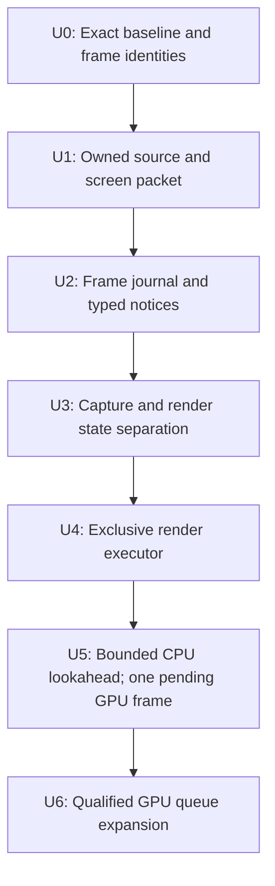

# Native Metal 4: upstream contract analysis and editor handoff

**BAR RAE · 2026-11-12 · English edition**

The executive sections below condense the original implementation handoff and analysis. The pinned source index and three detailed English evidence appendices are retained in full. The original historical handoff is preserved in [the earlier Git snapshot](https://github.com/yeojuny/BAR-Metal4/blob/99e1e012c64d94c3e6378c1ca16e44fd01a855b6/docs/research/BAR_Native_Metal4_Upstream_Refactor_Handoff_20261112.md). This is a historical analysis, not a claim about the current release or a new performance experiment.

Sections I–II use the intervention revision unless otherwise stated. Appendix A identifies its own main/review and Native233 overlay scopes; appendices B–C use their stated revisions. Paths are repository-relative. Implementation order and estimated opportunity are proposals; numerical performance and rendering equivalence require controlled implementation and validation.

## Contents

- [I. Editor implementation instructions](#editor-instructions)
- [II. Analysis and acceptance decisions](#analysis-report)
- [III. Detailed evidence appendices](#evidence-appendices)
  - [A — CUS capture, roster, pose and read-set](#appendix-capture)
  - [B — Resource graph, alias permission and dependencies](#appendix-resource)
  - [C — Frame ownership, worker and conditional two-ticket proof](#appendix-lifecycle)

<a id="editor-instructions"></a>

## I. Editor implementation instructions

### Goal and fixed sources

Reduce actual work while retaining the same workload, graphics semantics, and synchronized simulation. The original goal was to reach or exceed MVK3 throughput. No source edits or new Mac measurements were performed for this analysis.

| Scope | Revision |
| --- | --- |
| main | `5bc9cb313574e3f86758b429975d5becfadd7dbf` |
| review | `db4725a7490ff6dcc8d130646f76e28ebb9b7eae` |
| intervention | `16e7f1844203bdd7e26bb19a39e9e0276f1fcb74` |

Native233 on review is the effective source after applying its 31-file overlay, not the review root alone. Do not overwrite historical research packets with modern implementations.

### Six source-level facts to check first

1. `NativeTerrainProgramSource.cpp` Write (223–240) creates a value vector and full map snapshot per effective uniform write. Publish (217–221) copies program identity even on uniform-only changes. BindTerrainSource (247–255) revalidates each publication. Unlike the existing GLSL uniform state at Shader.cpp 760–780, the native source writer does not suppress equal writes.
2. `LuaNativeCUSSource.cpp` and `NativeCUSModelInputs.cpp` copy VAO submissions into the draw and model inputs separately; objects also appear in texture submission order. The structural validator proves these arrays have the same complete order.
3. `OrderNativePostprocessCommands` performs full validation and stable sorting. Finding a current-frame producer calls it again. `PrepareFrameImages` has repeated consumers in preparation and initial preparation; separate exact snapshots must remain distinct.
4. The deferred water/ground slice copies Draw by value, and forward CUS copies a whole frame before removing deferred draws. These contain maps and vectors rather than just inexpensive shared handles.
5. The existing render worker dispatch captures stack inputs by reference and returns through future/get and WaitIdle. It is synchronous thread migration, not overlapping CPU capture of N+1 with encoding N.
6. RuntimeNative conditionally admits two tickets, while UI, postprocess and cloud recorders each admit one submitted frame. A second Hold before retirement can conflict with the prior slot. This is a conditional call-chain proof, not evidence of a reproduced live failure.

### P0 — Establish a reproducible comparison

The combined intervention wrapper is not a control arm. Pin all measured flags explicitly, including those the wrapper does not set. Turning off a runtime flag does not undo compiler flags or unconditional code changes. Missing historical source inputs mean that a public-derived pair is not identical to the original measured Native233 binary.

Record actual drawable/attachment sizes, viewport, AA, VSync, map, game and widget hashes, seed, camera, SDK/compiler, warm-up and measurement windows, power and foreground state. Keep clean A/B runs separate from diagnostic captures. Do not call a frame-zero SDL_QUIT a gameplay, parity or performance pass. Preserve all raw intervals.

### P1-A — Terrain exact-change fast path

Read SourceProgram::Write, OwnsCurrent, MatchesCurrentPublication and Publish together in `Rendering/EngineBridge/NativeTerrainProgramSource.cpp`.

Retain the existing validation and error order for context, binding, location, count, ownership, overflow and non-finite inputs. Before constructing a new value vector, compare the complete type, shape, array count, transpose state and exact value bits. An early return is legal only when both the value and the currently bound publication match the writer's current state. A stale publication must follow the original clone/write/publish path.

Required counterexample:

```text
saved = Current(A)
Write(B)
Restore(saved)             // binding A, writer B
Write(the same value as B)
```

OwnsCurrent alone does not establish publication equality. Preserve signed zeros, NaN/Inf rejection, location -1, count zero, invalid inputs, nested ActiveShader/Current/Restore, shader reload, device/context recreation, deletion and address reuse. Earlier captured draws must remain immutable after later writes.

Record setter calls, exact changes, aligned no-ops, stale-publication fallbacks, map copies and publications. Aligned no-ops must create no vector/map/publication allocation and must not change the revision. Do not allocate a temporary container just to compare values.

### T2–T4 — Subsequent terrain changes

- Separate an immutable linked-program definition and certificate from uniform revision. Validate source hashes, compiler inputs, context and ABI at link time, retain owner and generation evidence for draws, and preserve the actual target/MSAA/texture-type/PSO checks during Prepare.
- Separate the mutable writer from sealed uniform content. Freeze only at semantic observation boundaries, classifying Current callers that check identity separately from Save/Restore and consumers. Do not re-seal on every setter. Preserve inactive-name values and the existing try_emplace default behavior.
- Build typed slot/packing plans at link time and reuse typed source values. Camera, matrices, fog, clip, target and image transport still affect actual GPU uniforms. Do not key a complete draw block or inverse matrix by simulation frame alone. Begin in terrain; do not introduce a giant unproven common struct.

### P1-B — Build the postprocess graph index once per immutable snapshot

Use the exact owner, serial, source frame and prefix/suffix selection. Construct ordered command references, version-to-producer lookup, immutable descriptors and static overwrite proofs once; verify current-frame producer order and sequence at use. Duplicate version, producer/consumer inversion and same-offset sequence ties must still be rejected.

Prefix and suffix may share a serial but differ in contents. Static metadata must not absorb runtime retirement, readability, preparation input or lease registration checks. Retain the original texture owner witnesses rather than adding broad extra shared owners that change alias eligibility.

Acceptance: one full order build per exact snapshot, no full sort for each lookup, unchanged command order, clears, targets, formats, copies, barriers, cancellation and failed/retired-input handling.

### P1-C — CUS immutable ordered roster

Seal the VAO builder's objects, submissions and bin metadata as one immutable roster after a successful mutation. Reuse the unchanged roster for successive Submit calls, and validate geometry/index range once per roster. Invalidate after each successful AddOne, not only after all elements of a table Add succeed; a failure can leave a committed prefix.

Retain Lua API semantics, model/bin ownership, swap-remove ordering, first/count/baseInstance, separate texture/world event ordinals and destroyed-object shadow behavior. A roster is not a place for frame-specific pose, uniform, VBO, texture or GPU handles. Each span must retain the relevant owner. Do not keep new and old duplicate arrays permanently.

Compare old/new validation accept/reject and exact original order. Independent changes to program, texture, uniform or instances must still reach each draw.

### P2 — Share immutable payloads and remove phase copies

Separate source-event identity from immutable content. Attach structural validation to a genuine immutable factory owner, never a public validated boolean. Retain existing page-content and unchanged VBO reuse. Move read-set identity from transient wrapper addresses to a conservative actual owner tuple including roster, instance, publication and read profile; preserve bone/skinning, observed row, team and interpolation distinctions.

Use shared per-draw payloads with selected forward/deferred envelopes rather than retaining an entire unrelated phase's content indefinitely. Keep source ABI values separate from late image/target transport.

An ordinary successful raster draw exhibited several SourceValidate invocations, and model MRT more; these call-path counts are not measured mean times. Do not confuse material identity, event identity and physical storage identity.

MRTWriteReuse209 depends on actual owner witnesses. A raw reference can remain alive without changing shared_ptr count. Preserve reader ownership proof or conservatively use copy-on-write; object lifetime alone does not permit overwriting an older image.

### P3–P4 — Ownership and completion before asynchronous rendering

Extend existing WorldFrame and CPU-read packets into an owning render task, including screen, surface policy, source certificates and retained read receipt. EndFrame exchanges storage; the next recorder writes separate storage. Initially use the synchronous executor.

Replace each single submitted-frame record with a bounded journal indexed by scene epoch, source draw frame, postprocess serial and capture ordinal. Reserve the exact frame before publishing to a queue. Abort/rollback must not touch unrelated outstanding frames.

Separate four notices:
- enqueue acceptance (CPU ownership transfer);
- submission (actual submission ID);
- GPU completion (event and feedback plus producer checks; errors/timeouts separate);
- presentation (actual drawable and presentation time).

Failure or timeout is not successful retirement. Quarantine ownership until safe. A late callback from a previous scene cannot retire a new scene. Workers return ID-bearing data notices instead of executing arbitrary main/Lua callbacks.

Resolve mutable crossings in environment/reflection state, shield and PBR pending records, screen allocation/cache maps, terrain mutable PSO and image-library maps, global registry/shadow data, target submission recording and alias permission before enabling overlap. Give the render executor exclusive ownership of render caches and fulfillment; keep live simulation/Lua capture and the publication journal on main. Preserve thread-affine destruction and avoid circular callbacks.

Test pause of worker N while main captures/aborts N+1, several held records plus the current recorder, second-ticket admission, wrong epoch, duplicate/out-of-order receipts, pre/post-Begin errors and GPU event or feedback timeouts. Pass on the synchronous reference executor before removing waits.

### P5 — True CPU lookahead with one pending GPU submission

Replace the blocking Invoke/get path with bounded task queues and completion notices only after P3–P4. Credit includes capture, queued/preparing and GPU-owned frames; monitor retained bytes and input/presentation latency. Keep a single pending GPU frame initially. Explicitly transfer the existing CPURead Packet scope to the consuming executor instead of sharing TLS pointers.

Start SaveImage/prefix/suffix, relink, resize/close and world reset as ordered drain controls. Do not move synced simulation or rerun source callbacks. Measure intersection of actual active capture and worker prepare/encode intervals excluding waits. Compare completed/presented throughput and latency, not only enqueue FPS.

### P6 — Optimize GPU work only after resource-use proof

Introduce typed producer invocation identity, immutable content/storage versions, views/samplers, actual stage and subresource reads/writes/preservation. Logical history, rollback, previous-pixel preservation and shader reads are distinct. A clear or copy can only be removed with a specific complete overwrite and reader proof. Scope barriers to a proven producer-consumer pair; do not erase waits globally.

### Acceptance and prohibited shortcuts

Preserve exact simulation and renderer semantics, original ordering, failure behavior and ownership. Test real matched images and resource versions. Maintain independent reversible switches and report actual work counters before clean same-input performance comparisons.

Do not introduce epsilon uniform equivalence, serial-only snapshot keys, pointer-only lifetime proofs, a global fast-math switch, unbounded caches or simultaneous unrelated refactors. Do not treat the full callback delay or sum of overlapping GPU envelopes as recoverable milliseconds. Do not promise additive FPS gains.

<a id="analysis-report"></a>

## II. Analysis and acceptance decisions

The smallest useful upstream seams are source publication, immutable geometry and postprocess metadata, followed by owning frame tasks. Existing work already has multiple reuse mechanisms; first prove whether a new change eliminates an operation, duplicates an existing cache, or merely moves it elsewhere.

The detailed CUS, resource and lifecycle analyses in the following appendices distinguish actual source behavior from proposed improvements. The public baseline audit identified repeated terrain publication, roster validation, postprocess graph rebuilds, and preparation preceding cache lookup. Additional concurrency depends on precise versioned resource and frame ownership; GPU submission depth is not a substitute for that proof.

The order used here is deliberately dependency driven: exact terrain writer reduction, immutable graph/roster, payload sharing, ownership and completion, CPU lookahead, then narrowly scoped GPU work. Recheck the current renderer before implementing any item because later releases may have independently addressed it.

Historical Native220/MVK3 measurements, the Native233 overlay, and later intervention diagnostics are distinct baselines. No source-only inspection establishes a numerical contribution or current performance ranking. Evaluate each independently with matched workload, compiler settings, quality, timing scope and fresh results.

### Pinned source and evidence index

The links refer to the analyzed revisions rather than live branches. S references identify source facts; R references identify measurements, provenance and official API descriptions. Not every linked line is claimed to be a performance bottleneck.

<a id="s01"></a>

#### S01 · Terrain source writer, publication, link and capture

[engine/rts/Rendering/EngineBridge/NativeTerrainProgramSource.cpp · 44–289](https://github.com/yeojuny/BAR-Metal4/blob/16e7f1844203bdd7e26bb19a39e9e0276f1fcb74/engine/rts/Rendering/EngineBridge/NativeTerrainProgramSource.cpp#L44-L289)

<a id="s02"></a>

#### S02 · Original GLSL unchanged-uniform suppression

[engine/rts/Rendering/Shaders/Shader.cpp · 760–780](https://github.com/yeojuny/BAR-Metal4/blob/16e7f1844203bdd7e26bb19a39e9e0276f1fcb74/engine/rts/Rendering/Shaders/Shader.cpp#L760-L780)

<a id="s03"></a>

#### S03 · Base program setter forwarding

[engine/rts/Rendering/Shaders/Shader.h · 261–281](https://github.com/yeojuny/BAR-Metal4/blob/16e7f1844203bdd7e26bb19a39e9e0276f1fcb74/engine/rts/Rendering/Shaders/Shader.h#L261-L281)

<a id="s04"></a>

#### S04 · Terrain uniform and square snapshot representation

[engine/rts/Rendering/Backend/NativeWaterGroundSourceData.h · 22–67](https://github.com/yeojuny/BAR-Metal4/blob/16e7f1844203bdd7e26bb19a39e9e0276f1fcb74/engine/rts/Rendering/Backend/NativeWaterGroundSourceData.h#L22-L67)

[engine/rts/Rendering/Backend/NativeTerrainSourceData.h · 25–65](https://github.com/yeojuny/BAR-Metal4/blob/16e7f1844203bdd7e26bb19a39e9e0276f1fcb74/engine/rts/Rendering/Backend/NativeTerrainSourceData.h#L25-L65)

<a id="s05"></a>

#### S05 · Terrain identity and image validation / capture

[engine/rts/Rendering/Backend/NativeTerrainSourceData.cpp · 30–141](https://github.com/yeojuny/BAR-Metal4/blob/16e7f1844203bdd7e26bb19a39e9e0276f1fcb74/engine/rts/Rendering/Backend/NativeTerrainSourceData.cpp#L30-L141)

<a id="s06"></a>

#### S06 · Actual SMF uniform writers

[engine/rts/Map/SMF/SMFRenderState.cpp · 389–402](https://github.com/yeojuny/BAR-Metal4/blob/16e7f1844203bdd7e26bb19a39e9e0276f1fcb74/engine/rts/Map/SMF/SMFRenderState.cpp#L389-L402)

[engine/rts/Map/SMF/SMFRenderState.cpp · 481–525](https://github.com/yeojuny/BAR-Metal4/blob/16e7f1844203bdd7e26bb19a39e9e0276f1fcb74/engine/rts/Map/SMF/SMFRenderState.cpp#L481-L525)

<a id="s07"></a>

#### S07 · Current/Restore source binding observation

[engine/rts/Rendering/Backend/NativeSourceProgramBinding.h · 14–72](https://github.com/yeojuny/BAR-Metal4/blob/16e7f1844203bdd7e26bb19a39e9e0276f1fcb74/engine/rts/Rendering/Backend/NativeSourceProgramBinding.h#L14-L72)

<a id="s08"></a>

#### S08 · Nested Lua ActiveShader save/restore

[engine/rts/Lua/LuaShaders.cpp · 869–908](https://github.com/yeojuny/BAR-Metal4/blob/16e7f1844203bdd7e26bb19a39e9e0276f1fcb74/engine/rts/Lua/LuaShaders.cpp#L869-L908)

<a id="s09"></a>

#### S09 · Terrain consumer mutable PSO state, DrawUniform and Prepare

[engine/rts/Rendering/Metal4/Metal4TerrainSourceGPU.mm · 269–310](https://github.com/yeojuny/BAR-Metal4/blob/16e7f1844203bdd7e26bb19a39e9e0276f1fcb74/engine/rts/Rendering/Metal4/Metal4TerrainSourceGPU.mm#L269-L310)

[engine/rts/Rendering/Metal4/Metal4TerrainSourceGPU.mm · 389–479](https://github.com/yeojuny/BAR-Metal4/blob/16e7f1844203bdd7e26bb19a39e9e0276f1fcb74/engine/rts/Rendering/Metal4/Metal4TerrainSourceGPU.mm#L389-L479)

[engine/rts/Rendering/Metal4/Metal4TerrainSourceGPU.mm · 704–825](https://github.com/yeojuny/BAR-Metal4/blob/16e7f1844203bdd7e26bb19a39e9e0276f1fcb74/engine/rts/Rendering/Metal4/Metal4TerrainSourceGPU.mm#L704-L825)

<a id="s10"></a>

#### S10 · Existing CPU read-set cache, sealed Packet and TLS active scope

[engine/rts/Rendering/Backend/NativeCUSCPUReadScope.h · 9–115](https://github.com/yeojuny/BAR-Metal4/blob/16e7f1844203bdd7e26bb19a39e9e0276f1fcb74/engine/rts/Rendering/Backend/NativeCUSCPUReadScope.h#L9-L115)

<a id="s11"></a>

#### S11 · Terrain uniform owner collection and deferred destruction

[engine/rts/Rendering/Metal4/Metal4TerrainUniformRelease220.inc · 70–117](https://github.com/yeojuny/BAR-Metal4/blob/16e7f1844203bdd7e26bb19a39e9e0276f1fcb74/engine/rts/Rendering/Metal4/Metal4TerrainUniformRelease220.inc#L70-L117)

<a id="s12"></a>

#### S12 · CUS mutable VAO roster and per-Submit capture

[engine/rts/Lua/LuaNativeCUSSource.cpp · 95–141](https://github.com/yeojuny/BAR-Metal4/blob/16e7f1844203bdd7e26bb19a39e9e0276f1fcb74/engine/rts/Lua/LuaNativeCUSSource.cpp#L95-L141)

<a id="s13"></a>

#### S13 · Repeated geometry-range proof and ModelInputs roster copy

[engine/rts/Rendering/Backend/NativeCUSModelInputs.cpp · 22–60](https://github.com/yeojuny/BAR-Metal4/blob/16e7f1844203bdd7e26bb19a39e9e0276f1fcb74/engine/rts/Rendering/Backend/NativeCUSModelInputs.cpp#L22-L60)

<a id="s14"></a>

#### S14 · CUS source draw structural validation

[engine/rts/Rendering/Backend/NativeCUSSourceData.cpp · 28–63](https://github.com/yeojuny/BAR-Metal4/blob/16e7f1844203bdd7e26bb19a39e9e0276f1fcb74/engine/rts/Rendering/Backend/NativeCUSSourceData.cpp#L28-L63)

<a id="s15"></a>

#### S15 · Existing WorldFrame source packet

[engine/rts/Rendering/Backend/WorldFrameData.h · 254–323](https://github.com/yeojuny/BAR-Metal4/blob/16e7f1844203bdd7e26bb19a39e9e0276f1fcb74/engine/rts/Rendering/Backend/WorldFrameData.h#L254-L323)

<a id="s16"></a>

#### S16 · CUS read-set inputs and skinning branches

[engine/rts/Rendering/Backend/NativeCUSRenderInputs.cpp · 66–117](https://github.com/yeojuny/BAR-Metal4/blob/16e7f1844203bdd7e26bb19a39e9e0276f1fcb74/engine/rts/Rendering/Backend/NativeCUSRenderInputs.cpp#L66-L117)

<a id="s17"></a>

#### S17 · CUS preparation, late material-cache lookup and dependency deduplication

[engine/rts/Rendering/Metal4/Metal4CUSSource.mm · 180–246](https://github.com/yeojuny/BAR-Metal4/blob/16e7f1844203bdd7e26bb19a39e9e0276f1fcb74/engine/rts/Rendering/Metal4/Metal4CUSSource.mm#L180-L246)

[engine/rts/Rendering/Metal4/Metal4CUSSource.mm · 388–474](https://github.com/yeojuny/BAR-Metal4/blob/16e7f1844203bdd7e26bb19a39e9e0276f1fcb74/engine/rts/Rendering/Metal4/Metal4CUSSource.mm#L388-L474)

<a id="s18"></a>

#### S18 · Deferred-phase validation, preserve/reuse decisions and encoding

[engine/rts/Rendering/Backend/NativeCUSDeferredData.cpp · 40–75](https://github.com/yeojuny/BAR-Metal4/blob/16e7f1844203bdd7e26bb19a39e9e0276f1fcb74/engine/rts/Rendering/Backend/NativeCUSDeferredData.cpp#L40-L75)

[engine/rts/Rendering/Metal4/Metal4CUSDeferred.mm · 176–365](https://github.com/yeojuny/BAR-Metal4/blob/16e7f1844203bdd7e26bb19a39e9e0276f1fcb74/engine/rts/Rendering/Metal4/Metal4CUSDeferred.mm#L176-L365)

<a id="s19"></a>

#### S19 · Deferred ground CUS draw-by-value selection

[engine/rts/Rendering/EngineBridge/NativeWaterGroundSourceCapture.cpp · 114–120](https://github.com/yeojuny/BAR-Metal4/blob/16e7f1844203bdd7e26bb19a39e9e0276f1fcb74/engine/rts/Rendering/EngineBridge/NativeWaterGroundSourceCapture.cpp#L114-L120)

<a id="s20"></a>

#### S20 · Forward ground full-frame copy then erase

[engine/rts/Rendering/Metal4/Metal4WorldRenderer.mm · 3232–3234](https://github.com/yeojuny/BAR-Metal4/blob/16e7f1844203bdd7e26bb19a39e9e0276f1fcb74/engine/rts/Rendering/Metal4/Metal4WorldRenderer.mm#L3232-L3234)

<a id="s21"></a>

#### S21 · Existing indexed world command selection

[engine/rts/Rendering/Backend/NativeWorldDrawPlan167.h · 19–88](https://github.com/yeojuny/BAR-Metal4/blob/16e7f1844203bdd7e26bb19a39e9e0276f1fcb74/engine/rts/Rendering/Backend/NativeWorldDrawPlan167.h#L19-L88)

<a id="s22"></a>

#### S22 · Existing published page and GPU storage reuse

[engine/rts/Rendering/Backend/NativeCUSPublishedReuse.h · 1](https://github.com/yeojuny/BAR-Metal4/blob/16e7f1844203bdd7e26bb19a39e9e0276f1fcb74/engine/rts/Rendering/Backend/NativeCUSPublishedReuse.h#L1)

[engine/rts/Rendering/Backend/NativeCUSPublishedData.cpp · 79–97](https://github.com/yeojuny/BAR-Metal4/blob/16e7f1844203bdd7e26bb19a39e9e0276f1fcb74/engine/rts/Rendering/Backend/NativeCUSPublishedData.cpp#L79-L97)

[engine/rts/Rendering/Backend/NativePublishedBufferPool.h · 44–69](https://github.com/yeojuny/BAR-Metal4/blob/16e7f1844203bdd7e26bb19a39e9e0276f1fcb74/engine/rts/Rendering/Backend/NativePublishedBufferPool.h#L44-L69)

<a id="s23"></a>

#### S23 · Unchanged VBO snapshot and unique-owner copy rule

[engine/rts/Rendering/Backend/NativeDirtyBufferSnapshot.h · 35–60](https://github.com/yeojuny/BAR-Metal4/blob/16e7f1844203bdd7e26bb19a39e9e0276f1fcb74/engine/rts/Rendering/Backend/NativeDirtyBufferSnapshot.h#L35-L60)

<a id="s24"></a>

#### S24 · Draw-time model uniform mutation and publication ordering

[engine/rts/Lua/LuaShaders.cpp · 1049–1069](https://github.com/yeojuny/BAR-Metal4/blob/16e7f1844203bdd7e26bb19a39e9e0276f1fcb74/engine/rts/Lua/LuaShaders.cpp#L1049-L1069)

[engine/rts/Rendering/Models/ModelsMemStorage.cpp · 97–102](https://github.com/yeojuny/BAR-Metal4/blob/16e7f1844203bdd7e26bb19a39e9e0276f1fcb74/engine/rts/Rendering/Models/ModelsMemStorage.cpp#L97-L102)

[engine/rts/Rendering/Backend/NativeCUSModelPublication.h · 22–25](https://github.com/yeojuny/BAR-Metal4/blob/16e7f1844203bdd7e26bb19a39e9e0276f1fcb74/engine/rts/Rendering/Backend/NativeCUSModelPublication.h#L22-L25)

<a id="s25"></a>

#### S25 · Postprocess full sort/validation per consumer

[engine/rts/Rendering/Backend/NativePostprocessData.cpp · 265–322](https://github.com/yeojuny/BAR-Metal4/blob/16e7f1844203bdd7e26bb19a39e9e0276f1fcb74/engine/rts/Rendering/Backend/NativePostprocessData.cpp#L265-L322)

<a id="s26"></a>

#### S26 · Postprocess readiness, duplicate preparation and image resolution

[engine/rts/Rendering/Metal4/Metal4PostprocessNative.mm · 478–607](https://github.com/yeojuny/BAR-Metal4/blob/16e7f1844203bdd7e26bb19a39e9e0276f1fcb74/engine/rts/Rendering/Metal4/Metal4PostprocessNative.mm#L478-L607)

<a id="s27"></a>

#### S27 · Postprocess EndFrame and same-serial prefix

[engine/rts/Rendering/Backend/NativePostprocessRecorder.cpp · 34–45](https://github.com/yeojuny/BAR-Metal4/blob/16e7f1844203bdd7e26bb19a39e9e0276f1fcb74/engine/rts/Rendering/Backend/NativePostprocessRecorder.cpp#L34-L45)

<a id="s28"></a>

#### S28 · Postprocess same-serial suffix selection and preparation

[engine/rts/Rendering/Metal4/Metal4WorldRenderer.mm · 1992–2023](https://github.com/yeojuny/BAR-Metal4/blob/16e7f1844203bdd7e26bb19a39e9e0276f1fcb74/engine/rts/Rendering/Metal4/Metal4WorldRenderer.mm#L1992-L2023)

[engine/rts/Rendering/Metal4/Metal4WorldRenderer.mm · 2193–2198](https://github.com/yeojuny/BAR-Metal4/blob/16e7f1844203bdd7e26bb19a39e9e0276f1fcb74/engine/rts/Rendering/Metal4/Metal4WorldRenderer.mm#L2193-L2198)

<a id="s29"></a>

#### S29 · Texture history event sequence and draw capture

[engine/rts/Rendering/Backend/NativeCUSTextureHistory.cpp · 1–134](https://github.com/yeojuny/BAR-Metal4/blob/16e7f1844203bdd7e26bb19a39e9e0276f1fcb74/engine/rts/Rendering/Backend/NativeCUSTextureHistory.cpp#L1-L134)

[engine/rts/Rendering/Backend/NativeCUSTextureHistory.h · 26–88](https://github.com/yeojuny/BAR-Metal4/blob/16e7f1844203bdd7e26bb19a39e9e0276f1fcb74/engine/rts/Rendering/Backend/NativeCUSTextureHistory.h#L26-L88)

<a id="s30"></a>

#### S30 · Texture version resolution, sampling updates and cancellation

[engine/rts/Rendering/Backend/NativeTextureRegistry.cpp · 65–131](https://github.com/yeojuny/BAR-Metal4/blob/16e7f1844203bdd7e26bb19a39e9e0276f1fcb74/engine/rts/Rendering/Backend/NativeTextureRegistry.cpp#L65-L131)

[engine/rts/Rendering/Backend/NativeTextureRegistry.cpp · 207–228](https://github.com/yeojuny/BAR-Metal4/blob/16e7f1844203bdd7e26bb19a39e9e0276f1fcb74/engine/rts/Rendering/Backend/NativeTextureRegistry.cpp#L207-L228)

<a id="s31"></a>

#### S31 · TerrainInfo repeated wrapper and callback construction

[engine/rts/Rendering/Metal4/Metal4TerrainInfoSource.mm · 113–180](https://github.com/yeojuny/BAR-Metal4/blob/16e7f1844203bdd7e26bb19a39e9e0276f1fcb74/engine/rts/Rendering/Metal4/Metal4TerrainInfoSource.mm#L113-L180)

<a id="s32"></a>

#### S32 · MRT structural ownership permission and sealed registry assumption

[engine/rts/Rendering/Metal4/Metal4MRTWriteReuse209.h · 18–22](https://github.com/yeojuny/BAR-Metal4/blob/16e7f1844203bdd7e26bb19a39e9e0276f1fcb74/engine/rts/Rendering/Metal4/Metal4MRTWriteReuse209.h#L18-L22)

[engine/rts/Rendering/Metal4/Metal4MRTWriteReuse209.h · 100–137](https://github.com/yeojuny/BAR-Metal4/blob/16e7f1844203bdd7e26bb19a39e9e0276f1fcb74/engine/rts/Rendering/Metal4/Metal4MRTWriteReuse209.h#L100-L137)

<a id="s33"></a>

#### S33 · Original clear and MRT/PostDeferred capture boundaries

[engine/rts/Rendering/EngineBridge/NativeOpaqueModelCapture.cpp · 62–149](https://github.com/yeojuny/BAR-Metal4/blob/16e7f1844203bdd7e26bb19a39e9e0276f1fcb74/engine/rts/Rendering/EngineBridge/NativeOpaqueModelCapture.cpp#L62-L149)

[engine/rts/Rendering/Metal4/Metal4OpaqueModelSource.mm · 303–309](https://github.com/yeojuny/BAR-Metal4/blob/16e7f1844203bdd7e26bb19a39e9e0276f1fcb74/engine/rts/Rendering/Metal4/Metal4OpaqueModelSource.mm#L303-L309)

<a id="s34"></a>

#### S34 · Existing exact overwrite/clear proofs and dependency summary

[engine/rts/Rendering/Backend/NativeMRTClearLoad145.h · 1](https://github.com/yeojuny/BAR-Metal4/blob/16e7f1844203bdd7e26bb19a39e9e0276f1fcb74/engine/rts/Rendering/Backend/NativeMRTClearLoad145.h#L1)

[engine/rts/Rendering/Backend/NativePostprocessOverwrite157.h · 1](https://github.com/yeojuny/BAR-Metal4/blob/16e7f1844203bdd7e26bb19a39e9e0276f1fcb74/engine/rts/Rendering/Backend/NativePostprocessOverwrite157.h#L1)

[engine/rts/Rendering/Metal4/Metal4Pass160Policy.h · 1–24](https://github.com/yeojuny/BAR-Metal4/blob/16e7f1844203bdd7e26bb19a39e9e0276f1fcb74/engine/rts/Rendering/Metal4/Metal4Pass160Policy.h#L1-L24)

[engine/rts/Rendering/Metal4/Metal4SourceImage.h · 1–35](https://github.com/yeojuny/BAR-Metal4/blob/16e7f1844203bdd7e26bb19a39e9e0276f1fcb74/engine/rts/Rendering/Metal4/Metal4SourceImage.h#L1-L35)

<a id="s35"></a>

#### S35 · Synchronous serial render worker

[engine/rts/Rendering/Backend/NativeSerialRenderWorker.h · 23–37](https://github.com/yeojuny/BAR-Metal4/blob/16e7f1844203bdd7e26bb19a39e9e0276f1fcb74/engine/rts/Rendering/Backend/NativeSerialRenderWorker.h#L23-L37)

<a id="s36"></a>

#### S36 · Reference-capturing worker dispatch and receipt delivery

[engine/rts/Rendering/Metal4/Metal4WorldRenderer.mm · 2110–2133](https://github.com/yeojuny/BAR-Metal4/blob/16e7f1844203bdd7e26bb19a39e9e0276f1fcb74/engine/rts/Rendering/Metal4/Metal4WorldRenderer.mm#L2110-L2133)

<a id="s37"></a>

#### S37 · Borrowed ScreenFrameView and mutable UI root storage

[engine/rts/Rendering/Backend/ScreenDrawList.h · 392–406](https://github.com/yeojuny/BAR-Metal4/blob/16e7f1844203bdd7e26bb19a39e9e0276f1fcb74/engine/rts/Rendering/Backend/ScreenDrawList.h#L392-L406)

[engine/rts/Rendering/Backend/NativeUIRecorder.cpp · 742–764](https://github.com/yeojuny/BAR-Metal4/blob/16e7f1844203bdd7e26bb19a39e9e0276f1fcb74/engine/rts/Rendering/Backend/NativeUIRecorder.cpp#L742-L764)

[engine/rts/Rendering/Backend/NativeUIRecorder.cpp · 793–807](https://github.com/yeojuny/BAR-Metal4/blob/16e7f1844203bdd7e26bb19a39e9e0276f1fcb74/engine/rts/Rendering/Backend/NativeUIRecorder.cpp#L793-L807)

<a id="s38"></a>

#### S38 · Environment capture writes and render preparation reads

[engine/rts/Rendering/Metal4/Metal4WorldRenderer.mm · 1196–1202](https://github.com/yeojuny/BAR-Metal4/blob/16e7f1844203bdd7e26bb19a39e9e0276f1fcb74/engine/rts/Rendering/Metal4/Metal4WorldRenderer.mm#L1196-L1202)

[engine/rts/Rendering/Metal4/Metal4WorldRenderer.mm · 2184–2191](https://github.com/yeojuny/BAR-Metal4/blob/16e7f1844203bdd7e26bb19a39e9e0276f1fcb74/engine/rts/Rendering/Metal4/Metal4WorldRenderer.mm#L2184-L2191)

<a id="s39"></a>

#### S39 · Capture-time ScreenGPU allocation sharing a renderer cache

[engine/rts/Rendering/Metal4/Metal4ScreenNative.mm · 1694–1720](https://github.com/yeojuny/BAR-Metal4/blob/16e7f1844203bdd7e26bb19a39e9e0276f1fcb74/engine/rts/Rendering/Metal4/Metal4ScreenNative.mm#L1694-L1720)

<a id="s40"></a>

#### S40 · Shared shield/PBR staging and remaining live state access

[engine/rts/Rendering/Metal4/Metal4WorldRenderer.mm · 1892–1956](https://github.com/yeojuny/BAR-Metal4/blob/16e7f1844203bdd7e26bb19a39e9e0276f1fcb74/engine/rts/Rendering/Metal4/Metal4WorldRenderer.mm#L1892-L1956)

[engine/rts/Rendering/Metal4/Metal4PBRSourceService.mm · 12–32](https://github.com/yeojuny/BAR-Metal4/blob/16e7f1844203bdd7e26bb19a39e9e0276f1fcb74/engine/rts/Rendering/Metal4/Metal4PBRSourceService.mm#L12-L32)

[engine/rts/Rendering/Metal4/Metal4WorldRenderer.mm · 2469–2472](https://github.com/yeojuny/BAR-Metal4/blob/16e7f1844203bdd7e26bb19a39e9e0276f1fcb74/engine/rts/Rendering/Metal4/Metal4WorldRenderer.mm#L2469-L2472)

[engine/rts/Rendering/Metal4/Metal4WorldRenderer.mm · 3036–3040](https://github.com/yeojuny/BAR-Metal4/blob/16e7f1844203bdd7e26bb19a39e9e0276f1fcb74/engine/rts/Rendering/Metal4/Metal4WorldRenderer.mm#L3036-L3040)

[engine/rts/Rendering/Metal4/Metal4WorldRenderer.mm · 3774–3779](https://github.com/yeojuny/BAR-Metal4/blob/16e7f1844203bdd7e26bb19a39e9e0276f1fcb74/engine/rts/Rendering/Metal4/Metal4WorldRenderer.mm#L3774-L3779)

[engine/rts/Rendering/Metal4/Metal4WorldRenderer.mm · 4036–4039](https://github.com/yeojuny/BAR-Metal4/blob/16e7f1844203bdd7e26bb19a39e9e0276f1fcb74/engine/rts/Rendering/Metal4/Metal4WorldRenderer.mm#L4036-L4039)

<a id="s41"></a>

#### S41 · Main-thread CPU read receipt and thread-local phase tracing

[engine/rts/Rendering/Metal4/Metal4SceneBridge.cpp · 1479–1505](https://github.com/yeojuny/BAR-Metal4/blob/16e7f1844203bdd7e26bb19a39e9e0276f1fcb74/engine/rts/Rendering/Metal4/Metal4SceneBridge.cpp#L1479-L1505)

[engine/rts/Rendering/Metal4/Metal4RuntimeNative.mm · 181–202](https://github.com/yeojuny/BAR-Metal4/blob/16e7f1844203bdd7e26bb19a39e9e0276f1fcb74/engine/rts/Rendering/Metal4/Metal4RuntimeNative.mm#L181-L202)

<a id="s42"></a>

#### S42 · Two-ticket admission, feedback and submission return

[engine/rts/Rendering/Metal4/Metal4RuntimeNative.mm · 845–945](https://github.com/yeojuny/BAR-Metal4/blob/16e7f1844203bdd7e26bb19a39e9e0276f1fcb74/engine/rts/Rendering/Metal4/Metal4RuntimeNative.mm#L845-L945)

[engine/rts/Rendering/Metal4/Metal4RuntimeNative.mm · 561–576](https://github.com/yeojuny/BAR-Metal4/blob/16e7f1844203bdd7e26bb19a39e9e0276f1fcb74/engine/rts/Rendering/Metal4/Metal4RuntimeNative.mm#L561-L576)

<a id="s43"></a>

#### S43 · Deferred receipt and source recorder Hold integration

[engine/rts/Rendering/Metal4/Metal4SceneBridge.cpp · 1597–1622](https://github.com/yeojuny/BAR-Metal4/blob/16e7f1844203bdd7e26bb19a39e9e0276f1fcb74/engine/rts/Rendering/Metal4/Metal4SceneBridge.cpp#L1597-L1622)

<a id="s44"></a>

#### S44 · Single-slot UI, postprocess and cloud submitted ownership

[engine/rts/Rendering/Backend/NativeUIRecorder.cpp · 793–807](https://github.com/yeojuny/BAR-Metal4/blob/16e7f1844203bdd7e26bb19a39e9e0276f1fcb74/engine/rts/Rendering/Backend/NativeUIRecorder.cpp#L793-L807)

[engine/rts/Rendering/Backend/NativePostprocessRecorder.cpp · 48–58](https://github.com/yeojuny/BAR-Metal4/blob/16e7f1844203bdd7e26bb19a39e9e0276f1fcb74/engine/rts/Rendering/Backend/NativePostprocessRecorder.cpp#L48-L58)

[engine/rts/Rendering/Backend/NativeVolumetricCloudContext.cpp · 42–52](https://github.com/yeojuny/BAR-Metal4/blob/16e7f1844203bdd7e26bb19a39e9e0276f1fcb74/engine/rts/Rendering/Backend/NativeVolumetricCloudContext.cpp#L42-L52)

<a id="s45"></a>

#### S45 · Prior-read checks and retirement ordering contract

[engine/rts/Rendering/Metal4/Metal4RuntimeNative.mm · 661–681](https://github.com/yeojuny/BAR-Metal4/blob/16e7f1844203bdd7e26bb19a39e9e0276f1fcb74/engine/rts/Rendering/Metal4/Metal4RuntimeNative.mm#L661-L681)

[engine/rts/Rendering/Metal4/Metal4FrameResources.h · 72–77](https://github.com/yeojuny/BAR-Metal4/blob/16e7f1844203bdd7e26bb19a39e9e0276f1fcb74/engine/rts/Rendering/Metal4/Metal4FrameResources.h#L72-L77)

<a id="s46"></a>

#### S46 · Engine draw-count FPS and CPU buffer timing

[engine/rts/Game/Game.cpp · 1350–1351](https://github.com/yeojuny/BAR-Metal4/blob/16e7f1844203bdd7e26bb19a39e9e0276f1fcb74/engine/rts/Game/Game.cpp#L1350-L1351)

[engine/rts/Game/Game.cpp · 1436–1441](https://github.com/yeojuny/BAR-Metal4/blob/16e7f1844203bdd7e26bb19a39e9e0276f1fcb74/engine/rts/Game/Game.cpp#L1436-L1441)

[engine/rts/Rendering/GlobalRendering.cpp · 855–867](https://github.com/yeojuny/BAR-Metal4/blob/16e7f1844203bdd7e26bb19a39e9e0276f1fcb74/engine/rts/Rendering/GlobalRendering.cpp#L855-L867)

<a id="s47"></a>

#### S47 · Side-effecting original uniform writer and capture order

[engine/rts/Rendering/UniformConstants.cpp · 233–352](https://github.com/yeojuny/BAR-Metal4/blob/16e7f1844203bdd7e26bb19a39e9e0276f1fcb74/engine/rts/Rendering/UniformConstants.cpp#L233-L352)

[engine/rts/Rendering/Backend/NativeCUSUniformCapture.cpp · 56–67](https://github.com/yeojuny/BAR-Metal4/blob/16e7f1844203bdd7e26bb19a39e9e0276f1fcb74/engine/rts/Rendering/Backend/NativeCUSUniformCapture.cpp#L56-L67)

<a id="r01"></a>

#### R01 · Original MVK3 / Native220 workload and timing evidence

[docs/research/mvk3-native220/README.md · 1](https://github.com/yeojuny/BAR-Metal4/blob/5bc9cb313574e3f86758b429975d5becfadd7dbf/docs/research/mvk3-native220/README.md#L1)

[docs/research/mvk3-native220/original/stock.json · 1](https://github.com/yeojuny/BAR-Metal4/blob/5bc9cb313574e3f86758b429975d5becfadd7dbf/docs/research/mvk3-native220/original/stock.json#L1)

<a id="r02"></a>

#### R02 · Effective native233 overlay and source provenance

[docs/research/native233/README.md · 1](https://github.com/yeojuny/BAR-Metal4/blob/db4725a7490ff6dcc8d130646f76e28ebb9b7eae/docs/research/native233/README.md#L1)

[docs/research/native233/OVERLAY-MANIFEST.json · 1](https://github.com/yeojuny/BAR-Metal4/blob/db4725a7490ff6dcc8d130646f76e28ebb9b7eae/docs/research/native233/OVERLAY-MANIFEST.json#L1)

<a id="r03"></a>

#### R03 · Separate 238–242 diagnostic evidence and limitations

[docs/research/native233/diagnostic/README.md · 1](https://github.com/yeojuny/BAR-Metal4/blob/db4725a7490ff6dcc8d130646f76e28ebb9b7eae/docs/research/native233/diagnostic/README.md#L1)

[docs/research/native233/diagnostic/238-analysis.json · 1](https://github.com/yeojuny/BAR-Metal4/blob/db4725a7490ff6dcc8d130646f76e28ebb9b7eae/docs/research/native233/diagnostic/238-analysis.json#L1)

<a id="r06"></a>

#### R06 · Candidate provenance and combined launcher defaults

[docs/interventions/native-perf-20261112/README.md · 1](https://github.com/yeojuny/BAR-Metal4/blob/16e7f1844203bdd7e26bb19a39e9e0276f1fcb74/docs/interventions/native-perf-20261112/README.md#L1)

[docs/interventions/native-perf-20261112/run-candidate.sh · 1](https://github.com/yeojuny/BAR-Metal4/blob/16e7f1844203bdd7e26bb19a39e9e0276f1fcb74/docs/interventions/native-perf-20261112/run-candidate.sh#L1)

<a id="r07"></a>

#### R07 · Native233 full measured flag set

[docs/research/native233/RESULTS.json · 1](https://github.com/yeojuny/BAR-Metal4/blob/db4725a7490ff6dcc8d130646f76e28ebb9b7eae/docs/research/native233/RESULTS.json#L1)

<a id="r04"></a>

#### R04 · Apple: Understanding the Metal 4 core API

[MTL4CommandBuffer resource lifetime; command queues and synchronization](https://developer.apple.com/documentation/metal/understanding-the-metal-4-core-api)

<a id="r05"></a>

#### R05 · Apple: Resource synchronization

[MTL4CommandQueue access conflicts, barriers/fences/events and hazardTrackingMode](https://developer.apple.com/documentation/metal/resource-synchronization)

---

<a id="evidence-appendices"></a>

## III. Detailed evidence appendices

The detailed evidence preserves symbols, branches, counterexamples and read coverage. Each appendix retains its own source snapshot scope. Proposed implementations and unmeasured effects are distinct from observed results.

<a id="appendix-capture"></a>

### Appendix A — CUS capture, roster, pose and read-set

### Native Metal4: upstream CUS capture/publication contract audit

#### Scope, source identity, and conclusion

Read-only audit, 2026-11-12. Main checkout: `BAR-Metal4`, commit `5bc9cb313574e3f86758b429975d5becfadd7dbf`. Review checkout: `BAR-Metal4-review`, commit `db4725a7490ff6dcc8d130646f76e28ebb9b7eae`. Unless marked **233 overlay**, paths below are under `engine/rts/` in those checkouts. Effective native233 changes are under `docs/research/native233/overlay/engine/rts/`; they must not be mistaken for already-active main-tree changes. This is source analysis, not a newly measured benchmark.

**The first CUS refactor should be a shared, immutable, ordered submission roster sealed at the existing `VertexArray::Submit` boundary.** Current source captures the same roster into three representations and then repeatedly compares them. They are not different subsets or rebased arrays. Keep draw-event identity separate from roster/content identity. This gives later validation, uniform, CPU preparation, and frame-partition changes one trustworthy upstream owner rather than a growing set of mutually checking copies.

Do not start with another WorldFrame class, global caching by unit ID, arbitrary draw sorting, or a broader worker that reads live game/Lua state. WorldFrame and a CPU-only worker packet already exist. Some apparent version churn is already handled correctly by page-content reuse. A sealed CPU draw also does not mean its deferred texture producer is fulfilled, encoded, or completed.

The structural repetitions below are proven by source. Their exact contribution to frame time is **not** measured by this audit. The prior diagnostic finding that one VBO byte-copy category is small does not measure map copying, repeated owner/order validation, skinning read-set construction, or the entire capture path. Conversely, none of these source repetitions proves a large speedup.

#### 1. Actual producer boundary: what a capture is allowed to observe

`Game/Game.cpp:1496–1521` runs the original unsynced update, world update, transforms upload, model-uniform upload, and uniform-constant update before native capture begins in `CGame::Draw` (`1528–1534`). The native branches of `Rendering/ModelsDataUploader.cpp:201–207,357–363` publish CPU data and return before legacy GL uploads. This is a publication boundary with observable ordering, not an invitation for a later worker to read the most recent mutable arrays.

There is a concrete later writer: `Lua/LuaShaders.cpp:1049–1069` obtains `modelUniformsStorage.GetObjUniformsArray(o)` and writes `userDefined`. The mutable getter in `Rendering/Models/ModelsMemStorage.cpp:97–102` marks the row dirty before returning the live storage reference. Consequently, a Draw callback may change CPU storage for the **next** publication while the current draw must use the earlier captured publication. `Backend/NativeCUSModelPublication.h:22–25` explicitly states that same boundary. The source bridge correctly passes `OriginalCUSModelPublication().Transforms()/ModelUniforms()` at Submit (`EngineBridge/NativeCUSSourceCapture.cpp:38–43`). Replacing that with “fetch current object/model data when preparing” changes semantics.

The uniform path also has real per-draw effects. `Rendering/UniformConstants.h:107–110` calls matrices then params. `UniformConstants.cpp:327–352` routes the original writers through native capture. The params writer at `233–324` consumes `guRNG.NextVector` (`235`), publishes time/interpolation (`240`), and writes active/custom team colors (`314–324`). Running the writer twice, skipping it because a camera looks unchanged, or using the next frame's interpolation is not an equivalent optimization.

The current uniform adapter redundantly enumerates active/custom palette rows before calling the original writer: `Backend/NativeCUSUniformCapture.cpp:58–67` versus the original writer's palette loop. This is a real duplicate traversal, but it is bounded by palette size. Its ordering is intentional: the allocation happens before the RNG-consuming writer so an allocation failure/retry cannot consume another RNG vector (`56–57`). An upstream typed writer that emits both bytes and the observed-row mask once could remove the traversal; it must retain that failure/side-effect ordering.

#### 2. The roster duplication is exact, not semantic transformation

##### 2.1 The mutable producer

`Lua/LuaNativeCUSSource.cpp:95–125` owns parallel vectors of objects, submission owners, and bin strings. `AddOne` resolves and retains a model submission at **AddToSubmission**, not at the eventual Draw (`105–117`). It also captures the bin at that point. The reason is explicit in `108–110`: retained commands can outlive a live unit lookup; shadow drawing may precede destroyed-object cleanup. `RemoveFromSubmission` swaps with the last element in all three arrays (`124`). A refactor must preserve that order, including the swap behavior; stable erase or sorting would change instance-row correspondence.

`Backend/NativeCUSModelCapture.cpp:15–40` resolves the original object/model under the model lock, verifies loaded/index-ready geometry, and captures original index first/count. `Rendering/WorldFrameCapture.cpp:569–634` already caches an immutable WorldModel by original model identity and deep-copies pieces/vertices/indices only on cache miss. There is no evidence here of recopying full model vertices for every CUS draw.

##### 2.2 Every Submit materializes the same roster again

Exact code, `Lua/LuaNativeCUSSource.cpp:132–140`:

```cpp
auto draw=services.inheritedRaster();draw.program=actualProgram->consumer;
draw.floatUniforms=actualProgram->floats;draw.intUniforms=actualProgram->ints;
draw.instances=instances->value->CaptureNativeSnapshot();
draw.objects=objects;draw.submissions=submissions;
draw.textures=std::make_shared<NativeCUSDrawTextureSnapshot>(
  TextureHistory().Submit(frame->sourceDrawFrame,draw.program->originalPass,
                         draw.program->family,bin,objects));
draw.sequence=NextNativeWorldDrawSequence();
draw.modelInputs=services.captureObjectInputs(draw);
draw.engineUniforms=services.captureEngineUniforms();
ValidateNativeCUSSourceDraw(draw);
```

`Backend/NativeCUSTextureHistory.cpp:129` copies those same objects again into `originalSubmissionOrder`. `Backend/NativeCUSModelInputs.cpp:54–60` allocates a new wrapper and copies those same submission pointers again:

```cpp
auto result = std::make_shared<NativeCUSModelInputs>();
result->sourceDrawFrame = frame;
result->sourceSequence = sequence;
result->submissions.assign(submissions.begin(), submissions.end());
```

For a VAO submitted repeatedly without roster mutation, the source therefore retains a mutable roster plus a new draw copy plus a new ModelInputs copy. Object identity has its mutable roster plus draw copy plus texture-history copy. These are pointer/object-record vectors, not copies of model geometry, but their construction and shared-owner reference increments recur per Submit.

The equality is not inferred: `Backend/NativeCUSSourceData.cpp:39–45` checks object-by-object equality between draw objects and texture history; full submission-vector equality between draw and ModelInputs; and matching objects in submission owners. `MakeNativeCUSModelInputs` receives the full `d.submissions` in `EngineBridge/NativeCUSSourceCapture.cpp:39–41`. No subsetting/rebasing occurs on that path.

Subsetting happens at the **frame's draw-event list**, discussed below. Adjacent instance grouping happens later in `NativeCUSDrawRuns147.h:18–27`, using equal geometry/index ranges and preserving original `first` offsets. Effective **233 overlay** `Metal4/Metal4CUSSource.mm:464–469` converts these runs to GPU objects. It does not retroactively change the source roster.

##### 2.3 Rechecking immutable geometry per Submit

`Backend/NativeCUSModelInputs.cpp:43–53` traverses every submitted model's pieces to recompute total index count and compare it with `originalIndexCount`. The loop is over pieces and their vector sizes, not all vertex data. Repeated instances of one geometry repeat this check; repeated Submit of an unchanged roster repeats it again. The geometry owner and retained index range are immutable. This is a suitable proof to seal once per new roster (or once per geometry/range), at the current Submit error boundary. It is not a reason to re-resolve units or alter model caching.

#### 3. Validation repetitions: exact scope and filtering

`Backend/NativeCUSSourceData.cpp:28–63` performs more than cheap null checks: N-element object-order comparisons, N-element submission-vector comparison, another object/submission loop, instance-layout/size checks, program-uniform metadata search, and a walk of both uniform maps and all scalar values.

For a successful source draw that reaches native preparation, normal non-raster-diagnostic paths are:

| Site | Predicate / action | Source-draw validator calls |
|---|---|---:|
| `LuaNativeCUSSource.cpp:140` | Every successful Submit before append | 1 |
| `NativeCUSRenderInputs.cpp:68` | Successful CPU Prime or consumer fallback computes its read set | 1 |
| **233 overlay** `Metal4CUSSource.mm:400` | Every draw in the provided source list, before raster omission | 1 |
| `NativeCUSDeferredData.cpp:46,74` | A selected model MRT callback is finished | +1 |
| **233 overlay** `Metal4CUSDeferred.mm:176` → `NativeCUSDeferredData.cpp:74` | That phase is prepared | +1 |

Thus ordinary successful non-culled/non-noattachment draws have three such passes when a successful CPU read-set result is retained/reused or the consumer performs one fallback; selected model MRT draws have five on that path. This is a per-draw control-flow count, **not a measured total for an entire benchmark loop**.

Important bounds:

- CPU Prime skips front-and-back culling and proven absence of attachment effects (**233 overlay** `NativeCUSCPUReadScope.h:25`). GPU Prepare still validates at `400`, then skips at `401–402`. Such draws have two ordinary or four model-MRT validation passes, not three/five.
- A zero viewport or scissor rejection occurs only after CPU reads (`Metal4CUSSource.mm:413–415`), so it does not remove that validation pass.
- `PrepareCUSDeferred` calls `programs.Prepare` at `227` before deciding read-only MRT retention at `246`; that optimization does not eliminate the source validation passes above.
- `pass.lua` and `pass.mrt->lua` can refer to the same Draw owners. Prime already suppresses identical keys (`NativeCUSCPUReadScope.h:26`); do not count this as two read-set constructions.
- Verification mode 3 deliberately builds and compares a second CPU receipt (`Metal4SceneBridge.cpp:1493–1496`). A failed Prime swallowed to retain original consumer-error order can also cause a later retry. Those are additional/exceptional paths, not the normal count.
- The byte budget also matters without any exception or verification mode: Prime computes/validates the read set at `NativeCUSCPUReadScope.h:28`, then can decline to retain it when the capacity-based `ByteLimit` check fails at `31–35`. The consumer subsequently recomputes it at `Metal4CUSSource.mm:408`; repeated Prime references can likewise retry an uncached result. The three/five counts therefore do not apply unconditionally to budget-fallback paths. `EntryLimit` can instead stop Prime before a read-set computation, leaving one consumer fallback.
- `FinishNativeCUSDeferredPhase:44–45` also loops over pass eligibility before `ValidatePhase` repeats pass eligibility at `74`. This is another real loop, separate from the three/five count.

A proper upstream seal lets consumers trust immutable structural facts, but cannot replace late checks involving the current compiler owner, target dimensions/formats, source-phase cameras, MRT generations, sampler resources, producer readiness, or encoder state. A public `bool validated` in the existing mutable aggregate would not establish this contract. Use an opaque factory-created owner/witness, and keep an unsealed legacy path during adoption.

#### 4. CPU read-set work: the key is broader than the computation

The **233 overlay** CPU cache key is `{program.get(), modelInputs.get(), engineUniforms.get(), instances.get()}` (`Backend/NativeCUSCPUReadScope.h:52`), with shared ownership checked at `59–60`. The owner check is important against address reuse. The problem is the **granularity**: `MakeNativeCUSModelInputs` constructs a fresh owner on every Submit even if roster, instances, transforms, and model uniforms are identical. Event sequence/frame metadata and another copied roster are in that wrapper. Two semantically equivalent source submissions cannot hit the same read-set entry simply because the wrapper changed.

This is a provable missed reuse opportunity, not proof that the current cache returns wrong results. It already avoids repeated work for the same captured Draw. It has 4096-entry/32 MiB limits and one serialized Draw lifetime (`14–16`); a proposed cross-frame cache is a different design with different retention/correctness requirements.

The actual read-set computation in `Backend/NativeCUSRenderInputs.cpp:66–117` depends on:

- roster geometry and original instance rows;
- rigid versus skinning program family (`70–71`), not arbitrary mutable renderer state;
- whether published model-uniform/transform rows were observed;
- team index and the engine params observed-team mask (`75–85`);
- skinning transform scales and clamped interpolation (`72–73,101–108`).

The rigid path already caches a geometry's unique first-bone set (`45–59,88–93`). Do not claim it visits all rigid vertices every draw. The skinning path still visits indexed vertices and reconstructs rows (`95–110`) and sorts/uniques the row vectors (`112`). Its source early return depends on interpolated scale (`104`), so geometry alone cannot key its read-set proof. Taking the union of every possible bone read is not automatically equivalent: it may reject an unobserved row the actual shader branch does not read. Team `255` is a literal-zero sentinel and must not be converted to a palette lookup (`78–85`).

The returned read sets are validation/trace products. Effective `Metal4CUSSource.mm:409,471` uses them for validation and optional tracing; published GPU upload still uses the source page publications (`425`). They are not a compact vertex/index command stream or a row-gather upload plan.

After roster identity is fixed, separate (a) event metadata, (b) immutable pose/publication owner tuple, and (c) read-profile identity. Initially keep conservative actual-publication keys. Only later narrow matrices/RNG-unrelated invalidation after proving the exact dependencies above; CPU reads do not inspect engine matrices even though the current key includes the whole matrix+params publication.

#### 5. Publication churn: separate real avoidable churn from existing reuse

##### 5.1 Models SSBO path already does the right major things

`Backend/NativeCUSModelPublication.cpp:25–32` handles capacity changes and returns the existing owner when there is no dirty work. It consumes UpdateList ranges only after successful publication (`36–46`). `NativeCUSPublishedData.cpp:79–97` compares observed element bytes and preserves unchanged 4 KiB page owners; modified pages are copied once. A new publication wrapper can exist even when all dirty bytes compare equal, but that is not synonymous with a new GPU upload.

`NativeCUSPublishedReuse.h:6–18` explicitly excludes publication serial/frame metadata from storage identity while including kind, stride, context, allocation generation, capacity, and page ownership. `NativePublishedBufferPool.h:55` reuses equal content; `57–69` mutates only an unpinned compatible slot and copies only the plan. `Metal4PublishedRequestCache.h` shares this pool across consumers within the runtime/request path. Therefore “publicationSerial increments, so every draw uploads the entire model SSBO again” is false for the reviewed implementation.

There is smaller remaining overhead: every actual dirty publication builds range/write vectors and a new wrapper/page-owner vector, and equivalent wrappers can miss the cheap per-request owner cache before the pool recognizes content equivalence. The evidence does not justify making this the first broad rewrite. Keep observed-row masks: allocated zero bytes are not evidence that an original writer produced that row.

##### 5.2 Engine constants have coarser owner churn

`NativeCUSUniformData.cpp:19–32` always creates a new 1664-byte matrix owner and publication wrapper. `35–58` creates a new params owner, copies the previous complete params object (`43`), overwrites the 288-byte prefix and actually written team rows, preserves/extends the observed-row mask, then creates another wrapper. Constants are 1664 and `288 + 2048*16 = 33056` bytes in `NativeCUSUniformData.h:14–18`.

For CUS, effective `Metal4CUSSource.mm:316–321` caches buffers by immutable owner. Preparation uses it at `421–423`; identical owner reuse across many draws works, but a new owner for byte-identical matrices misses. Params' prefix really changes with time/RNG. Do not skip the original writer or assume every new params publication is false invalidation. A later content object separate from publication metadata could reuse identical matrices and palette content while preserving update/event history. That is a producer-level prerequisite for a cleaner downstream upload cache.

##### 5.3 Lua VBO snapshots already cache unchanged revisions

`Lua/LuaVBOImpl.cpp:1735–1745` calls `NativeDirtyBufferSnapshotSource::Capture`. `Backend/NativeDirtyBufferSnapshot.h:35–60` returns the existing snapshot when the revision is unchanged, and permits partial byte-storage transfer only if the old snapshot is uniquely held; otherwise it preserves old immutable bytes with a full copy. More retained snapshots can force the full-copy path. Do not describe every `CaptureNativeSnapshot()` call as a fresh byte copy, and do not make a long-lived roster own a frame-specific instance snapshot.

#### 6. Frame partitions presently deep-copy Draw containers

`EngineBridge/NativeWaterGroundSourceCapture.cpp:114–120` creates a deferred frame slice, copies `sourceLoads`, and copies every Draw whose original sequence falls inside the deferred span. A Draw contains both uniform maps and object/submission vectors (`NativeCUSSourceData.h:45–64`), so `push_back(draw)` is not just a shared-pointer increment.

The **233 overlay** `Metal4WorldRenderer.mm:3203–3205` does the complement this way:

```cpp
auto forwardCUS=std::make_shared<NativeCUSSourceFrame>(*source.cus);
if(actual->deferred)
  std::erase_if(forwardCUS->draws,[&](const auto& draw){
    return actual->deferred->Contains(draw.sequence);
  });
ground.cus=impl->cusSourceGPU.Prepare(...,forwardCUS,...);
```

It first copies the whole frame, including Draw containers that are then erased. Without a deferred phase it still copies the whole source. Main has the same operation at `3202–3204`. These are selections of unchanged draw events, not meaningful alternate data productions.

A later source-selection interface can retain ordered selected event envelopes and their immutable payload owners, or expose a const ordered view. **Do not uncritically hold the entire parent frame from each view:** `PreparedCUSSource::Impl` retains its source until completion (`Metal4CUSSource.mm:163,388`). A whole-parent view can keep the other partition's program/texture/pose/instance owners alive longer, increase pinned buffer generations, and prevent the VBO partial-copy or published-pool reuse paths. Shared per-draw payloads with selected lightweight envelopes avoid that unnecessary cross-partition retention. A full-parent view is acceptable only if existing lifetime already proves it cannot lengthen those pins.

`LuaNativeCUSSource.cpp:248–250` also copies the accumulated loaded-source manifest into each finished CUS frame. It changes only on source load/reset, not on each Draw. A shared immutable source-manifest owner is another small content-identity improvement; preserve exact source hashes/resolved paths and reset context.

#### 7. Why a const source packet is not an independent render task yet

`NativeCUSSourceFrame` owns immutable CPU snapshots, but its texture descriptors can name scheduled producers. `Backend/NativeTextureBacking.h:12–22` explicitly distinguishes publication from completion. `NativeDeferredColorData.h:21–24` and `NativeShieldDepthBacking.h:23–27` declare `Fulfill(...) const` with a mutable resource owner. The original MRT phase creates content versions before Lua capture; **233 overlay** `Metal4CUSDeferred.mm:275–279` fulfills actual resources only after preparation.

`Metal4/Metal4SourceImage.h:8–25` carries resource owners and `encodeDependencies`, `requireReadable`, and `didComplete` callbacks. CUS executes these at `Metal4CUSSource.mm:207–218,241–245`. `Metal4DeferredColorNative.mm:8–21` resolves the actual resource and verifies its source/producer state. These are intentionally live lifecycle dependencies, not transitive immutable CPU values.

The **233 overlay** already draws the safe worker boundary narrowly: `Metal4SceneBridge.cpp:1216–1235` starts CPU work only for sealed opaque CUS frames while water/alpha/Lua captures continue on the original main thread. Its receipt is adopted or verified at `1484–1498`; errors are delivered at the original main-thread boundary (`1490–1492`). No Metal allocation, texture fulfillment, original Lua callback, or live session registry is moved to that worker.

The first refactor should preserve that division. A structural CUS witness proves source owners/layout/order/uniform values, not GPU readability or a right to retire/reuse target storage. A queue-depth or all-pass-parallelization change before separating these contracts would touch many downstream consumers twice.

#### 8. First PR: smallest useful upstream seam and exact compatibility boundary

##### Proposed contract

Introduce one internal immutable ordered roster owner, conceptually `NativeCUSSubmissionRoster`, containing the captured object identities, submission owners, and required captured bin metadata. It carries no frame sequence, current program, texture binding, engine uniform publication, instance bytes, MTL object, or live object pointer lookup. Its order and element count are the original VAO command order. The original `originalIndexFirst/count` remain unchanged.

Keep the existing mutable VAO builder and public Lua API. Add a cached sealed roster and a builder mutation generation. On first Submit after an actual roster mutation, copy/seal once, prove the immutable geometry/index-range invariants now checked in `MakeNativeCUSModelInputs`, then publish it. On an unchanged roster Submit, reuse the owner. `Add/Remove/Clear/Delete` invalidate after a successful logical mutation; a no-op clear need not invent a new content identity. AttachInstanceBuffer, VBO writes, uniforms, texture binds, and program changes do not change the roster, but still change the appropriate per-draw owner/state. Do not introduce cross-VAO deduplication or global live-ID caching in this PR.

Submit remains the geometry-proof/error boundary. AddOne retains its current validation, ownership, bin lookup, and exception rollback. The program still validates active/current ownership even for inactive uniform writes. Delete/Clear release the builder's cached roster; already captured draws continue to hold old owners. The only retained bin currently consumed at Submit is `uniformBins.front()`; do not add an unproven new requirement that every bin in the roster be equal.

`NativeCUSSourceDraw`, `NativeCUSModelInputs`, and the texture snapshot reference that same roster owner. Event frame/sequence stays in the event envelope; the texture-history ordinal remains distinct. Temporarily leave the per-event ModelInputs wrapper if needed—removing copied vectors and repeated geometry proofs is independently useful. A subsequent PR can make the pose payload independently identified to unlock CPU read-set reuse without conflating source events.

##### Caller changes, not a renderer rewrite

| Files / API | Required mechanical adaptation |
|---|---|
| `Lua/LuaNativeCUSSource.cpp` | Builder mutation invalidation; seal/reuse in Submit; keep Lua functions and original source order |
| `Backend/NativeCUSModelInputs.h/.cpp` | One shared roster reference; accessors/spans for submissions; keep per-draw instance/publication checks |
| `Backend/NativeCUSSourceData.h/.cpp` | Reference roster once; identity checks replace comparisons of identical copies after seal |
| `Backend/NativeCUSTextureHistory.h/.cpp` | Snapshot retains roster identity instead of its own object-order vector; history API still advances event sequence and resolves bindings at Submit |
| `Backend/NativeCUSModelCapture.h/.cpp` | CaptureDraw accepts shared roster; CaptureSubmission remains at AddOne |
| `EngineBridge/NativeCUSSourceCapture.cpp:39–41` | Forward roster owner into model/pose capture |
| `Backend/NativeCUSRenderInputs.cpp:74–95` | Read the same original index order through a const roster span |
| `Backend/NativeCUSDrawRuns147.h` and effective `Metal4CUSSource.mm:464–470` | Consume const submission span; same adjacent-run grouping/first/count |
| Source trace and any synthetic fixtures constructing these public aggregates | Use read-only accessors or an explicitly unsealed compatibility factory; retain legacy validation until migrated |

The object/submission types currently cross-include texture/model headers. Move only their small common declarations to a common source-data header if needed to avoid a cycle. This is internal C++ ABI work, not a user-facing shader/Lua ABI change.

Compatibility should use const accessors/spans and, if required, a legacy construction overload that makes one sealed roster. Do not keep both the new owner and permanently duplicated old vectors; that preserves the materialization cost and creates another consistency invariant. Do not allow a dangling span: its owner must be retained in every event/receipt that outlives the call.

Rollback boundary: keep the old full validation callable for synthetic/unsealed inputs and optional comparison during migration; preserve the old GPU preparation signature/order through the accessor adapter. Revert this one producer/data-contract commit without requiring a shader rebuild, target scheduling change, queue change, or new Metal feature. Once exact roster/order/owner equivalence is established, subsequent removal of redundant full validation can be its own commit. A permanent runtime option for two diverging data models is unnecessary.

##### What this first PR deliberately does not promise

It does not eliminate per-instance pose checks, combine independent original draws, merge MRT passes, reuse a mutable GPU allocation, change shader arithmetic, or increase queue depth. It provides the stable source identity those later changes would otherwise have to invent independently. It changes O(roster size) per-Submit materialization/proof to O(roster size) per-mutated-roster sealing plus small per-event state capture, but the workload's roster mutation rate and measured CPU savings still have to be established.

#### 9. Subsequent adoption, in dependency order

1. **Shared roster and exact compatibility adapters.** Preserve output and error boundaries; establish stable content owner and mutation rules first.
2. **Separate event envelope from immutable pose/uniform payload; seal structural draw facts once.** Consumers retain O(1) provenance/owner checks plus their own late target/lifecycle checks. Do not suppress actual missing-row validation or phase-version checks.
3. **Program uniform snapshot at Submit.** `LuaNativeCUSSource.cpp:66–75,133` builds/replaces values on every write and deep-copies maps every Submit. Cache immutable value content by actual bitwise change, keeping exact defaults and active-program checks. Use compiled field IDs/typed blocks when the source ABI supports it. Float equality must not silently merge signed zeros; integer representation/default semantics must stay exact.
4. **Typed uniform base plus late transport.** `NativeCUSProgramData.cpp:32–55` does name lookup and scalar validation per reflected field for both stage blocks; `Metal4CUSUniformUpload.inc:30–31` invokes it for every prepared draw. Source values and source water colors can be frozen/packed with the program ABI. Image masks/sample codes/clip flags at `37–39` depend on resolved images and target and must remain late patches. Do not move full transport packing into a Lua setter. This shares the parent's terrain recommendation of immutable source content plus late target transport; it need not share an oversized universal packet type.
5. **Frame selections and source manifest ownership.** Remove copy-then-erase and deferred Draw copies after per-draw payloads are shareable; audit lifetime pins as above.
6. **Read-set cache keyed to real input payload.** First use stable roster/instances/publications and explicit read profile; then consider narrower/cross-frame content keys only with proof of skinning branch/interpolation/observed-mask dependencies. Reuse the existing CPU receipt worker rather than re-running original capture off-thread.
7. **Downstream upload/run/scheduling work.** Now measurements can distinguish source computation from GPU resource work without each consumer reconstructing source identity. Adjacent-run metadata could be sealed once with the roster, but GPU address allocation and target/texture readiness remain submission-specific.

#### 10. Correctness cases and measurement that actually decide acceptance

These are implementation acceptance requirements for the proposed refactor, not claims that this audit executed new tests:

- Multiple Submit calls with unchanged roster reuse one roster owner while distinct draw/texture event ordinals remain distinct. Changing program, uniform, texture, raster, or instance snapshot must remain independently visible.
- Add/Remove/Clear after a captured Submit never changes the old draw. Remove retains swap-with-last order. Destroyed-unit-before-shadow-cleanup retains AddOne's model/bin; no later live lookup is introduced.
- VBO redefine, write, Delete, context reset, and allocator address reuse cannot alias old snapshots. A roster cache must not pin a frame-specific VBO snapshot forever.
- Full source-validator accept/reject behavior remains available for unsealed inputs. Moving a proof earlier must not change which original Lua call fails without an explicit compatibility decision.
- Rigid and skinning read sets match. Exercise scale sign/zero crossings, interpolation, first-bone low-byte behavior, original two-extra-bone loop, team-255 sentinel, and unobserved published rows.
- Source partitions form the same disjoint ordered event selection; interleaved engine/CUS sequence order and initial clears remain intact. No assumption that CUS draw indices themselves form one contiguous range is required.
- Texture default/unobserved/disabled/failed-lookup states remain distinct. MRT content publication, fulfillment, encoded/completed state, cancellation, and prior-content loads retain original ordering.
- Worker receipt identity, abort/exception release on main, and packet capacity limits remain valid. Long-lived shared payloads must not unexpectedly pin old published GPU slots or opposite-phase source owners.

First measure structural counters: roster seals versus Submits, roster elements copied, full SourceValidate invocations/elements, uniform map copies, read-set build/cache counts, and partition Draw materializations. Then compare CPU main-thread work and capture/ready timestamps with the same replay, target, rendering work, and diagnostic settings. Aggregate allocator counts alone cannot prove critical-path improvement; a cache that saves CPU but lengthens old-owner pins may increase copy/allocation costs elsewhere. Do not attach an FPS estimate until an A/B run exists.

#### Editor reproduction searches

Run from the relevant pinned checkout. These searches locate the high-value seams without depending on report prose:

```sh
rg -n 'struct VertexArray|AddOne|RemoveFromSubmission|void Submit|draw\.floatUniforms|draw\.objects|draw\.submissions|EndFrame' engine/rts/Lua/LuaNativeCUSSource.cpp
rg -n 'submissions\.assign|for \(const auto& submission|sourceSequence|originalInstances' engine/rts/Rendering/Backend/NativeCUSModelInputs.*
rg -n 'originalSubmissionOrder|ValidateNativeCUSSourceDraw|ValidateNativeCUSDeferredPhase' engine/rts/Rendering/Backend/NativeCUS*
rg -n 'FirstBones|ValidateRenderReads|boneWeights|scale>0|Unique\(' engine/rts/Rendering/Backend/NativeCUSRenderInputs.cpp
rg -n 'KeyFor|SameOwner|Prime\(|EntryLimit|Packet' docs/research/native233/overlay/engine/rts/Rendering/Backend/NativeCUSCPUReadScope.h
rg -n 'FinishDeferredCallbacks|slice->draws' engine/rts/Rendering/EngineBridge/NativeWaterGroundSourceCapture.cpp
rg -n 'forwardCUS|ValidateNativeCUSSourceDraw|ForEachNativeCUSDrawRun147|NativeCUSCPUReadScope|programs.Prepare|retainsReadOnlyContents' docs/research/native233/overlay/engine/rts/Rendering/Metal4
rg -n 'PublishMatrices|PublishParams|writtenRows|writtenTeamRows|SameNativeCUSPublishedStorage|use_count' engine/rts/Rendering/Backend/NativeCUSUniform* engine/rts/Rendering/Backend/NativeCUSPublished* engine/rts/Rendering/Backend/NativePublishedBufferPool.h
rg -n 'GetObjUniformsArray|userDefined|SetUpdate' engine/rts/Lua/LuaShaders.cpp engine/rts/Rendering/Models/ModelsMemStorage.cpp
rg -n 'Fulfill|mutable.*resource|encodeDependencies|requireReadable|didComplete' engine/rts/Rendering/Backend/NativeDeferredColorData.h engine/rts/Rendering/Backend/NativeShieldDepthBacking.h engine/rts/Rendering/Metal4/Metal4SourceImage.h
```

Coverage note: This focused addendum deeply followed the CUS producer, publication, roster, CPU-read, deferred selection, and consumer call paths named above, plus their relevant effective native233 replacements. The earlier `native_code_audit.md` and `native_source_scan.json` distinguish machine scanning of all 720 backend/Metal4 files from detailed semantic review. This addendum does not claim all game source, all generated shaders, or every test fixture was read. No new engine build, Metal execution, or benchmark was possible/performed in this read-only Linux source audit.

---

<a id="appendix-resource"></a>

### Appendix B — Resource graph, alias permission and dependencies

### Native Metal4: upstream resource and consumer contract audit

#### Scope and evidence boundary

This is a source audit for the upstream-first editor handoff. It does not report a new benchmark, GPU capture, measured time saving, or verified rendering defect. The strongest confirmed findings are repeated structural work and incomplete interfaces between existing logical producers and downstream preparation. Opportunities to remove additional GPU copies or boundaries remain conditional on exact consumer and execution proofs.

All line numbers below refer to `BAR-Metal4-intervention/engine/rts/`, commit `16e7f1844203bdd7e26bb19a39e9e0276f1fcb74`, unless stated otherwise. A GitHub source link can use `https://github.com/yeojuny/BAR-Metal4/blob/16e7f1844203bdd7e26bb19a39e9e0276f1fcb74/engine/rts/<path>#L<line>`.

The reference baseline is effective native233: review commit `db4725a7490ff6dcc8d130646f76e28ebb9b7eae` with the compiler source postimages under `docs/research/native233/overlay/engine/` replacing their corresponding `engine/` files. It is not unmodified review `engine/`. The manifest reports release base `80f13accdc2a02b7e97cb732d230307528ce6990` and measured engine SHA256 `3a0b5b4cfcd78240117664ce76a5f5ee5b01b4c0d2c03b23a32e1c8b41585ff6`. This establishes the retained source boundary, not an independently reconstructed exact build/toolchain.

Compared directly against effective native233, the following audited files are byte-identical in intervention: `NativePostprocessData.cpp`, `NativePostprocessRecorder.cpp`, `NativeCUSTextureHistory.cpp`, `NativeTextureRegistry.cpp`, `Metal4PostprocessNative.mm`, `Metal4SourceImage.h`, `Metal4TerrainInfoSource.mm`; overlay `NativeCUSCPUReadScope.h` and `NativeTerrainSourceData.cpp` are also identical. Intervention changes exist in `Metal4CUSSource.mm`, `Metal4CUSDeferred.mm`, `Metal4MRTWriteReuse209.h`, `Metal4OpaqueModelSource.mm`, `Metal4Pass160Policy.h`, `Metal4RuntimeNative.mm`, and `Metal4WorldRenderer.mm`. The relevant preexisting behavior is distinguished below from intervention admission changes.

#### Principal conclusion

The project already has logical image versions, exact source sequences, typed producers, immutable owner snapshots, producer encoded/completed states, indexed world selections, and several narrowly proved copy/encoder eliminations. It does not need a new generic framegraph as a starting point.

The useful missing seam is a **sealed, indexed description of actual resource uses and producer effects**, constructed from the existing immutable source packets and consumed once per render request. At present some consumers repeatedly rediscover static facts, and other consumers receive opaque callbacks whose resource effects or predecessor requirements cannot be inspected. Memory retention also doubles as a proxy for whether an image has a semantic reader in one alias permission. A larger texture pool or another barrier exception written before these contracts are stable would preserve or multiply that coupling.

There is no confirmed source-level basis here to claim that all current clear/copy/pass decisions are wrong, or that a large fraction of GPU work can safely disappear. Existing MRT evidence discussed by root includes zero preservation copies in sampled owners. The upstream work can first remove demonstrable repeated CPU work and make the remaining GPU decisions explainable; its additional GPU benefit must then be measured.

#### Existing contracts that the refactor must preserve

| Existing mechanism | Evidence | Implication |
| --- | --- | --- |
| Logical allocation and immutable content identity | `Rendering/Backend/NativeCUSTextureHistory.h:28–41`; `NativeTextureBacking.h` | Dimensions, levels, samples, original format, context, object identity and content owner already exist. Do not infer allocation size from viewport or treat a logical GL name as sufficient identity. |
| Draw-time immutable binding capture | `NativeCUSTextureHistory.h:69–72`; `.cpp:119–132` | Resolve current content at the original draw, then retain that exact version. Do not resolve a recorded name again at later GPU preparation. |
| Exact source order and real producer publication | `Rendering/EngineBridge/NativeOpaqueModelCapture.cpp:62–85,92–133,143–149`; `NativeCUSDeferredData.cpp:9–24` | MRT logical versions are deliberately published before original callbacks, so PostDeferred readers can retain U rather than later F. Publication is not GPU completion. |
| Existing postprocess producer graph | `NativePostprocessData.h`; `.cpp:265–322` | It has operations, external family producers, outputs, previous versions, inputs, source stage, world sequence, screen insertion offset, and same-offset command sequence. It is already a graph and order contract. |
| Immutable CPU validation receipts | `NativeCUSCPUReadScope.h:19–60,63–105` | Buffer-row read sets are keyed by retained owner/control-block identity and can be sealed/adopted. This is a useful pattern, not a missing feature to reimplement. It does not describe GPU image reads. |
| Existing indexed world selection | `NativeWorldDrawPlan167.h:19–24,67–88,158–206` | Family/stage selection already avoids older full command copies/scans for covered families. It explicitly remains an invocation-local index, not a general validation receipt. |
| Physical resource reuse | `Metal4PublishedRequestCache.h:42–71`; `Metal4DeferredStoragePool.inc:24–49`; existing argument/material pools | GPU allocation and upload caching already exist. They do not, by themselves, eliminate source capture, image resolution, or callback wrapper construction. |
| Proven omission of prior pixels | `NativeMRTClearLoad145.h:5–15`; `NativePostprocessOverwrite157.h:6–27` | Exact first clear/full fixed-copy proofs already avoid some preservation reads/copies. Keep these proofs and expose their result to the indexed plan. |
| Read-only and zero-reader writing MRT reuse | `Metal4CUSDeferred.mm:45–115,251–287`; `Metal4MRTWriteReuse209.h` | Fresh logical versions can already share physical storage in restricted cases. Do not propose unconditional U/F aliasing or call all versioning copies unnecessary. |
| Strict dependency inspection | `Metal4Pass160Policy.h:6–20`; `Metal4SourceImage.h:15–35` | `NoCommands` means no omitted GPU commands **and no lost producer-side CPU transition**. Separate draw-time readability must remain. |

#### 1. The highest-level chain that determines MRT copy, clear and physical pass work

The concrete chain is:

1. `NativeOpaqueModelCapture::Capture`, `Rendering/EngineBridge/NativeOpaqueModelCapture.cpp:72–85`, captures the actual clear decision, mask, depth mask, color write masks, stencil mask and scissor. `FullInitialClear()` decides whether the original whole-target clear can become a load clear. A partial clear must preserve prior pixels.
2. `BeginNativeCUSDeferredPhase`, `NativeCUSDeferredData.cpp:9–24`, publishes five color versions and one depth version against the actual named allocation extent, before the engine and Lua source callbacks.
3. Capture executes original engine/Lua/material callbacks once, finishes the immutable MRT phase, and subsequently executes PostDeferred callbacks at their original boundary: `NativeOpaqueModelCapture.cpp:92–133`. This order is why U and F cannot casually be merged or have their publications coalesced.
4. `PrepareOpaqueModelSource`, `Metal4OpaqueModelSource.mm:303–309`, attempts `MRTWriteReuse209` before either fresh MRT backing is fulfilled, then prepares all selected MRT resources before later screen/Shield/SSAO/Bloom preparation.
5. `PrepareCUSDeferred`, `Metal4CUSDeferred.mm:192–228`, determines which previous attachments must be preserved. The optional exact first Map clear can discard selected attachment predecessors. Required previous resources are resolved and checked for actual extent/format.
6. It prepares actual Lua consumers and merges engine/Lua source order, then decides read-only reuse, writing alias, or fresh physical storage at `:235–261`. Backings receive physical resources only after successful preparation at `:283–287`.
7. The actual encode path uses that decision: `:335–354` emits no preservation copies for read-only/write reuse, otherwise copies preserved colors/depth; `:357–365` constructs attachment loads/stores, starts the MRT render pass, and applies the queue-stage barrier.

This is the upstream decision boundary to improve. Starting with the six-texture pool at step 6 cannot fix uncertainty about readers at steps 2–5.

##### What is limited today

`MRTWriteReuse209::ExclusiveFreshPair`, `Metal4MRTWriteReuse209.h:100–137`, uses exact ownership and publication checks. In particular `:122–127` requires precisely two shared-pointer owners of U's logical object and precisely two of its backing. This is a safe, deliberately narrow structural proof for one sealed normal-main path. It is not an explicit list of shader/readback consumers.

Consequently, additional **retention** can reject reuse even if it is not an actual GPU read. CUS snapshots retain 12 source sampler bindings regardless of which are active in the compiled fragment (`NativeCUSTextureHistory.cpp:125–132` versus `Metal4CUSSource.mm:434–447`). Terrain snapshots retain every unit/target (`NativeTerrainSourceData.cpp:101–109`) before later consuming the selected profile's samplers (`Metal4TerrainSourceGPU.mm:757–787`). If such an otherwise inactive binding retains U, the current count proof cannot distinguish it from an actual reader. This is a concrete limitation of the proof, **not evidence that this happens often or caused measured preservation copies**.

An explicit actual-read summary can eventually separate these cases. It must cover PostDeferred, Lua, engine, UI RTT, readback prefixes/suffixes, callbacks and retained cross-frame users before it replaces the structural proof. Until coverage is complete, `Unknown` must retain the existing COW path.

##### Refactor trap

Adding an innocent graph vector of strong `shared_ptr<Backing>` or `shared_ptr<NativeCUSTextureObject>` will increase these exact counts and disable existing reuse. An initial index should retain its already-owned frame root and reference existing immutable records/keys rather than manufacture additional leaf owners. Record alias-admission reasons before and after the change. Do not remove leaf owners simply to pass the old test: they may be real readers.

**A root-retaining index is safe for this proof only if it leaves the existing owning reader records intact.** For example, an index that references an existing draw's texture snapshot while that snapshot still owns U's object/backing does not hide the reader from the old count test. It may extend a reader record's lifetime and cause an additional conservative rejection, but it does not remove the extra reader owner. By contrast, changing a per-draw payload/view to borrow `U.current`, `F.previous`, or a writer phase's backing through a nonowning reference can remove the reader's separate leaf ownership. The frame root can keep the borrowed object alive while `u.use_count()==2` and `ub.use_count()==2` still hold despite a real semantic reader. That invalidates the zero-reader premise at `Metal4MRTWriteReuse209.h:18–22,122–127`; root lifetime alone does not prove that overwriting aliased storage preserves the old logical version. Sharing many readers through one distinct owning material snapshot remains visible as at least one extra leaf owner, but borrowing the writer's structural owner does not. Therefore any source snapshot/payload/view refactor that changes which records own leaf versions must re-audit reuse209, even when it is presented as a CPU-only representation change. Keep reuse fail-closed for affected paths until all actual reads retain the old proof's ownership witness or an explicit sealed semantic-consumer proof replaces it. Do not use an unchanged leaf count as evidence of safety after changing the ownership representation that made that count meaningful.

Intervention's Lua-only writer admission is only a broader producer gate at `Metal4MRTWriteReuse209.h:41–48`; the exact fresh-publication, view, owner-count, registry and rollback checks still apply. It is not an explicit semantic consumer graph.

#### 2. Confirmed repeated postprocess graph construction and validation

##### Call chain

`OrderNativePostprocessCommands`, `NativePostprocessData.cpp:265–281`, allocates an order vector, deeply validates every operation, validates external producers, stable-sorts the merged list, then checks source-order collisions.

`ValidateNativePostprocessFrame`, `:283–297`, calls that function and builds a produced-version set. It visits inputs, previous versions and outputs to enforce availability and single writers.

`ValidateNativePostprocessConsumer`, `:298–322`, calls **the same full order/validation function again for every current-frame version lookup**, then scans the ordered outputs to locate one producer and checks its stage/sequence against that consumer. CPU-owned or already retired versions take an earlier fast path.

`PostprocessGPU::ResolveImage`, `Metal4PostprocessNative.mm:572–579`, invokes that consumer validator for unresolved current-frame reads. Callers include `Metal4WorldRenderer.mm:696` and the shared root provider at `:1012`, plus later external-family previous/output resolution.

`PostprocessGPU::PrepareFrameImages`, `Metal4PostprocessNative.mm:547–567`, first calls `ValidateNativePostprocessFrame` (one order build), then calls `OrderNativePostprocessCommands` again to allocate every output (another order build). It also prunes cache maps and rechecks fixed-copy overwrite eligibility.

The normal renderer calls `PrepareFrameImages` early at `Metal4WorldRenderer.mm:2197`; later `PostprocessGPU::Prepare` at `WorldRenderer:3844` calls `PrepareFrameImages` again unconditionally at `PostprocessNative:607`. The synchronous screen continuation route repeats the pattern at `WorldRenderer:2011,2022`. The normal path therefore performs four full ordered-graph constructions across these two preparation calls, plus eligible per-consumer reconstructions, when both calls execute.

##### Root cause and minimal change

The existing immutable frame DTO does not carry a reusable structurally validated order/producer index. Consumers therefore reconstruct it when they need one fact.

Introduce a sealed postprocess plan containing:

- exact retained frame owner, serial, source frame and **snapshot/prefix identity**;
- ordered command references;
- version-key to producer reference/ordinal lookup;
- validated output allocation descriptors;
- per-operation static overwrite/preserve classification based on existing proof functions;
- external-version requirements separated from same-frame order checks.

Construct static facts once at `NativePostprocessRecorder::EndFrame` (`NativePostprocessRecorder.cpp:34–37`) or on first preparation of an exact sealed snapshot. `SnapshotPrefix` (`:39–45`) creates a separate filtered frame with the same serial, so serial/source-frame alone is an unsafe cache key. Screen continuation also copies and filters a suffix (`Metal4WorldRenderer.mm:1997–2001`). Each exact selection needs its own plan or a validated view into a sealed immutable base with explicit cutoff/ordinal bounds.

Retirement and encoded/readability checks are **dynamic**, and remain at their original runtime boundary. Do not cache `isRetired` as a static property of the frame. Per-lease output registration is also distinct from the long-lived static plan: the same frame-plan hit must still retain allocations and obey the no-resubmission checks.

Complexity of the avoidable work is visible in source: repeated `O(P log P)` order construction and validation plus producer scans for `R` current-frame consumers, rather than one order build and indexed checks. Actual P, R, cache hits, CPU time and frame-time contribution are unmeasured here.

##### Smaller work that can share the same seam

`PreparedPostprocessFrame::Encode`, `Metal4PostprocessNative.mm:261–267`, builds and stable-sorts screen/effect/RTT events during encoding. `EncodeOperation`, `:280–284`, linearly searches prepared operations by immutable source index. The operations are appended in source operation order at `:621–740`. A prepared event list and direct source-index mapping can remove this reconstruction without changing source order. This is secondary to the upstream plan, and its timing contribution is unmeasured.

#### 3. Material/binding identity is mixed with source event identity

##### What Binding actually does

`NativeCUSTextureHistory::Binding`, `.cpp:119–123`, copies a small binding record and calls the registry's resolver. Normal `NativeTextureRegistry::Resolve`, `.cpp:79–86`, returns the existing immutable `current` object. It does **not** allocate a new object on every lookup. `Find`, `:65–76`, allocates only when it must materialize a pending cancellation restore.

Actual sampler updates unconditionally clone the full object and increment its version: `SetSampling`, `:108–115`, through `Replace`, `:98–105`. Content publication and allocation also create a new immutable object (`:155–168,191–205`). This pins pre-mutation versions correctly.

`history.Sequence()` advances for ActiveTexture, Bind, Enable, failed lookup, object-state updates and CUS Submit itself (`NativeCUSTextureHistory.cpp:14–16,31,41–64,125–132`). It is the original event chronology, not a stable material revision. Caching full materials by that sequence would miss even on repeated submits with unchanged material contents.

##### Existing duplication

`CaptureNativeTerrainImages`, `NativeTerrainSourceData.cpp:101–109`, resolves every unit/target and validates the whole snapshot. `ValidateNativeTerrainImages`, `:111–129`, walks all of them. `TerrainSourceGPU::Prepare`, `Metal4TerrainSourceGPU.mm:736`, validates the full snapshot again, then `RequireNativeTerrainImage` (`NativeTerrainSourceData.cpp:131–141`) validates selected objects while resolving each active shader sampler (`TerrainSourceGPU:757–787`).

Do not characterize these as full image pixel copies; they are owner/state snapshot, lookup and validation work. Also do not drop all but the 12 model slots from terrain: its real profile can use any of the 32 units, and its vertex height sampler has different access semantics from fragment samplers.

##### Safe contract direction

Keep three concepts distinct:

1. original event/consumer order: draw frame, event/command sequence, stage and insertion position;
2. immutable logical resource content: context generation, object identity, allocation generation, content version and exact retained owner;
3. material/sampling state: unit/target bindings, enable/default knowledge where relevant, complete sampler state, shader/program ABI and active usage.

A reusable binding/material snapshot can share unchanged immutable revisions while the enclosing draw keeps its own original sequence. If using dirty tracking, a content/sampler update to a currently bound name must invalidate all affected resolved binding views even without a new Bind. Name deletion/reuse and context recreation must also invalidate. Preserving only GL name or a hash is insufficient.

`CancelContentPublication`, `NativeTextureRegistry.cpp:207–228`, explicitly restores content while preserving later sampler state and does not emit an original GL writer event. This is why a new optimization cannot rely only on the global history sequence to notice changes. `ResolveRecordedName`, `:125–131`, explicitly avoids restoring old pixels/parameters when a logical name is reused.

The safest first change is structural sharing and one validated snapshot receipt while retaining existing semantics. Removing unused binding retention or separating sampler/content revision increments is a subsequent change that must be reviewed against both original event chronology and `MRTWriteReuse209` ownership assumptions.

#### 4. GPU material-cache hits still pay family resolution and wrapper costs

`CUSSourceGPU::Prepare`, `Metal4CUSSource.mm:400–456`, processes every live draw and active fragment texture slot. At `:447` it calls the image provider and validates the resulting texture/sampler/owner/readability; only at `:456` does it consult the material buffer cache using the resolved textures/samplers. Existing material cache hits therefore cannot avoid the earlier family dispatch, source validation and callback construction.

The general model provider at `Metal4WorldRenderer.mm:605–669` dispatches through typed backing checks. The terrain provider at `:715–770` has related but distinct paths. Retaining separate adapters is reasonable because sampler, target and consumer semantics differ; a giant replacement base class is unnecessary.

One concrete family demonstrates identity churn. `ResolveNativeTerrainInfoImage`, `Metal4TerrainInfoSource.mm:113–154`, rechecks immutable source/allocation/resource facts and registers resources. At `:156–180` it allocates a new `ImageOwner` and constructs callbacks on every resolver invocation, even when the immutable backing/resource is the same. Later `PreparedCUSSource::PreparePassInspection160`, `Metal4CUSSource.mm:180–188`, deduplicates by `image.owner.get()`; `EncodeDependencies`, `:211–212`, and completion `:242–246` similarly deduplicate wrapper owner addresses. Distinct wrappers for the same producer pass through those sets independently. Inner producer guards may prevent duplicate GPU encoding, but do not remove outer callbacks/wrappers/validation.

The upstream interface should expose a stable producer invocation identity separately from the sampling-view owner. A per-request resolved read receipt can then share physical resolution while preserving the exact logical binding and consumer validation. Its key must include runtime/device, immutable content owner, sampler/view semantics, submission identity, producer state domain and relevant validation/program generation. A read in a later submission must not inherit a prior submission's completion callback or encoded/readable result.

Do not first broaden raw-pointer deduplication: two wrappers with different semantics are not equivalent merely because they reach the same texture. Introduce the identity through the actual typed family producer, verify it, then consume it at the generic seam.

#### 5. Existing dependency summary is too coarse for general barrier/pass planning

`CUSSourceImage` (`Metal4SourceImage.h:8–25`) carries physical texture/sampler, a lifetime owner, three callbacks, flags, and a query. `SourceDependencyResult160` (`Metal4Pass160Policy.h:6–20`) carries only `Unknown / NoCommands / CommandsRequired` and a cube diagnostic bit. It does not describe exact producer identity, resource versions, subresources, read/write stages, attachment effects, or predecessor-submission identity.

There is already an explicit pure-inspection contract. Extend this contract incrementally; do not call a callback speculatively to discover its work.

Downstream consequences are visible:

- `PreparedCUSSource::PreparePassInspection160` builds deduplicated physical root tables; `InspectDependencies160`, `Metal4CUSSource.mm:191–199`, returns Unknown if a sampled root aliases a live color/depth/stencil root.
- `PreparedOpaqueModelSource::TryKeepForwardPass160`, `Metal4OpaqueModelSource.mm:140–149`, rejects callback presence and unproved attachment actions. Its comment explicitly states that callback presence is not proof of commands or emptiness.
- Alpha inspection has a separate typed CPU-lifecycle gate (`:161–191`). Existing alpha support therefore must be integrated, not replaced with a second incompatible effect scheme.
- `PrepareCUSDeferred` still uses a broad Fragment/Dispatch/Blit→Vertex/Fragment queue-stage barrier at `Metal4CUSDeferred.mm:365`, except for a narrow verified host-only vertex capability.
- Postprocess encode barriers remain broad at `Metal4PostprocessNative.mm:258–259,301,319–323`.

Missing effect/stage information prevents a general decision from being justified. It does not prove those barriers are currently unnecessary. Stage refinement must preserve actual Metal ordering constraints, especially the existing Apple tile-based-renderer restrictions on fragment waits inside an open render pass. The intervention's empty-pass gates are intentionally narrower than the historical disabled broad path.

Existing frozen-source capabilities are a good starting point: `CUSForwardVertexInputsAreHostOnly`, `Metal4CUSSource.mm:106–143`, freezes actual generated vertex source/uniform ABI and requires no vertex textures. Terrain explicitly has vertex height reads (`Metal4TerrainSourceGPU.mm:782–783,825`), so a blanket renderer-wide “vertices are host-only” claim would be false.

A useful extension is a typed effect record with producer invocation identity, logical version accesses, actual shader stage, subresource/view identity, attachment read/write/preserve effects, and CPU lifecycle obligations. Unknowns stay explicit. Start with one closed family and compare the resulting decisions against the original path before using it to remove a barrier or pass.

#### 6. Prior-read registration is not yet an exhaustive dependency manifest

`RuntimeFrameResources::priorReadChecks`, `Metal4FrameResources.h:73–77`, stores deduplicated closures that must succeed after actual previous retirement. `RuntimeLease::OrderAfterPreviousSubmission`, `Metal4RuntimeNative.mm:661–667`, registers only during overlapped preparation with a different slot. `RetirePreviousSubmission`, `:673–681`, drains the predecessor, delivers its source receipt, then checks the closures.

Only the following directly call this registration API in the audited tree:

- world info: `Metal4WorldInfo.mm:72–79`;
- Bloom: `Metal4Bloom.mm:48–60`;
- BumpWater recurrence: `Metal4BumpWater.mm:220–226`;
- cube contents: `Metal4CubeTextureSource.mm:35–51`;
- terrain-info wrapper: `Metal4TerrainInfoSource.mm:162–175`.

Other paths rely on the global submission-retirement discipline. In particular `PostprocessGPU::PreparationInput`, `Metal4PostprocessNative.mm:478–486`, explicitly permits pinning a successfully encoded, unretired prior version because N's real event/feedback will precede N+1 submission. It does not register a prior-read check. `ResolveImage`, `:575–578`, accepts that preparation input, and `RequireReadable`, `:581–587`, accepts encoded or completed.

Intervention `SubmitAndDefer`, `Metal4RuntimeNative.mm:854–860`, uses `priorReadChecks.empty()` as its two-in-flight admission test and can skip previous retirement. Empty means no callbacks were registered through this API. It is not, by itself, a proof that every resource is independent of the predecessor.

This is a **source-level admission-proof gap requiring investigation**, not a demonstrated rendering corruption claim. Same-queue execution, queue barriers, retained resource owners and callback behavior may cover particular inputs, but they must be explicitly audited and represented. The contract should distinguish CPU complete, encoded in this submission, ordered GPU predecessor and actual retired publication. Do not solve it by marking an encoded predecessor completed or by erasing checks.

Before expanding queue occupancy, make registration or an explicit no-dependency receipt mandatory for every source family that can borrow a pending producer, including postprocess and screen prefixes. Keep failure quarantine, pool pins and actual source completion callbacks separate from GPU ordering.

#### 7. Logical history, preservation reads and shader reads are different edges

An operation's `previous` version serves immutable source history and rollback even when no old pixels are read. This distinction already appears in the implementation:

- `NativePostprocessOverwrite157.h:6–27` permits only fixed full copies with exact destination coverage; actual framebuffer snapshot remains.
- `Metal4PostprocessNative.mm:627–642` omits old-pixel resolution/copy when that proof succeeds while keeping logical history.
- `NativeMRTClearDiscard145` derives per-attachment preservation omission from an actual first clear; `Metal4CUSDeferred.mm:194–228` uses it.

The indexed plan should carry distinct edge categories: logical predecessor, preserve-old-pixels read, shader texture read, attachment load, producer dependency, and readback. Treating every retained predecessor as a GPU read makes an upstream graph needlessly conservative. Treating all predecessor edges as disposable breaks rollback, source order and partial writes.

Do not broaden overwrite based only on a fullscreen quad. For example, DOF includes real `discard_fragment()` in pass 1 (`Metal4DOFShaderSource.h:298–301`), near blur and composition (`:480–494`); a fullscreen target does not establish total write coverage. Some non-discard DOF variants may be candidates for a separately proved coverage contract, but this audit did not establish their actual captured viewport/quad coverage or benchmark occurrence.

#### Minimal implementation order to avoid downstream rework

##### Step A: define identities and a sealed static receipt, without changing GPU work

Use existing immutable roots and ownership identity. Define exact source snapshot/prefix identity, material revision versus event sequence, resource-version identity, producer invocation identity, and logical versus actual read categories. Reuse the design discipline of `NativeCUSCPUReadScope`, not its row-only payload.

Start in the postprocess family because its existing graph is explicit and the repeated rebuilding is mechanically evident. Build one ordered producer index, keep dynamic readability checks, and make output preparation idempotent **within the exact lease**. Preserve existing source error ordering where the old consumer is the required rejection boundary; new early validation can be compared in observation mode first.

No alias, barrier, allocation policy, fast math, queue-depth or visual semantic change in this step. This gives the editor a bounded, reviewable first patch and a stable contract to use in later patches.

##### Step B: source-side material snapshots and resolved read receipts

Introduce sharing of unchanged immutable binding/material state without collapsing original source events. Connect content/sampler/default/enable/context/name-reuse/cancellation invalidation. For one typed image producer (terrain info is a concrete candidate), provide stable producer identity and a per-request resolved read receipt. Confirm that repeated callbacks and source validations fall while actual command order/readability/completion stay unchanged.

The new index must not accidentally add backing owners before the old `MRTWriteReuse209` test. Keep roots and references, measure existing alias gate results, and retain fallback when identity/effect coverage is incomplete.

##### Step C: propagate existing exact effects into the sealed source plan

Carry the already proved clear/full-overwrite/per-attachment preserve results, active sampler stage accesses, attachment descriptors and callback lifecycle effects. Connect model/terrain/screen/postprocess family summaries through the existing CUSSourceImage boundary rather than replacing every renderer. An actual GPU read is distinct from retained history.

At this point the plan can report why each copy/encoder/barrier exists, using source producer and consumer identities. It still need not reorder any command.

##### Step D: use complete consumer coverage to replace only one structural permission

For the existing sealed normal-main U/F case, compare an explicit semantic reader summary against `MRTWriteReuse209` decisions. Once complete, it can distinguish harmless retention from real readers while preserving the exact original publication, clear/load, view and rollback contracts. Unknown or cross-snapshot cases keep COW. This precedes broader physical texture reuse because ownership and last-use changes can alter pool eligibility.

##### Step E: downstream GPU experiments, individually

Only after the contract describes the work, examine additional preservation-copy omission, physical allocation pooling, stage-scoped barriers/pass continuation and cross-frame queue overlap. Use one change at a time with actual Metal validation, output equivalence and representative frame timing. Retain preexisting texture pools/material caches and narrow proven capabilities. Fast math is a separate numerical-semantics experiment and is not necessary for this upstream work.

#### Narrow editor investigation checklist

1. **Postprocess index patch surface:** `NativePostprocessData.{h,cpp}`, `NativePostprocessRecorder.{h,cpp}`, `Metal4PostprocessNative.{h,mm}`, and the two WorldRenderer prepare call sites. Count exact frame/prefix owners, order builds, operations validated, consumer lookups, output registration hits and dynamic predecessor checks. Compare old versus indexed producer selection and failure cases for duplicate versions, stage inversion, same-offset screen copies, prefix/suffix and canceled publications. Do not replace runtime readability with a static flag.
2. **Binding sharing patch surface:** `NativeCUSTextureHistory`, `NativeTextureRegistry`, `NativeTerrainSourceData`, the terrain capture caller, and selected shader profile reads. Record history events versus meaningful content/sampler/binding revision changes, full capture cells, unique immutable objects, selected reads and repeated validation. Explicitly cover same-name writes without Bind, sampler-only updates, default-object state, Push/PopAttributes, deletion/reuse and cancellation after sampler changes. First reuse full semantic snapshots; do not silently narrow what is captured.
3. **Stable typed resource-read patch surface:** `Metal4TerrainInfoSource.mm`, `Metal4SourceImage.h`, and `Metal4CUSSource.mm`. Measure provider invocations, unique `(logical backing, sampler/view, submission)` combinations, fresh wrappers, callback invocations and actual producer commands. Preserve per-consumer ordering/readability even when the common physical resolution is shared.
4. **MRT permission visibility:** add reason categories around `MRTWriteReuse209::Try/ExclusiveFreshPair`, keeping the current gate. Record actual shader readers separately from leaf-owner counts and copy bytes actually emitted. Observe original source sequences and attachment IDs. An owner-count rejection alone is not evidence of a removable copy.
5. **Dependency coverage before two in flight:** enumerate every pending-version borrow, especially postprocess/screen/RTT and recurrence paths; require each to name its prior submitting owner and ordering requirement. Check that no path depends on unconditional previous retirement without registering that requirement. Keep CPU publication/completion receipts tied to actual retirement.
6. **Only then quantify GPU headroom:** classify each render/compute encoder by actual draws/copies, preserve bytes, clear masks and producer/consumer edges. Stage scope and pass elimination need a concrete dependency proof plus Mac validation. Code inspection alone cannot supply the speedup.

#### Read coverage for this task

Read completely or nearly completely: `NativeTextureBacking.h`, `NativeCUSTextureHistory.{h,cpp}`, `NativeTextureRegistry.{h,cpp}` (the core registry and geometry allocation sections), `NativePostprocessData.h`, `NativePostprocessRecorder.{h,cpp}`, `NativeDeferredColorData.h`, `NativeShieldDepthBacking.h`, `NativeCUSDeferredData.{h,cpp}`, `NativeCUSCPUReadScope.h`, `NativeCUSRenderInputs.cpp`, `NativePublishedRequestCache.h`, `NativeWorldDrawPlan167.h` through its selection implementation, `Metal4SourceImage.h`, `Metal4Pass160Policy.h`, `Metal4MRTWriteReuse209.h`, `Metal4FrameResources.h`, `Metal4PublishedRequestCache.h`, `Metal4DeferredStoragePool.inc`, `NativePostprocessOverwrite157.h`, `NativeMRTClearLoad145.h`, and `NativeOpaqueModelCapture.cpp`.

Read relevant implementation ranges: `NativePostprocessData.cpp` validation/order/consumer logic; `NativeTerrainSourceData.cpp` identity/image capture/validation; `Metal4PostprocessNative.mm` cache, preparation, image resolution, encode and completion paths; `Metal4CUSSource.mm` host-only capability, dependency inspection, encode, completion and preparation; `Metal4CUSDeferred.mm` reuse, preparation and encode; `Metal4OpaqueModelSource.mm` forward/alpha inspection and MRT/forward preparation; `Metal4TerrainSourceGPU.mm` sampler and preparation; `Metal4TerrainInfoSource.mm`; `Metal4WorldInfo.mm`; `Metal4Bloom.mm`; `Metal4BumpWater.mm`; `Metal4CubeTextureSource.mm`; `Metal4RuntimeNative.mm`; `Metal4WorldRenderer.mm`; and selected DOF shader branches. Read root's native/intervention notes for the existing measured boundary and prior optimizations. This task does not claim whole-repository or complete every-family access-graph coverage.

---

<a id="appendix-lifecycle"></a>

### Appendix C — Frame ownership, worker and conditional two-ticket proof

### Upstream-first native frame lifecycle and render ownership audit

#### Decision

The first durable change is a **frame ownership and publication boundary**, followed by actual CPU lookahead with the **existing one-pending-GPU policy retained**. A larger GPU queue is a separate change. Moving `DrawPrepared` to a worker and removing `future.get()` is not a safe implementation of that boundary.

The current intervention is deliberately synchronous thread migration. More seriously, its optional two-ticket runtime has a **conditional integration inconsistency**: the three engine recorders still accept only one submitted frame. If a normal scene reaches the intended second-ticket branch without an earlier drain, the second frame's UI hold fails. This is a source-level conditional proof; no runtime reproduction or claim that the public benchmark reached that branch is made.

This audit is read-only. No repository files or benchmarks were changed. It traces the normal frame, source capture services, runtime submission/retirement, UI/postprocess/cloud journals, and relevant source/cache crossings. It does not certify every destructor or every backend family as safe on a new thread.

#### Snapshots and citation convention

- Intervention checkout `BAR-Metal4-intervention`, HEAD `16e7f1844203bdd7e26bb19a39e9e0276f1fcb74`.
- Effective native233: `BAR-Metal4-review` HEAD `db4725a7490ff6dcc8d130646f76e28ebb9b7eae`, using the **31 replacement engine files in `docs/research/native233/overlay/`** over its pinned base. The review checkout's root `engine/` alone is not the measured 233 implementation.
- Unless prefixed `E233`, source references below are relative to `BAR-Metal4-intervention/engine/rts/`. `E233` means `BAR-Metal4-review/docs/research/native233/overlay/engine/rts/`.
- Diagnostic references are relative to `BAR-Metal4-review/docs/research/native233/diagnostic/`.

The packet provenance limitation remains: the 233 overlay describes source inputs, not a byte-reproducible measured executable. Its README:32–34 says so. The current candidate wrapper is also not automatically the 233 flag/configuration baseline; use the baseline audit in `analysis/final_cross_review.md` when establishing A/B arms.

#### 1. Exact existing timeline

##### Main and renderer are one serial CPU production path

`SpringApp::Update` updates configuration/window/timer, calls controller `Update`, acquires the load lock, calls controller `Draw`, then `SwapBuffers`. These occur in that order on the main caller (`System/SpringApp.cpp:915–959`). `CGame::Draw` first calls `UpdateUnsynced` (`Game/Game.cpp:1528–1532`). The latter updates camera, Lua/event state, named textures, fonts, world state, transforms and model uniforms (`Game.cpp:1449–1520`). These are live engine writes that the renderer must never read concurrently through old mutable pointers.

The native draw then:

1. Opens UI, generic world, postprocess and cloud recorders (`Game.cpp:1541–1547,1574–1576`).
2. Invokes Genesis, shadow/environment, terrain, PreUnit and opaque/water/alpha source stages in their original order (`Game.cpp:1605–1646`; `Metal4SceneBridge.cpp:814–828,1198–1358`).
3. Runs later world and screen Lua calls and closes their typed snapshots (`Game.cpp:1647–1753`).
4. Gets a **borrowed** `ScreenFrameView`, supplies its address to synchronous `scene::DrawWorld`, and passes the other typed frames by `shared_ptr<const ...>` (`Game.cpp:1750–1767`).
5. Applies the return result's immediate retirement actions, or retains submitted UI/postprocess/cloud transactions inside SceneBridge for a later GPU receipt (`Game.cpp:1771–1780`; `Metal4SceneBridge.cpp:1612–1622`).
6. Returns from `Draw` before the next `SpringApp::Update` iteration can execute.

The current worker does not alter step 6. `Metal4WorldRenderer::DrawDispatch` captures the stack `frame`, `options`, surface snapshot and receipt flag by reference in `worker.Invoke([&]{ ... DrawPrepared(...); })` (`Metal4WorldRenderer.mm:2110–2133`). `NativeSerialRenderWorker::Invoke` calls `result.get()` and then `WaitIdle()` before returning (`Backend/NativeSerialRenderWorker.h:23–37`). Thus main cannot execute N+1 simulation/update/capture while this worker prepares or encodes N. This is the immediate execution reason, not an inference from FPS.

```cpp
// Current intervention, shortened without changing the dependency:
auto result = worker.Invoke([&] {
    Metal4SurfaceWorkerScope scope(snapshot);
    return DrawPrepared(frame, options, std::move(deferredReceipt));
});
deliverReceipt();

// Invoke:
auto value = result.get();
WaitIdle();
return value;
```

The source itself logs `main_wait=1` and `simulation_overlap=0` (`Metal4WorldRenderer.mm:2130`). The standalone worker test checks different thread identity, serial invocations, exception propagation, and recursive-call rejection; it does not check frame graph ownership or CPU overlap (`docs/interventions/native-perf-20261112/tests/render-worker.cpp:5–15`).

##### Effective233 already has a different, useful overlap

Do not describe 233 as synchronously waiting for the GPU after every frame before doing any CPU work. It can capture and prepare/record the next CPU frame while the prior GPU submission executes:

- An overlap lease keeps the predecessor pending and selects a different recording slot (`E233 Metal4RuntimeNative.mm:518–529`).
- `Begin` permits recording on that independent slot while a predecessor is pending (`E233 ...:786–803`).
- Before the successor is submitted, `SubmitAndDefer` retires the prior submission and checks that it is no longer pending (`E233 ...:815–826`).
- Retirement waits for **both** shared-event completion and commit feedback, checks the GPU error, resets the allocator, runs the exact producer completion graph, and only then releases/transfers the completed owner (`E233 ...:909–941`).

This is CPU/GPU overlap on one serial CPU producer. The missing overlap is **main producing N+1 while a separate CPU renderer prepares/encodes N**. Those are different optimizations and need separate validation.

#### 2. Existing frame abstractions are useful but not sufficient

##### Keep and extend these abstractions

`Backend/WorldFrameData.h:254–323` already collects world camera, simulation/draw identities, terrain, poses, environment, world stages and many typed Lua packets. Much of its payload is owned vectors or `shared_ptr<const ...>`. It should remain the base payload, not be discarded for a second parallel scene representation.

`Backend/NativeCUSCPUReadScope.h:65–108` already has a move-only sealed `Packet` of validated CPU read sets with ownership matching and a diagnostic digest. The existing CPU read worker builds this bounded receipt; it is joined before `PrepareWorld` exits (`Metal4SceneBridge.cpp:1219–1242,1356–1358`) and adopted/verified before ordinary draw validation (`...:1479–1505`). This is a narrow and real precursor for an owned CPU packet.

`Metal4/Metal4FrameResources.h:18–102` already separates command/residency slots, per-request ownership, publication pins and a deferred immutable retained graph. The GPU lifetime graph is not the same thing as an immutable source capture packet: it is built later during preparation. The renderer also builds `M4OriginalSourceLifetime` with actual prepared and source owners (`Metal4WorldRenderer.mm:3981–4024`) and captures completion inputs by value/move in `complete` (`...:5092–5148`). Preserve these successful lifetime pins.

##### Gaps in a proposed top-level immutable packet

| Existing boundary | Actual gap | Required upstream change |
| --- | --- | --- |
| `WorldFrame` | Renderer still consumes mutable `impl` state and live engine registries in addition to the frame. | Complete the capture-to-render input boundary; remove those hidden inputs from ordinary `DrawPrepared`. |
| `ScreenFrameView` | `drawList` is a raw pointer and `targetPasses` is a span; both refer to the recorder's mutable storage. | Add an owning sealed screen packet and derive transient views from it inside the renderer. |
| `shared_ptr<const Backing>` | Some backings have `mutable resource` members fulfilled by `const` methods during render preparation. | Separate frozen source/version metadata from render-owned resource fulfillment/completion state, or prove that main never accesses the mutable part. |
| `shared_ptr<const ProgramConsumer>` | A const program consumer can contain mutable PSO/library maps; source validation reads some of them. | Publish a frozen link/readiness certificate separate from render-owned lazy PSO caches. |
| Deferred result | A callback captures raw Session/renderer pointers and currently mutates Session containers. | Use generation-tagged data messages and a lifetime-controlled completion mailbox. |
| UI/source journals | Only one submitted frame is stored. | A bounded per-frame ledger must precede any additional outstanding source frame. |

The screen issue is unambiguous: `ScreenDrawList.h:392–406` describes a borrowed synchronous view and declares the pointer/span. `NativeUIRecorder::EndFrame` returns `&impl->output` and `impl->passes` (`NativeUIRecorder.cpp:760–764`). The next `BeginFrame` calls `impl->output.ClearGeometry()` (`...:742–751`). `HoldSubmittedFrame` moves passes and publication changes, **not the root draw list** (`...:793–801`). Simply copying `ScreenFrameView` leaves its storage borrowed.

The const qualification issue is equally concrete. `NativeShieldDepthBacking::Resource` returns a reference to a `mutable shared_ptr` and `Fulfill(...) const` writes it once (`Backend/NativeShieldDepthBacking.h:13–27`, `.cpp:16–19`). `NativeMapTextureBacking` has the same pattern (`Backend/NativeMapTexturePublication.h:14–22`), and `DrawPrepared` fulfills it (`Metal4WorldRenderer.mm:2845–2851`). These patterns are valid with the current serialization; `const` is not evidence that concurrent main/render access would be safe.

#### 3. Hidden main/render crossings that must be removed before asynchronous lookahead

##### A. Environment capture mutates the renderer's active frame

Main calls `renderer->CaptureEnvironmentInputs(...)` before PreUnit (`Metal4SceneBridge.cpp:814–825`). That method writes `impl->environmentInputs`, changes validation state and resets reflection plans (`Metal4WorldRenderer.mm:1196–1202`). `DrawPrepared` reads those same fields at `2184–2191` and requires `impl->environmentInputs == frame.environmentFrame` at `2491–2496`.

If main enters N+1 capture while worker N is preparing, it can replace the shared pointer and clear plans. This is both a data race and a same-frame identity failure. The immutable `frame.environmentFrame` already exists: derive render preparation state from that member locally, and keep reflection plans in the per-render request or render-only cache keyed by frame/version. Main must stop writing renderer active-frame state.

##### B. Shield publication is a single mutable capture transaction inside renderer Impl

`BeginShieldMapPublication` requires `!impl->shieldPending`, then writes `shieldRegistry` and `shieldPending` (`Metal4WorldRenderer.mm:1892–1903`). Main later fills/borrows model depth into this same object (`1905–1937`). `DrawPrepared` requires pointer equality between `impl->shieldPending` and `frame.shieldDepthFrame` (`2806–2808`). Submission clears these capture slots only after encoding/submission (`5290–5293`).

Therefore N+1 cannot currently begin its shield publication before N's worker finishes. Move the publication transaction to the main capture builder. Its sealed frame and cancellation journal must travel by stable frame ID; renderer acceptance must validate packet identity rather than equality to one global active slot. `AbortShieldPublications` currently also consults live registry/cubemap state and `activeSourceSubmission` (`1940–1956`); it must become a capture-owned, ID-scoped cancellation operation rather than a render-cache method.

##### C. Capture-time allocation services touch render-owned caches

Session installs geometry allocation and terrain program services that call the renderer, as well as coverage, sensor preview and blockout services (`Metal4SceneBridge.cpp:194–270,561–567`). A directly demonstrated cache race is:

- Main `AllocateCoverageTarget` calls `screenGPU.ReserveAttachmentAllocationForCapture` (`Metal4WorldRenderer.mm:1504–1514`).
- That reservation reads and writes `ScreenGPU::Impl::textures` without a runtime lease (`Metal4ScreenNative.mm:1694–1710`).
- Render preparation uses the same cache through `PrepareImage -> impl->Image` (`1712–1720`) and ordinary screen preparation.

Other services take a default `RuntimeLease`, which drains pending GPU work and serializes on `requestMutex`: geometry checking (`Metal4WorldRenderer.mm:1454–1489`), program creation (`1765–1775,1796–1844`), and PBR shader compile (`Metal4PBRSourceService.mm:14`). Making the whole main source capture take that mutex would preserve safety but defeat CPU lookahead.

Classify each service explicitly:

- **Pure capture metadata:** create immutable source handles/version declarations on main; no renderer cache access.
- **Immediate API-result operation:** a shader link or FBO validation that must report actual failure to Lua/C++ remains an ordered synchronous control request to the render owner. It may stall on creation/reload, but ordinary cache-hit frame capture must not require it.
- **GPU preparation:** resolve declared handles into resources only on the render owner.

Do not claim allocation succeeded using a fabricated placeholder to avoid waiting. Preserve immediate error behavior where the original API requires it.

##### D. PBR pending work crosses both owners

PBR services install `services.enqueue=[this]{ pending.push_back(...) }` for capture (`Metal4PBRSourceService.mm:12–20`). The renderer iterates the same vector in `Prepare`, reads it in `HasPending`, and erases completed rows in `PruneCompleted` (`25–32`). Renderer calls Prepare at `Metal4WorldRenderer.mm:2501–2502` and PruneCompleted from GPU retirement at `5165`.

Replace the shared pending vector with capture-owned producer declarations transferred into the sealed frame/control stream. Render owns prepared/encoded/completed producer state; main receives exact producer IDs to retire its publication journal. Atomic `image->completed` does not make concurrent vector iteration and push/erase safe.

##### E. Ordinary DrawPrepared still reads live source context

These calls must be eliminated from the asynchronous ordinary render path or supplied by a frozen packet certificate:

- Disabled-shadow fallback queries `OriginalNativeShadowTextures()` and live `shadowHandler` IDs (`Metal4WorldRenderer.mm:2469–2472`). Capture the selected allocation/backing pair.
- Standalone model depth reads live geometry names/extents (`2836–2837`). Capture the exact selected source metadata.
- The opaque path passes a live `NativeTextureRegistry*` to `PrepareOpaqueModelSource` (`3036–3040`). Water/ground validation reads current registry generation (`3070,3226`). Capture context identity and immutable relevant registry observations.
- Presentation margins read `globalRendering->fullScreen`, `dualScreenMode` and view rectangle (`3774–3779`). Capture these in the surface/frame presentation policy.
- After command Begin, even the worker-eligible ordinary route calls global `ui::GetRecorder().RecordTargetSubmission(...)` (`4036–4039`). The source callback exclusions in DrawDispatch do not remove this call. It is safe today only because main is blocked and the recorder is closed. It must operate on a per-frame journal/receipt rather than global current recorder state.

##### F. Existing reuse proof assumes no later source writer

`PrepareOpaqueModelSource` invokes `MRTWriteReuse209::Try` with the live registry before fulfilling fresh MRTs (`Metal4OpaqueModelSource.mm:303–309`). That proof explicitly assumes a sealed normal main path, exact structural owner counts, and no later writer (`Metal4MRTWriteReuse209.h:18–22,122–135`). `use_count()==2` is not a general concurrent last-reader proof. Main N+1 capture can publish new versions or retain new readers after the check.

Before enabling lookahead, produce an immutable, version-scoped read/write certificate at the source seal point, with explicit resource pins. Do not broaden the existing refcount predicate. Until the certificate supports an optimization, retain its conservative copy-on-write fallback. The packet boundary should establish the same reusable proof for later MRT/fusion/ICB work so each downstream optimization does not invent its own source-liveness rules.

##### G. Program readiness is not deeply immutable

The root audit independently identified this; source inspection here confirms it. `Metal4TerrainSourceGPU::OriginalProgram` stores mutable `imageLibraries` and `pipelines` maps (`Metal4TerrainSourceGPU.mm:300–302`). `LibraryGeneration` and `Supports` read `pipelines.empty()` (`305–309`), while renderer preparation can emplace pipelines (`325–367`). Main source validation and publication use the consumer (`EngineBridge/NativeTerrainProgramSource.cpp:126–128,196–221`).

A frozen certificate should contain successful link identity, supported semantic family and generation. Source validation reads that immutable certificate. Render-only pipeline maps can then specialize targets without racing source validation. Adding a mutex around every main validation call would be a smaller local patch but retains the architecture coupling and can reintroduce a hot-path main/renderer barrier.

#### 4. Three kinds of completion and their current coupling

##### Existing normal flow

The GPU feedback handler writes error/timestamps and signals a semaphore (`Metal4RuntimeNative.mm:881–885`). It does **not** run Lua or scene retirement. Runtime retirement occurs on the serialized lease/cleanup caller under `requestMutex`, waits event plus feedback, validates success, resets allocator, and invokes `pending->retire` (`961–990`).

The renderer's completion graph runs prepared-resource `DidComplete` functions and constructs an exact source result (`Metal4WorldRenderer.mm:5148–5229,5279–5288`). This still mutates render-owned caches and producer state; it should remain on the render owner after asynchronous migration.

`SceneBridge`'s `deferredCompleted` currently captures raw `session.get()`, checks identity and appends the result to `session->deferredFrames` (`Metal4SceneBridge.cpp:1597–1603`). The `previousRetired` callback then calls `ApplyDeferredFrameReceipts`, which mutates water/world-info state and UI/postprocess/cloud recorders (`1605–1609`, `497–509`). In the intervention worker wrapper, this callback only sets a stack `receiptReady` boolean on the worker; the real callback is delivered after `Invoke` returns (`Metal4WorldRenderer.mm:2119–2133`). The stack flag is safe under that synchronous handoff. It is not an asynchronous mailbox.

`previousRetired` currently serves two unrelated roles: its **presence** enables independent recording, and its **execution** delivers main-thread source receipts (`Metal4RuntimeNative.mm:529–546,661–681,817`). The two-ticket experiment even executes it without draining every predecessor (`854–859`). That is harmless only as “flush already completed receipts”; it must not be interpreted as proof that the newest predecessor completed.

##### Minimum replacement API outline

These are proposed API responsibilities, not existing symbols or an implementation claim:

```cpp
struct FrameId {
    uint64_t sceneEpoch;
    uint64_t sourceDrawFrame;
    uint64_t postprocessSerial;
    uint64_t captureOrdinal;
};

struct SealedFrame {
    FrameId id;
    WorldFrame world;
    OwnedScreenFrame screen;           // owns root list and target-pass vector
    FrozenCaptureCertificates source; // selected versions, context, readiness
    SurfaceFramePolicy surface;       // revision, extent, safe area, presentation
    NativeCUSCPUReadScope::Packet cpuReads;
};

// Main ownership, before making the packet visible to the worker:
FrameReservation SealSourceTransactions(FrameId);
EnqueueReceipt Enqueue(SealedFrame&&, FrameReservation);

// Worker -> main: data, never arbitrary main callbacks under requestMutex.
struct SubmissionNotice { FrameId id; uint64_t submission; bool presentRequested; };
struct GPUCompletionNotice {
    FrameId id;
    uint64_t submission;
    uint64_t eventValue;
    CompletionStatus status; // success only after event AND feedback + producer checks
    ExactProducerReceipts producers;
};

// Optional presentation observation, keyed to that submission/drawable.
// Collected serially; distinct from GPU/source retirement and callback delivery time.
struct PresentationNotice {
    FrameId id;
    uint64_t submission;
    uint64_t drawableId;
    optional<double> actualPresentedTime;
};

// Main event boundary:
void ApplyGPUCompletion(const GPUCompletionNotice&);
void ApplyPresentationObservation(const PresentationNotice&);
void DrainThrough(FrameId, DrainReason); // readback/reload/teardown/bounded backpressure
```

Necessary semantics:

- `EnqueueReceipt` transfers **CPU ownership**, not successful GPU completion or physical presentation. Reserve the ledger entry before publication to avoid a fast completion arriving before a hold exists.
- `SubmissionNotice` marks the actual submission boundary. A frame already queued to worker cannot be locally rolled back by main while worker may call Begin. Cancellation before Begin needs an explicit worker acknowledgement; after Begin the original poison/quarantine policy still applies.
- `GPUCompletionNotice` allows main to retire exactly the matching journal. It cannot clear N+1's recorder transactions. A GPU event alone, feedback alone, an enqueue success or a presentation request is not sufficient.
- `PresentationNotice` must not authorize command allocator reuse or source producer completion. The 238 diagnostic already distinguishes requested present, presented time and callback delivery; use those distinctions. Current production `result.presented` means scheduled presentation, not measured scanout (`Metal4WorldRenderer.mm:5311–5312`).
- Every main application is idempotent or rejects a duplicate/mismatched ID deterministically. Completion notices carry scene epoch so an old game cannot retire resources from a new Session.
- A future/promise for each frame may still exist for explicit drains and error observation. Normal Enqueue must not immediately `get()` it.

Do not return asynchronous failures by invoking arbitrary callbacks into Lua from the worker. Publish a typed frame failure. The main boundary reports it and cancels only safe, never-begun later work. Preserve the original exception's frame/producer identity.

#### 5. Conditional two-inflight integration error: complete call-chain proof

##### State required for the issue

This applies to normal SceneBridge deferred presentations, not every standalone runtime user. Let A have successfully submitted and returned; UI, postprocess and clouds have held A. Let B be another eligible normal deferred presentation. Require that A remains in `runtime.pendingSubmissions` when B reaches `SubmitAndDefer`, and B's `priorReadChecks` is empty.

Earlier drains can prevent this state. Relevant ones include:

- Default `RuntimeLease` without the overlap receipt drains in its constructor (`Metal4RuntimeNative.mm:535`). Scene/capture control operations may use that path.
- Height or map-owner change (`Metal4WorldRenderer.mm:2181–2182`).
- A texture's first-use producer is still unretired (`...:533–534`).
- Dynamic or legacy water (`...:3922–3935`).
- Family gates in `Metal4BumpWater.mm:168,225`, `Metal4WorldParticles.mm:330`, `Metal4WorldEnvironment.mm:125`, `Metal4PBRSource.mm:60`.
- Nonempty `priorReadChecks`, which forces the existing drain at final submission (`Metal4RuntimeNative.mm:854–860`).

Those sites can make the second-ticket path unreachable in a given workload; they do not repair the integration once that path is reached.

##### What happens once B reaches the admitted second-ticket path

1. `independentQueue = InterventionTwoInFlight() && frame->priorReadChecks.empty()` is true (`RuntimeNative.mm:854`).
2. With exactly one pending A, `while (pendingSubmissions.size() >= 2)` runs **zero times** (`857`).
3. `previousRetired` only flushes already retired scene receipts, directly or via the worker wrapper. It does not itself drain GPU work (`859`; SceneBridge `1606–1608` calls only `ApplyDeferredFrameReceipts`). A has not generated its retirement callback because it is still pending.
4. B is pushed to the pending deque and committed (`898–912`). The two-ticket success log is emitted at `902–903`, before returning to engine holds.
5. `SubmitAndDefer` finishes without a drain (`914–945`). `RuntimeLease::~RuntimeLease` joins residency work, sets poison flags if needed and conditionally cleans resources; it does not drain an existing pending submission (`561–576`).
6. Renderer resets its capture slots and returns `presented=true`, `sourceFrameCompleted=false` (`WorldRenderer.mm:5284–5295`). Its completion closure stays in the pending ticket.
7. In worker mode, `deliverReceipt()` invokes only `ApplyDeferredFrameReceipts` after the worker returns (`WorldRenderer.mm:2128`; SceneBridge `497–509`). The GPU feedback handler cannot independently fill this queue: it only writes error/probe data and signals a semaphore (`RuntimeNative.mm:881–885`).
8. SceneBridge's post-return drain is conditional on `!result.presented`; B has `presented=true`, so it is skipped (`SceneBridge.cpp:1610–1611`).
9. SceneBridge calls `ui::GetRecorder().HoldSubmittedFrame(B)` (`1612–1615`). UI requires `!impl->submittedFrame` (`NativeUIRecorder.cpp:793–800`), but A is still held, so the requirement fails. If UI were fixed alone, postprocess and clouds have the same single-slot requirements (`NativePostprocessRecorder.cpp:48–55`, `NativeVolumetricCloudContext.cpp:42–50`).

No automatic drain was found between steps 4 and 9. A physical GPU completion in that interval does not change this conclusion: the pending record and engine holds are retired only by the explicit runtime drain and receipt application.

**Editor gate:** an integration test must force two eligible sequential normal frames with no prior-read checks/early drain, delay A's retirement acknowledgement, successfully hold both, then retire A and B by ID. Seeing `[NativeInterventionTwoInFlight] queued_tickets=2` alone is insufficient. Until a complete per-frame ledger exists, keep the two-ticket flag disabled for the CPU lookahead implementation.

#### 6. `priorReadChecks` is a useful safeguard, not a general frame independence proof

`OrderAfterPreviousSubmission(owner, check)` registers only when a prior request is pending and the current slot is different (`Metal4RuntimeNative.mm:661–667`). The owner-pointer keys deduplicate checks and their closures retain the actual owners. `RetirePreviousSubmission` drains first and evaluates the checks afterwards (`673–681`). This is designed to **prepare/encode a read now while still requiring the producer's real completion before submit**.

Inspected callers:

| Caller | Existing dependency contract |
| --- | --- |
| `Metal4WorldInfo.mm:72–79` | An encoded prior info update can be selected as the next copy base; it must complete before successor submission. |
| `Metal4Bloom.mm:48–66` | A read can identify a prior encoded Bloom version; explicit previous-complete verification remains. |
| `Metal4BumpWater.mm:218–227` | Persistent normal/coast recurrence either registers the predecessor or drains before overwriting it. |
| `Metal4TerrainInfoSource.mm:162–180` | Borrowed terrain info identifies the exact prior submission and requires its completion. |
| `Metal4CubeTextureSource.mm:35–50` | A cube producer must have fully encoded its dependencies/version before an ordered borrow is admitted. |

An empty map proves only that these visited paths registered no checks. It does not prove that every attachment, in-place target, captured mutable backing, raw cache pointer, UI publication or CPU lifetime is independent. The source describes this map as prior producer reads, not an exhaustive access manifest (`Metal4FrameResources.h:72–77`).

For CPU lookahead, preserve all these gates and GPU pending limit 1. For later GPU queue expansion, introduce explicit dependencies keyed by resource identity + storage generation + content version + subresource/range + access type + producer submission. Distinguish CPU-write exclusion, resource lifetime, GPU ordering, and memory visibility. Removing the CPU-completion gate requires a valid replacement for each of those properties; preserving a `shared_ptr` alone replaces only one of them.

#### 7. Concrete upstream implementation sequence

These should be individually reviewable commits with a synchronous reference executor retained through the transition. Each step makes the next mechanically possible; downstream optimization work should consume this common boundary.

##### U0 — Freeze a truthful baseline and current contracts

Record effective233 source overlay, full environment, public UI pair, toolchain and actual active flags. Candidate wrapper defaults omit six measured233 flags, so do not treat `run-candidate.sh` as an automatic control arm. Keep pure compiler changes, shader math, GPU queue depth and pool changes independent of lifecycle work.

Document current frame identifiers and allowed source stages. Preserve original callback order in `Game.cpp:1605–1753`, source readback cut semantics in `SceneBridge.cpp:1393–1449`, and target-only work while minimized (`1527–1556`). This is the acceptance reference, not a proposal to redesign rendering semantics.

##### U1 — Own and seal complete source packets while execution remains synchronous

Add an owning screen snapshot with root geometry and a target-pass vector. `NativeUIRecorder::EndFrame` should move/exchange storage into it and reinitialize recorder-owned writable storage. Return views only from an owner whose lifetime encloses preparation. Avoid per-frame deep copies where a move/pool is possible; retain exact geometry and ordering.

Bundle `WorldFrame`, owned screen, logical/surface policy, source identity and CPU read receipt into one move-only submission input. Move the existing scalar/typed data; do not recapture Lua or engine state. Add a seal-time validation that every source family refers to the same source draw/context and that all open recorder scopes are closed.

**Gate:** after sealing N, mutate/reuse the recorder for N+1 and destroy the Game stack locals; N's root geometry, target passes, uniforms, selected texture/version identities and read receipt remain unchanged. Test abort N+1 and confirm N is unchanged. Both synchronous and worker executors consume the same packet API.

##### U2 — Introduce the main-owned per-frame journal and data notices

Replace the single submitted optional in UI, postprocess and clouds with a bounded ledger keyed by `FrameId`. Include queued-but-not-begun, begun/submitted, GPU-retired and failed states. Ensure postprocess `OwnsPendingVersion` checks all relevant outstanding journals (`NativePostprocessRecorder.cpp:83–87` currently checks only the one held frame). Use exact-ID retirement; do not infer completion from “oldest current recorder”.

Keep live binding publication/rollback on main. Reserve the journal before queue publication. Transfer immutable producer lists and stable IDs to worker; replace `ui::GetRecorder().RecordTargetSubmission` in renderer with a data submission notice / packet-owned execution record. Normal `AbortFrame` can rollback only its current unqueued transaction. Already accepted work needs coordinated cancellation, and begun work keeps quarantine ownership.

**Gate:** two distinct held frames plus one current capture can coexist; completion of N changes neither N+1's live bindings nor N+2's recording buffer. Duplicate, reordered and wrong-epoch messages are caught deterministically. Inject failures before Begin, after Begin, at commit feedback and during producer completion. The new ledger must not turn partial/failed GPU work into successful source publication.

##### U3 — Remove capture access to mutable renderer state

Move environment/shield/PBR capture staging into the source builder. Replace main coverage-cache access with a declared resource handle or a synchronous control request where immediate allocation validity is required. Capture shadow fallback, geometry names/extents, context generation, fullscreen/safe-area policy and source registry proof before enqueue. Split immutable program linkage certificates from render-only PSO maps. Make MRT reuse permission source/version scoped, with a conservative fallback when the proof is absent.

**Mechanical audit:** on the ordinary render execution path, inspect all remaining references to `OriginalNative*`, `globalRendering`, `shadowHandler`, `ui::GetRecorder`, `LuaNative*`, and global `session`. Every remaining occurrence must either be eliminated, be read-only immutable lifetime metadata with a documented owner, or be in an explicit drained control/readback path. Do not approve a blanket “shared_ptr is const” rationale.

**Gate:** with a renderer deliberately paused after it starts N, main can build and seal N+1 without writing an object/map/vector that N reads. Thread-sanitizer-capable host tests exercise packet/journal/service state; Apple runtime validation checks the actual resource path. Keep current source-validation decisions and error ordering.

##### U4 — Give one serial render executor exclusive mutable backend ownership

Own renderer Impl, GPU resource caches, resource fulfillment, runtime command slots and GPU completion publication on one executor. Keep live engine/Lua state on main. Capture services that require real compilation or allocation become ordered controls with explicit return data. No render task may synchronously request a main callback while main is waiting for a render control, because that would create a cycle.

Split the broad `MainThread()` check (`WorldRenderer.mm:170`, currently main **or** worker TLS scope) into explicit capture-owner and render-owner assertions. Preserve a deliberate main-thread shutdown adapter for AppKit/SDL and availability publication; `Impl::~Impl` currently requires main and safe detach (`477–491`). Changing all destruction to worker indiscriminately would violate that current contract.

Runtime lease policy must no longer use callback presence as its recording-mode flag. Keep explicit “allow recording on independent slot” policy and separate completion delivery. Worker runs GPU-resource completion; main drains source notices at documented boundaries.

**Gate:** no renderer cache can be accessed from the main ordinary capture path. Test each synchronous control during concurrent capture/queued work, including failed shader creation, texture deletion/recreation, water switch, shader reload and context reset. Verify no reverse worker-to-main callback dependency.

##### U5 — Enable bounded CPU lookahead, still one pending GPU submission

Replace immediate `Invoke(...).get()` by Enqueue + nonblocking main completion processing. Retain one render worker and the existing two command recording slots. Let main produce N+1 while worker prepares/encodes N and GPU executes an earlier frame where legal.

Use a small explicit credit bound that counts **capturing, queued/preparing and GPU-owned source packets**, not just queue entries. A first design can allow at most three live source-frame credits, covering current main capture, one render preparation and one GPU submission; main blocks for a credit instead of allowing an unbounded ready queue. This is a proposed engineering bound, not measured memory cost. Do not silently drop captured frames with side-effecting original Lua/target producers.

Keep explicit drains for SaveImage/prefix continuation, Lua reload, map/world reset, water resource reset, resize/close transitions that invalidate the current presentation owner, and shutdown. Initially retain the existing synchronous readback semantics after draining; ordinary-frame lookahead must not change which source prefix SaveImage sees.

Carry surface revision already present in `Metal4SurfaceSnapshot` (`Metal4SurfaceState.h:9–21`) together with source extent. The intervention retains a layer and snapshots surface state (`Metal4WindowSurfaceNative.h:17–26`; `.mm:283–294`), but a retained layer object alone does not make resize/window teardown ordering correct. A revision mismatch must select a defined preserve/offscreen/drain path; never reinterpret old camera/copy coordinates with a new surface size.

**Gate:** record both endpoints of the main capture interval for N+1 and of each actual worker prepare/encode active interval for N, excluding worker waits. Require a positive-length intersection: for at least one such active interval, `max(CaptureBegin(N+1), WorkerActiveBegin(N)) < min(CaptureEnd(N+1), WorkerActiveEnd(N))`. The weaker check `CaptureBegin(N+1) < EncodeEnd(N)` is necessary for that overlap but is not sufficient; it also passes if capture finishes before the worker starts active preparation/encoding. Preserve source stage order, visible output and accepted/presented frame identities. Merely moving thread identity or increasing main-loop FPS is not success. Count live credits, peak retained bytes, input-to-present latency, completed/presented throughput and tails.

##### U6 — Expand GPU occupancy only after explicit dependency eligibility

Now evaluate whether more submitted GPU frames are useful. Replace empty-check inference with an explicit eligibility result or conservative per-family certificate. Expand all relevant ledgers and source owners consistently. Retain separate allocator/residency slots and both event/feedback gates. Integrate the conditional test from section 5.

The state machine must allow a GPU error or event/feedback timeout with later queued tickets without resetting any still-owned allocator, clearing any outstanding residency or acknowledging incomplete source work. `Runtime::DrainOldestLocked` currently pins failed owners (`961–995`); preserve the guarantee rather than treating timeout as reusable completion.

Only after this boundary exists should downstream changes such as command batching, MRT reuse, pass fusion or ICB construction rely on it. They can then consume a stable packet + version/read/write contract instead of directly consulting Lua's live registry.

#### 8. Two preservation traps in the current worker experiment

##### Thread-local CPU read cache is not transferred

`NativeCUSCPUReadScope::active` and its geometry cache are `thread_local` (`NativeCUSCPUReadScope.h:113–114`). SceneBridge primes/adopts the active scope on main (`1479–1505`). Worker DrawPrepared does not create or adopt that scope. `CUSSourceGPU` therefore sees `Find(...) == nullptr` and takes `ValidateNativeCUSRenderReads(...)` fallback for draws it queries (`Metal4CUSSource.mm:408–409`).

This is a concrete code-path loss of the existing reuse opportunity. It is not a measured cost or a correctness failure: the fallback validates again. The sealed frame should transfer the existing read receipt and activate it on the consuming executor, preserving source-owner release requirements. Do not transfer the TLS pointer itself or rerun unrelated validation simply to restore an instrumentation counter. Audit source/program/destructor thread affinity before moving final owner destruction.

##### Current CPU-phase trace is also thread-local

The runtime's CPU phase stack is thread-local, and non-loop scopes return inactive when the current thread has no sampled loop (`Metal4RuntimeNative.mm:181–202`). Moving renderer work to a worker without explicit cross-thread frame/sample identity can make the old diagnostic renderer scopes disappear. A lower measured main-thread CPU time alone does not establish lower total CPU work or higher presentation throughput.

Carry stable FrameId and sampling decision into render tasks; record main and worker CPU separately. The clock join needs actual per-frame host boundaries and GPU/presentation identities, not an assumption that thread-local nesting survives dispatch.

#### 9. Correctness and performance gates derived from the existing evidence

##### Evidence and its limits

The 238 diagnostic provides 1,736 complete loops and 1,735 adjacent pairs. Independently reprocessing all joined CSV rows reproduced 1,585 late-ready pairs (91.354%), mean previous-GPU-end to ready 0.705198 ms, to next commit 0.806199 ms, and inter-GPU envelope gap 0.945049 ms. The raw summary is in `238-analysis.json:4–7,93–123`; the reproducible reanalysis is `analysis/benchmark_recompute.py` / `benchmark_recomputed.json`.

Reported 238 main CPU scopes are total loop 5.725547 ms, capture 2.430688 ms, renderer prepare 1.586620 ms and encode 0.623872 ms; loop wall is 5.775826 ms (`238-analysis.json:245–253,303–341,416–423`). The reported exposed partition between prior GPU end and next commit is prepare 0.260761 ms and encode 0.448457 ms, with total 0.806199 ms (`213–239`). These stage CPU/partition numbers are summary evidence: exported CSV does not contain all stage CPU clocks/boundaries to recompute them independently.

The instrumented GPU envelope mean is 4.830822 ms. This is a command/queue envelope, not an exclusive hardware execution floor. The same 238 run had a changed SDK binding and instrumentation; do not use its throughput against clean233 or Native220 (`diagnostic/README.md:43`).

##### What this means for the lifecycle work

- The observed exposed prepare+encode portion is about **0.709219 ms**. Ownership restructuring targets their **placement on the critical path**; it does not prove that those instructions can be deleted or that all 0.709 ms can be recovered.
- A simple conditional partition of reported CPU time, if prepare+encode were entirely moved off main without extra work, leaves approximately **3.515055 ms** of the old main-thread work and **2.210492 ms** of worker work. These are arithmetic scheduling references, not predicted new timings: control requests, source contention, task dispatch, destruction and other existing workers remain.
- Keeping unchanged GPU envelopes and filling all their gaps gives roughly **207 FPS** (`1000 / 4.830822`). That is a same-work scheduling reference, not a Metal4 ceiling. A design claiming 230–300 FPS from merely removing main `get()` must also explain the GPU envelope change or legal overlap.
- At 200 FPS the frame interval is 5 ms. With unchanged 4.830822 ms serial GPU envelopes, only about **0.169178 ms** remains between envelopes. The old ~0.945049 ms average gap would have to fall by about 0.776 ms. This is a demanding conditional budget, not a promise for the first worker patch.
- At 230 FPS the interval is **4.347826 ms**. Old serial main CPU exceeds it by **1.377721 ms**; that work must shrink or be legally overlapped. The old GPU envelope exceeds it by **0.482996 ms**, so GPU work/scheduling also must change. Do not add these deficits because CPU and GPU overlap.
- At 300 FPS the interval is **3.333333 ms**. Corresponding old main-CPU and GPU-envelope deficits are **2.392214 ms** and **1.497489 ms**, separately. A lifecycle-only speed claim at that level is unsupported.

##### Required acceptance witnesses

Correctness is a gate on the refactor, not a performance experiment to postpone:

1. **Ownership:** immutable source payload survives recorder reuse; no borrowed root/pass vector escapes; every packet, journal, slot and submission has one matching ID/epoch and a bounded lifetime. Every frame credit returns exactly once after its actual terminal state.
2. **Ordering:** original Lua callback/stage order, generation publication, predecessor reads, world/screen copies, target-only minimized work and synchronous SaveImage prefix are unchanged. Paused frames still use distinct source draw IDs; simulation frame alone is not an identity.
3. **Failure:** before-Begin cancellation, after-Begin encode failure, feedback error, event timeout, feedback timeout, completion-function error, close/resize, Lua reload and new-game reset neither acknowledge incomplete producers nor release outstanding resources. No late callback dereferences destroyed Session/renderer state.
4. **Race:** a deterministic host test pauses worker N during source/resource preparation while main builds N+1 and runs abort/retirement cases. Check mutable cache/registry/journal accesses, not only the worker queue container. Run actual Metal API validation on the Apple target separately; host tests do not validate Metal hazards.
5. **Parity:** fixed-scene images and source producer/read/write counts remain consistent. Exercise shadow on/off/reload, map deformation/info updates, water modes/reflection/refraction, postprocess/RTT/cloud chains, minimization and resume, shader or texture creation/deletion, and SaveImage. The public 233 packet does not already certify full-frame pixel equivalence (`native233/README.md:30`).
6. **Throughput:** compare a common clean baseline and one lifecycle change with all flags/toolchain/UI assets frozen. Report paired mean frame time/FPS and tail/latency behavior; keep all valid runs. Diagnostic output is separate from clean performance runs.
7. **No FPS accounting shortcut:** `Game.cpp:1350–1351` increments draw counters before native submission; `1436–1441` derives engine FPS from these counters. Asynchronous enqueue can decouple this from completed presentation. Preserve legacy counters but separately verify accepted, committed, GPU-complete and actually presented frames with matched IDs. `GlobalRendering.cpp:855–867` is CPU buffer retirement/timing, not actual Metal presentation.

For the first async change, require measured source-production/renderer overlap and a positive end-to-end clean result beyond the established run variation without a tail/latency regression. Do not set a claimed savings equal to exposed prepare/encode times. If the architecture is correct but clean throughput does not improve, the source boundary can still be a valuable upstream enabler; report it as such and do not bundle unqualified faster math or a larger GPU queue to manufacture a win.

#### 10. Editor handoff: minimal dependency graph



U1/U2 can be implemented while synchronous; U3's families can be split into independent commits against the same packet/ledger API. The dependencies that must not be reversed are: remove no main wait before ownership and shared state separation; add no second GPU ticket before all source journals can hold it; replace no producer-completion gate before a concrete dependency contract exists.

The architecture target is therefore concrete: main owns live engine/Lua capture and source publication journals; one render executor owns mutable backend preparation/encoding/resource completion; serial presentation observations are tracked separately; owned frame packets and typed receipts cross those boundaries. That is the stable upstream foundation that later cache, batching, pass and shader work can reuse.

---
